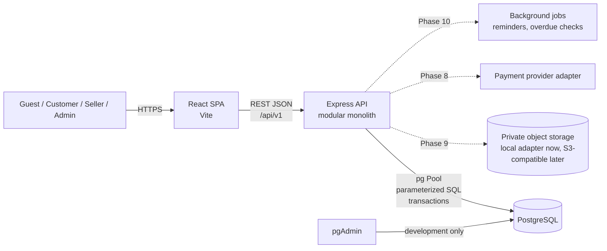

# Exchnage — Architecture

- **Status:** Phases 1–3 — local infrastructure, backend foundation, and frontend foundation
- **Last updated:** 22 October 2026

This document describes the intended architecture and the decisions that should
be settled before the corresponding modules are implemented. It is deliberately
not a complete database schema. The detailed ER model will be reviewed before
each set of schema migrations is written.

---

## 1. Product context

Exchnage is a circular-fashion marketplace with three closely related flows:

1. **Rental** — a customer books a physical item for a date range, pays a
   rental charge and possibly a refundable deposit, receives the item, returns
   it, and completes an inspection/refund process.
2. **Resale** — a customer buys a second-hand item. The physical item must not
   be sold twice.
3. **Supply** — a seller lists items for rent, sale, or both. Supply can come
   from company-owned inventory or peer-to-peer sellers and boutiques.

Trust is a first-class requirement: verified transactions, separate seller and
renter reputations, condition evidence, disputes, and carefully bounded
administrative enforcement. A complaint or accusation is not proof of fraud.

The initial MVP is intentionally smaller than the full vision: local
infrastructure, backend foundation, frontend foundation, authentication,
catalog/listings, discovery, rentals, basic sale orders, and admin access.
Payments, memberships, inspections, disputes, reputation, and enforcement are
built after those foundations are stable.

---

## 2. System context



- **React** renders the public marketplace and the customer, seller, and admin
  experiences. It has no database credentials and never runs SQL.
- **Express** is the single application backend. It owns authentication,
  authorization, validation, pricing, availability, transactions, and business
  rules.
- **PostgreSQL** is the system of record.
- **pgAdmin** is a development administration client. It is not part of the
  application runtime and will not be publicly deployed.
- **Object storage** will hold listing images and inspection evidence. Only
  metadata and object references belong in PostgreSQL.
- **Payment adapter** will isolate the eventual provider. No live payment or
  payout integration is implemented before the provider and policies are chosen.

---

## 3. Architectural style

### Modular monolith

One Express deployable, organized into business modules with explicit layers.
This is preferable to microservices at this stage because:

- marketplace operations frequently need a single database transaction across
  listings, inventory, bookings, and financial records;
- one deployment and one database are much easier to reason about, test, and
  operate while the product is being validated;
- module boundaries can still be kept strict, so a module can be extracted
  later only if a real scaling or ownership need appears.

Avoid: controllers containing SQL, shared “god” services, cross-module database
writes without a service boundary, and generic repositories that hide important
transactional behavior.

### Backend layers

```
HTTP route
  -> authentication / authorization / request validation / rate limit
  -> controller (HTTP input and output only)
  -> service (business rules, pricing, state transitions, transaction boundary)
  -> repository (parameterized SQL, row mapping)
  -> pg Pool
```

Transaction rules:

- A service owns the unit of work when multiple writes must succeed or fail
  together.
- Repositories accept a database client so they can participate in a
  transaction; they do not open their own transactions.
- Authorization is checked on the server for every protected operation, not
  inferred from a hidden React button.
- Price, commission, deposit, and availability calculations happen on the
  server using database values. Client-supplied amounts are treated as
  untrusted input and normally rejected or ignored.

### Backend layout

```text
backend/
├── src/
│   ├── app.js                 # Express app factory, no listening side effects
│   ├── server.js              # bootstrap and graceful shutdown
│   ├── config/
│   │   ├── env.js             # validated environment configuration
│   │   ├── database.js        # pg Pool and readiness query
│   │   ├── cors.js            # explicit allowed origins
│   │   └── platform.js        # brand, currency, timezone
│   ├── routes/
│   │   └── index.js           # /api/v1 router; health only for now
│   ├── middleware/
│   │   ├── requestId.js
│   │   ├── errorHandler.js
│   │   ├── notFound.js
│   │   └── README.md          # auth/authorization/validation pending
│   ├── modules/               # auth, users, profiles, catalog, listings,
│   │                          # inventory, rentals, orders, payments,
│   │                          # deposits, memberships, reviews, inspections,
│   │                          # disputes, reputation, notifications, media,
│   │                          # admin
│   ├── jobs/
│   ├── utils/
│   └── appErrors/
├── database/
│   ├── migrations/
│   ├── seeds/
│   └── factories/
├── tests/
│   ├── unit/
│   ├── integration/
│   └── helpers/
├── .env.example
└── package.json
```

Each feature module will follow the same shape where it makes sense:
`<name>.routes.js`, `<name>.controller.js`, `<name>.service.js`,
`<name>.repository.js`, `<name>.validation.js`, and `<name>.constants.js`.
Not every module needs every file. Empty module directories are intentional;
they mark boundaries without pretending the features exist.

### Frontend structure

```text
frontend/
├── public/
├── src/
│   ├── app/                   # App, router, providers
│   ├── assets/                # images, icons, fonts
│   ├── components/
│   │   ├── common/
│   │   ├── layout/
│   │   ├── forms/
│   │   ├── feedback/
│   │   └── navigation/
│   ├── features/              # auth, home, catalog, listings, rentals, orders,
│   │                          # checkout, profile, seller, reviews,
│   │                          # memberships, disputes, notifications
│   ├── hooks/
│   ├── services/
│   │   ├── apiClient.js
│   │   └── endpoints.js
│   ├── utils/
│   ├── constants/
│   ├── styles/
│   │   ├── reset.css
│   │   ├── variables.css
│   │   └── global.css
│   ├── config/
│   │   └── appConfig.js
│   └── main.jsx
├── .env.example
├── index.html
├── package.json
└── vite.config.js
```

- React Router is configured centrally; only a minimal home route exists.
- A small API client wrapper centralizes the base URL, credentials, request
  headers, and error normalization. No business calls are implemented.
- Plain CSS with tokens and CSS Modules for component-scoped styles.
- Responsive layouts using CSS grid, fluid type, and local breakpoints.
- Server state will be fetched through the API; no direct database access.
- Browser-exposed configuration uses `VITE_` variables only.
- Access tokens, if used, will not be placed in `localStorage` (see auth plan).

---

## 4. API conventions

The current contract is documented in
[`api-conventions.md`](api-conventions.md). Only `GET /api/v1/health` is
implemented; no business endpoints are mocked.

- Base path: `/api/v1`.
- JSON request and response bodies.
- Consistent success envelope:

  ```json
  {
    "data": {},
    "meta": {}
  }
  ```

- Consistent error envelope:

  ```json
  {
    "error": {
      "code": "LISTING_NOT_AVAILABLE",
      "message": "The selected item is not available for those dates.",
      "details": []
    },
    "requestId": "..."
  }
  ```

- Suitable status codes: `200`, `201`, `204`, `400`, `401`, `403`, `404`,
  `409`, `422`, `429`, `500`.
- Collection endpoints use pagination (`page` and `limit` initially, with a
  capped limit; cursor pagination can be introduced if needed).
- Validate path parameters, query parameters, and bodies before reaching the
  service layer.
- Idempotency keys will be required for payment/checkout creation once
  payments are implemented.
- OpenAPI documentation will be added after the authentication and catalog
  contracts stabilize.
- Never expose internal SQL errors, password hashes, refresh tokens, private
  evidence URLs, or payment secrets.

---

## 5. Identity and authentication proposal

One user account can act as a buyer, renter, and seller. Do not create separate
accounts for each role. Roles and permissions are assigned to the same user.

Proposed model:

- `users` — credentials and account state.
- `user_profiles` — public/private profile data.
- `roles` — customer, seller, administrator, and future roles.
- `permissions` — fine-grained capabilities.
- `user_roles` / role-permission mappings — server-side authorization.
- `user_addresses` — shipping and service addresses.
- `refresh_sessions` — session/token records if the hybrid token approach is
  selected.
- `audit_logs` — sensitive administrative actions.

### Recommended authentication approach

**Short-lived access JWT + rotating refresh token in an HttpOnly cookie.**

- Access token: about 15 minutes, held only in React memory.
- Refresh token: random opaque value (not a JWT), stored as a hash in
  `refresh_sessions`, delivered in an `HttpOnly`, `Secure` (in production),
  `SameSite=Lax` cookie.
- Refresh rotation on use with reuse detection; logout and “sign out all
  devices” revoke refresh sessions.
- CSRF protection for cookie-bearing state-changing endpoints (origin checks
  plus a CSRF token strategy); CORS allowlist.
- Password hashing: Argon2id with per-password salt and a documented cost
  configuration.
- Rate limits on login, registration, password reset, and other sensitive
  endpoints.
- No refresh token, password hash, or private session identifier in ordinary
  API responses.

**Trade-off:** a pure server-side session cookie is simpler to revoke and avoids
JWT complexity, but requires a database session lookup on more requests and is
less convenient if native mobile clients are added later. The hybrid approach
supports future clients and keeps long-lived credentials out of JavaScript, at
the cost of token rotation and reuse-detection logic.

This decision will be confirmed before Phase 4. It is not implemented yet.

---

## 6. Data design direction

The final schema will be reviewed as an ER model before migrations. The
following principles are already fixed because they affect most modules.

### Identifiers and time

- UUID primary keys (`gen_random_uuid()`; PostgreSQL 17 has this built in).
- `created_at` and `updated_at` on mutable entities, with `TIMESTAMPTZ`.
- Store timestamps in UTC. Display in the configured business timezone
  (assumed `Asia/Kolkata`; to confirm).
- Rental periods are date-based in the first release and will use PostgreSQL
  `daterange` and `DATE`, avoiding timezone ambiguity in “which day is the
  return due?”. Hour-based rentals are a later feature and would use
  `tstzrange`.

### Money

- Store monetary amounts as integer **paise** in `BIGINT` columns. Do not use
  floating point.
- Commission rates and percentage discounts are stored as integer basis points,
  not floating-point fractions.
- Use PostgreSQL `NUMERIC` only where a non-monetary decimal is genuinely
  required; money calculations remain integer-based.
- API responses expose integer paise plus the currency; the frontend formats
  them for display.
- Each booking/order stores an immutable price and terms snapshot. Later
  listing-price or commission changes must not rewrite history.
- Security deposits are separate ledger liabilities, not revenue.

### Listings versus physical inventory

A **listing** is a commercial offer. An **inventory item** is a physical object.
They are not the same thing.

- A listing records title, description, category, brand, attributes, condition,
  images, rental/sale prices, deposit, replacement value, service area, status,
  and approval state.
- An inventory item records a specific physical unit, its owner, ownership type
  (`PLATFORM` or `SELLER`), serial/internal identifier, condition, and current
  lifecycle state.
- A listing may map to one or more inventory items. Initially the UI may create
  a single physical unit per listing, but the schema and availability logic will
  support multiple copies without duplicating the listing.
- Ownership is explicit. Company-managed inventory and peer-to-peer inventory
  use the same core model with different ownership and verification policies.

### Availability and double-booking prevention

Availability cannot rely on a frontend calendar or a single “is_available”
boolean.

The planned rental design uses a reservation record per booking item with:

- `inventory_item_id`;
- a `daterange` for the rental period;
- a blocking status;
- an exclusion constraint such as
  `EXCLUDE USING gist (inventory_item_id WITH =, rental_period WITH &&)`
  restricted to blocking reservations.

The reservation is inserted inside the same transaction as the booking. Two
overlapping confirmations therefore cannot both commit. Behaviour under
concurrency will be tested explicitly with two database connections.

A sale must claim the physical item exclusively. The exact mechanism (a
partial unique reservation index, a conditional item-state update, or both)
will be chosen in Phase 7 and tested for double-selling. A listing that offers
both rental and sale needs a documented policy for selling an item while a
future rental exists; this is a business decision, not just a schema detail.

### Booking and order state machines

Rental and sale statuses are not free-form text updates. Each module will have
an explicit transition map:

- Allowed transitions are defined in one place.
- Customer-driven transitions and administrator/system transitions are
  separate.
- Every transition appends an immutable history row.
- Invalid transitions return a conflict (or forbidden) response.
- Financial captures, refunds, and deposit releases occur only through
  authorized service methods, never through a generic status endpoint.

### Supporting domains

The schema will grow in these groups, but not all tables are needed for the
first MVP:

- **Catalog:** categories, listings, listing images, attributes, inventory.
- **Rentals:** bookings, booking items, reservations, status history, price
  snapshots, returns.
- **Sales:** orders, order items, status history.
- **Finance:** payment transactions, refunds, deposit ledger, commissions,
  seller ledger, payout requests.
- **Memberships:** plans, subscriptions, entitlement/credit ledger.
- **Inspections:** inspection records, media metadata, access-controlled
  evidence.
- **Trust:** reviews, disputes, evidence, fraud reports/investigations,
  reputation events, account restrictions, appeals.
- **Operations:** notifications, audit logs, platform settings.

---

## 7. Domain modules and responsibilities

| Module | Responsibility |
|--------|----------------|
| `auth` | Registration, login, logout, refresh rotation, password reset, sessions |
| `users` | Profiles, addresses, account settings, public seller summary |
| `categories` | Category tree and category-specific attribute definitions |
| `catalog` | Public discovery, search, filters, availability presentation |
| `listings` | Seller listing CRUD, images, pricing fields, moderation status |
| `inventory` | Physical units, ownership, condition, lifecycle |
| `rentals` | Availability reservation, pricing, booking state machine, returns |
| `orders` | Sale checkout, order state machine, fulfillment |
| `payments` | Provider abstraction, payment records, refunds, deposits |
| `memberships` | Plans, subscriptions, entitlements, credits |
| `reviews` | Eligibility-checked reviews and rating aggregation |
| `inspections` | Pre-dispatch and return inspections, private evidence |
| `disputes` | Dispute workflow, evidence, decisions, appeals |
| `trust` | Reputation events, fraud reports, investigations, restrictions |
| `notifications` | In-app and email event delivery |
| `admin` | Permission-checked operational tools and audit log access |

Background jobs (later) will handle reminders, overdue transitions, expired
holds, and notification retries. They will use the same service layer rather
than bypassing business rules with ad-hoc SQL.

---

## 8. Search and discovery

Start with PostgreSQL:

- Indexed category, brand, size, colour, condition, price, and status columns.
- Full-text search over title and description using `tsvector` / GIN indexes,
  plus `pg_trgm` for partial matching where useful.
- Availability filtering must consult reservations, not only listing flags.
- Suspended, unapproved, or fully unavailable listings never appear in public
  results.
- Ranking should combine relevance, listing quality, availability, and
  fulfillment evidence. New sellers are not penalized merely for having no
  history.

A separate search engine is deferred until there is measured need.

---

## 9. Media and evidence storage

- Do not store large images in PostgreSQL.
- Use a storage interface with operations such as `put`, `get`, `delete`, and
  `createSignedUrl`.
- Local development will use a private local adapter and a clearly isolated
  uploads directory.
- Production will use an S3-compatible private bucket. Public listing images
  may use a public/CDN bucket or signed URLs; inspection evidence must remain
  private.
- Store object key, owner, purpose, MIME type, size, checksum, visibility, and
  timestamps in PostgreSQL.
- Validate uploads by size and detected content type; never trust only the
  filename extension.
- Private evidence access is checked against the transaction, dispute, and
  role. URLs should be short-lived and not enumerable.
- Preserve original evidence; do not overwrite it. Additional annotations or
  comparisons are separate records.

---

## 10. Security and privacy principles

- Parameterized SQL only; no string-built queries from user input.
- Server-side role and permission checks for every protected endpoint.
- Input validation at the boundary; domain invariants in services/database
  constraints.
- Centralized error handling with safe client messages and internal logging.
- Rate limiting for authentication, uploads, checkout, reviews, and reporting.
- CORS allowlist, not `*` with credentials.
- Helmet-style security headers; secure cookies in production; HTTPS.
- Secrets from environment or a secret manager, never source code.
- Audit logs for admin, financial, moderation, restriction, and evidence
  access actions.
- Avoid returning private user data, password hashes, refresh tokens, payment
  details, or investigation evidence in ordinary responses.
- Administrative decisions preserve reasons, evidence references, decision
  maker, dates, and appeal state.
- Reputation is based on verified events and documented decisions, not
  unproven allegations. New users are “insufficient history”, not “bad”.

---

## 11. Testing strategy

The current foundation test suite is read-only and covers:

- the database-backed health endpoint;
- CORS headers for an allowed origin;
- the shared 404 response envelope and request ID.

As soon as the first migration exists, integration tests will move to a
**separate test database**. Future coverage includes:

- unit tests for pricing, commission, state transitions, eligibility rules, and
  validation;
- migration tests: apply from zero, verify constraints;
- database constraint tests for overlap exclusion, duplicate reviews, unique
  sale claims, and foreign-key behaviour;
- concurrency tests: two overlapping rental attempts; two sale attempts; race
  between sale and rental;
- authorization tests: another seller editing a listing, suspended user
  booking, customer calling admin endpoints;
- financial tests with integer paise and snapshots;
- dispute/restriction workflow tests that prove no automatic penalty from an
  accusation.

Test data setup will use migrations plus explicit fixtures/factories. Tests
must never contain real personal data.

---

## 12. Branding and configuration

- Current placeholder name: **Exchnage**.
- The brand will be represented by a central frontend config (name, tagline,
  logo, colour tokens, support links) and CSS custom properties.
- Server-side emails and legal copy will read from platform settings/brand
  configuration, not literal strings scattered through controllers.
- Administrators will eventually be able to manage safe branding values through
  `platform_settings`; colour values must be validated and no arbitrary HTML
  should be executable.
- Database names and Docker project names may use `exchnage` for convenience,
  but application UI text must not depend on the filesystem folder name.

The local folder is `C:\Users\user\Desktop\exchange` (without the second “c”
in the brand). This is harmless; renaming the folder later is optional.

---

## 13. Deployment direction (later)

Local development uses Docker Desktop, host-run Express/React, and pgAdmin.
Production will not reuse this exact shape.

Planned production characteristics:

- Managed PostgreSQL with TLS, automated backups, and point-in-time recovery.
- Express API behind HTTPS and a reverse proxy/load balancer.
- React built as static assets and served by a CDN or web server.
- Private object storage for evidence; CDN for public listing images.
- Secret manager, environment separation, structured logs, metrics, alerts.
- No public pgAdmin. Administrative access through the authenticated app or a
  separately protected bastion.
- Payment provider webhooks verified and processed idempotently.
- Documented backup restore drills and a production-readiness checklist.

No Kubernetes or cloud deployment is required for the MVP.

---

## 14. Phase roadmap and gates

| Phase | Scope | Gate before moving on |
|-------|-------|------------------------|
| 1 | Docker, PostgreSQL, pgAdmin, docs | ✅ Healthy DB, pgAdmin connected, persistence verified |
| 2 | Express foundation, config, pool, health, error handling, tests | ✅ API starts, health check proves DB connectivity, tests pass |
| 3 | React/Vite foundation, routing, shell, design tokens, API client | ✅ Frontend builds and starts; shell is responsive; API client is ready |
| 4 | Database design review, initial migrations, identity, roles, permissions, protected routes | ER approved before migration; unauthorized access blocked server-side; tests pass |
| 5 | Categories, listings, images, search/filter, seller profiles | Seller creates listing; guest discovers it; moderation rules |
| 6 | Inventory, availability, rentals, pricing, state machine | Concurrent overlapping bookings cannot both confirm |
| 7 | Sale listings, orders, fulfillment, item exclusivity | Same physical item cannot be sold twice |
| 8 | Payment abstraction, deposits, refunds, commissions, memberships | Financial records reconcile; no live payments without approval |
| 9 | Inspections, evidence, disputes | Evidence is private; dispute decision history preserved |
| 10 | Reviews, reputation, fraud cases, restrictions, appeals | Justified decisions, audit trail, no accusation-based penalties |
| 11 | Admin dashboard and analytics | Operational workflows are usable and permission-checked |
| 12 | Hardening and deployment preparation | Security review, backups, monitoring, readiness checklist |

Phases are sequential by dependency, not by calendar. Each phase ends with a
short review of what was built, what was tested, and what remains. No schema or
authentication work begins until Phase 4 is explicitly approved.

---

## 15. Assumptions to confirm

These are reversible defaults for now; confirm the ones marked **material**
because they affect schema or workflow decisions.

| # | Assumption | Current default | Why it matters |
|---|------------|-----------------|----------------|
| 1 | Market and currency | India, INR, business timezone `Asia/Kolkata`; UTC in the database | Money types, tax/legal copy, date display |
| 2 | Launch supply mix | Support both platform-owned and peer-to-peer inventory; MVP may seed primarily platform-owned items | Approval and inspection workflows |
| 3 | Authentication | Access JWT + rotating refresh cookie | Session table design and frontend auth |
| 4 | Rental granularity | Date-based first; hourly later | `daterange` vs `tstzrange`, availability UX |
| 5 | Logistics | Seller/platform self-ships with manually recorded tracking in the first release | Booking states and delivery evidence |
| 6 | Payments | Provider not selected; development adapter only, no live capture | Checkout architecture and legal review |
| 7 | Commission | 5% rental commission as a configurable placeholder, not final | Pricing snapshots and seller earnings |
| 8 | Media | Local private storage in development; S3-compatible in production | Upload abstraction and access control |
| 9 | Brand | “Exchnage” placeholder; central config; folder may remain `exchange` | UI copy, emails, theming |

**Recommended next decisions before Phase 4:** authentication approach, launch
inventory mix, and logistics.

---

## 16. Immediate next step

The foundation is running. Do not start Phase 4 until it is explicitly approved.

Phase 4 will begin with a written ER review for identity, profiles, roles,
permissions, addresses, and refresh sessions. Only after that review is approved
will the migration tooling and first schema migration be added. Authentication
implementation follows the schema, not the other way around.

The database is intentionally empty of application tables at this point.
