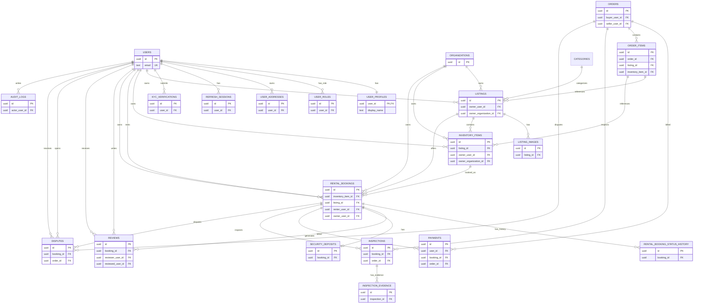

# Exchnage — Database Architecture and Schema Review

**Status:** Proposed design review only. No database tables, migrations, seeds, or application functionality have been implemented.

**Date:** 22 October 2026

**Project root:** `C:\Users\user\Desktop\exchange`

**Database:** PostgreSQL 17.11, database `exchnage_dev`, user `exchnage_app`

---

## 1. Executive Summary

Exchnage is a circular-fashion marketplace that supports clothing rental, second-hand resale, and marketplace supply.

The existing foundation has completed the local infrastructure, backend foundation, and frontend foundation phases. The backend uses Node.js, Express, JavaScript ES modules, PostgreSQL through `pg`, Docker Compose, and the modular-monolith structure. The API uses the `/api/v1` prefix and has a database-backed health endpoint.

The database phase was intentionally not started. No application tables, migrations, seeds, or schema implementation exist. This report is the proposed database architecture and schema review.

The purpose of this task is to inspect the existing state, understand the business requirements, propose a coherent PostgreSQL schema, create a Mermaid ER diagram, and document the design for approval. The final deliverable is the Markdown report; no database implementation is included.

The proposed architecture is intended to support:

1. User accounts and access.
2. KYC and verification.
3. Catalog, listings, listing images, and physical inventory.
4. Rental bookings and availability.
5. Sales orders and order items.
6. Payments, refunds, and security deposits.
7. Reviews and reputation.
8. Inspections, disputes, and audit logs.
9. Future marketplace features.

The design must preserve the already agreed principles:

- UUID primary keys.
- `TIMESTAMPTZ` timestamps stored in UTC.
- Date-based rental periods using `DATE` and `daterange`.
- Monetary values as integer paise in `BIGINT`.
- Percentage rates as integer basis points.
- Immutable transaction price snapshots.
- Security deposits treated separately from revenue.
- Listings separated from physical inventory.
- PostgreSQL GiST exclusion constraint for overlapping rental bookings.

---

## 2. Existing Project State

### 2.1 Architecture

The backend is organized as a modular monolith:

```text
backend/
├── src/
│   ├── app.js
│   ├── server.js
│   ├── config/
│   ├── routes/
│   ├── middleware/
│   ├── modules/
│   ├── jobs/
│   ├── utils/
│   └── appErrors/
├── database/
│   ├── migrations/
│   ├── seeds/
│   └── factories/
└── tests/
```

The backend layers are intended to be:

```text
HTTP route
→ auth / authorization / validation / rate limit
→ controller
→ service
→ repository
→ pg pool
```

The existing implementation has:

- Express application factory.
- Server bootstrap and graceful shutdown.
- Validated environment configuration.
- PostgreSQL pool and health check.
- CORS configuration.
- Request ID.
- Centralized error handler.
- Not-found handler.
- API router with `/api/v1/health`.
- AppError class.
- Database module.
- Configuration module.
- Platform module.

The feature modules are present as empty or pending boundaries and are not implemented.

### 2.2 Backend Database Connection

The backend database module uses:

```js
import pg from 'pg';
import { env } from './env.js';

const { Pool } = pg;

export const pool = new Pool({
  host: env.db.host,
  port: env.db.port,
  database: env.db.name,
  user: env.db.user,
  password: env.db.password,
  max: env.db.poolMax,
  idleTimeoutMillis: 30_000,
  connectionTimeoutMillis: env.db.connectionTimeoutMs,
  ssl: env.db.ssl ? { rejectUnauthorized: true } : false,
  application_name: 'exchnage-api',
});
```

It exports:

- `pool`
- `checkDatabaseConnection()`
- `closeDatabasePool()`

The health check executes:

```sql
SELECT 1 AS ok
```

and returns `{ ok, latencyMs }`.

### 2.3 Environment Configuration

The environment module validates:

- `NODE_ENV`
- `HOST`
- `PORT`
- `API_PREFIX`
- `FRONTEND_URL`
- `DB_HOST`
- `DB_PORT`
- `DB_NAME`
- `DB_USER`
- `DB_PASSWORD`
- `DB_SSL`
- `DB_POOL_MAX`
- `DB_CONNECTION_TIMEOUT_MS`
- `PLATFORM_NAME`
- `PLATFORM_CURRENCY`
- `PLATFORM_TIMEZONE`

It fails with a clear error if required or invalid settings are missing.

It rejects wildcard frontend origins.

It requires explicit HTTP/HTTPS origins for development and HTTPS origins in production.

It uses the platform name, currency, and timezone for platform configuration.

### 2.4 API and Health

The API router currently defines:

```text
GET /api/v1/health
```

Behavior:

- Checks database connection.
- Returns `200` with data status.
- Returns `503 DATABASE_UNAVAILABLE` on database failure.
- Does not expose connection details.

### 2.5 Docker and Database State

Docker Compose currently defines:

- `postgres` service using `postgres:17.11-alpine`.
- `pgadmin` service using `dpage/pgadmin4:9.18.0`.
- Named volumes for PostgreSQL and pgAdmin.
- PostgreSQL health check.
- pgAdmin dependency on PostgreSQL health.
- Loopback-only port bindings.

Verified state:

- PostgreSQL container healthy.
- pgAdmin container running.
- `pg_isready` accepted connections.
- Backend health reported database connected.
- PostgreSQL version: `17.11 on x86_64-pc-linux-musl, compiled by gcc 15.2.0, 64-bit`.
- Timezone set to UTC.
- UUID support via `gen_random_uuid()` available.
- `btree_gist` version 1.7 available.
- Only `plpgsql` extension installed in the inspected database.
- Other extensions were available but not installed.
- No application database tables existed at the time of inspection.

### 2.6 Current Database Directories

The following directories exist but were empty or pending:

```text
backend/database/migrations/
backend/database/seeds/
backend/database/factories/
backend/tests/unit/
backend/tests/integration/
backend/tests/helpers/
```

The existing integration test only covered:

- Health endpoint.
- Allowed CORS origin.
- Unknown route 404 envelope.

No application tables were created.

---

## 3. Verified Facts and Assumptions

### 3.1 Verified Facts

The following were verified from the repository and database:

1. Docker Compose configuration was valid.
2. PostgreSQL container was healthy.
3. PostgreSQL accepted connections.
4. Backend health endpoint connected to database.
5. No application tables existed.
6. `gen_random_uuid()` was available.
7. `btree_gist` 1.7 was available.
8. PostgreSQL timezone was UTC.
9. Backend package had only `cors`, `dotenv`, `express`, and `pg`.
10. Frontend had React, React Router, Vite, and the React plugin.

### 3.2 Assumptions

The following assumptions were made for the proposed design:

1. The business requirements supplied in the task are current intent.
2. The current platform currency is INR.
3. The current business timezone is `Asia/Kolkata`.
4. Rental periods are date-based initially.
5. Security deposits are refundable or capturable according to future policy.
6. Reviews are based on completed rental transactions.
7. KYC may use future authorized providers but should not store raw identity documents in ordinary tables.
8. Platform-owned inventory should be represented through an organization model.
9. Payment provider integration is not yet implemented.

### 3.3 Unknowns

The following require user approval:

1. Whether KYC is mandatory before listing, booking, or both.
2. Whether business-owned inventory requires a full organization membership model immediately.
3. Which booking statuses are allowed.
4. Whether cancellation fees are supported.
5. Which payment provider will be used.
6. Whether rentals are date-based only.
7. Whether delivery tracking is in scope.
8. Membership features and policies.
9. KYC retention and legal compliance requirements.

---

## 4. Business Requirements

### 4.1 User Accounts and Roles

Exchnage requires one user account that can act as both a rental provider and a renter.

The account should have:

- One identity for the person.
- Potential multiple rental roles.
- Authentication state.
- Public profile data.
- Private contact/credential data.
- Refresh sessions.
- KYC state.

The proposed design uses `users` for private account data and `user_profiles` for public profile data.

### 4.2 Product Ownership

Exchnage should support:

1. User-owned inventory.
2. Platform-owned inventory.

A listing is a commercial offer. An inventory item is a physical object.

The proposed design separates:

- `listings`: offer details, owner, category, pricing, status, images.
- `inventory_items`: physical unit, owner, listing relationship, status, condition notes.

The owner of a listing or inventory item may be a user or an organization.

The design uses nullable owner columns with an exactly-one-owner check.

### 4.3 Listings, Inventory, and Availability

Listing types:

- `RENT`
- `SALE`
- `BOTH`

Listing status:

- `DRAFT`
- `PENDING_REVIEW`
- `ACTIVE`
- `PAUSED`
- `ARCHIVED`

Inventory status:

- `AVAILABLE`
- `RESERVED`
- `RENTED`
- `SALE_PENDING`
- `SOLD`
- `MAINTENANCE`
- `RETIRED`
- `LOST`

The design keeps listing status and inventory status separate.

### 4.4 Rental Transactions

Rental booking should include:

- Inventory item.
- Listing.
- Renter.
- Owner.
- Start date.
- End date.
- Rental period.
- Rental price per day and total.
- Security deposit.
- Status.
- Price snapshot.
- Condition snapshot.
- Status history.

Availability should use a PostgreSQL exclusion constraint:

```text
EXCLUDE USING gist (
  inventory_item_id WITH =,
  rental_period WITH &&
)
WHERE (status IN ('CONFIRMED', 'ACTIVE', 'RETURNED', 'DISPUTED'));
```

The design should use `daterange(start_date, end_date, '[)')` so the end date is exclusive.

The design should use `btree_gist` for UUID equality within the GiST exclusion constraint.

### 4.5 Reviews and Reputation

Reviews should be linked to a qualifying rental booking.

The proposed uniqueness rule is:

```text
reviewer_user_id + booking_id + reviewed_role
```

This allows a renter and provider to review each other differently based on the reviewed role.

Only approved reviews should contribute to average reputation initially.

The design should not let users directly modify reputation.

### 4.6 KYC and Trust Indicators

KYC should be separate from:

- User roles.
- Rental reputation.
- Marketplace indicators.

KYC statuses:

- `PENDING`
- `VERIFIED`
- `REJECTED`
- `EXPIRED`
- `REQUIRES_REVIEW`

The design should not treat document upload as verification.

### 4.7 Payments and Security Deposits

The design should separate:

- Rental charges.
- Sale charges.
- Security deposit collection.
- Security deposit release.
- Security deposit deduction.
- Refunds.
- Platform fees.

Security deposits are liabilities, not automatically revenue.

### 4.8 Safety and Administration

The design should support inspections, disputes, and audit logs.

Inspection evidence should be private and stored outside PostgreSQL where possible; PostgreSQL should store object metadata only.

### 4.9 Future Features

The architecture should later support:

- Notifications.
- Membership plans and subscriptions.
- Delivery tracking.
- Listing moderation.
- Appeals and restrictions.

---

## 5. Proposed Database Architecture

### 5.1 Proposed Table Groups

#### Identity and Access

- `users`
- `user_profiles`
- `user_roles`
- `user_addresses`
- `refresh_sessions`

#### KYC and Verification

- `kyc_verifications`

#### Catalog and Ownership

- `organizations`
- `categories`
- `listings`
- `listing_images`
- `inventory_items`

#### Rentals and Sales

- `rental_bookings`
- `rental_booking_status_history`
- `reviews`
- `orders`
- `order_items`
- `payments`
- `security_deposits`

#### Safety and Administration

- `inspections`
- `inspection_evidence`
- `disputes`
- `audit_logs`

#### Optional Reputation Events

- `reputation_events`

#### Future Features

- `notifications`
- membership plans/subscriptions
- delivery tracking
- listing moderation
- appeals/restrictions

---

## 6. Proposed Table Specifications

### 6.1 `users`

**Purpose:** Private account identity, credentials, and account state.

| Column | Type | Required | Notes |
|---|---:|---:|---|
| `id` | `uuid` | Yes | PK, default `gen_random_uuid()` |
| `email` | `text` | Yes | NOT NULL; normalized; unique lower(email) |
| `phone` | `text` | No | E.164-like check; partial unique lower(phone) |
| `password_hash` | `text` | Yes | NOT NULL; Argon2id; length check |
| `account_status` | `text` | Yes | Default `PENDING`; check values |
| `email_verified_at` | `timestamptz` | No | |
| `phone_verified_at` | `timestamptz` | No | |
| `last_login_at` | `timestamptz` | No | |
| `created_at` | `timestamptz` | Yes | Default `now()` |
| `updated_at` | `timestamptz` | Yes | Default `now()` |

**Relationships:** One user has one profile, zero or more roles, zero or more addresses, zero or more refresh sessions, zero or more KYC records.

**Privacy:** Email, phone, and password hash are private.

### 6.2 `user_profiles`

**Purpose:** Public profile data.

| Column | Type | Required | Notes |
|---|---:|---:|---|
| `user_id` | `uuid` | Yes | PK, FK `users` |
| `display_name` | `text` | Yes | NOT NULL; length check |
| `bio` | `text` | No | Max length check |
| `avatar_key` | `text` | No | Object-storage key |
| `city` | `text` | No | Max length check |
| `created_at` | `timestamptz` | Yes | |
| `updated_at` | `timestamptz` | Yes | |

### 6.3 `user_roles`

**Purpose:** Role assignments that can coexist for one user.

| Column | Type | Required | Notes |
|---|---:|---:|---|
| `id` | `uuid` | Yes | PK |
| `user_id` | `uuid` | Yes | FK `users` |
| `role` | `text` | Yes | Check in `RENT_GIVER`, `RENT_TAKER`, `ADMIN` |
| `granted_at` | `timestamptz` | Yes | Default `now()` |
| `revoked_at` | `timestamptz` | No | |
| `granted_by_user_id` | `uuid` | No | FK `users` |
| `created_at` | `timestamptz` | Yes | Default `now()` |
| `updated_at` | `timestamptz` | Yes | Default `now()` |

Unique partial index:

```text
UNIQUE (user_id, role) WHERE revoked_at IS NULL
```

### 6.4 `user_addresses`

**Purpose:** Private user addresses.

| Column | Type | Required | Notes |
|---|---:|---:|---|
| `id` | `uuid` | Yes | PK |
| `user_id` | `uuid` | Yes | FK `users` |
| `label` | `text` | Yes | Check in `HOME`, `WORK`, `OTHER` |
| `recipient_name` | `text` | Yes | NOT NULL; length check |
| `phone` | `text` | No | E.164 check |
| `line1` | `text` | Yes | NOT NULL |
| `line2` | `text` | No | |
| `city` | `text` | Yes | |
| `state` | `text` | No | |
| `postal_code` | `text` | No | |
| `country_code` | `char(2)` | Yes | Default `IN`; check length |
| `is_default` | `boolean` | Yes | Default `false` |
| `archived_at` | `timestamptz` | No | |
| `created_at` | `timestamptz` | Yes | |
| `updated_at` | `timestamptz` | Yes | |

Unique partial index:

```text
UNIQUE (user_id) WHERE is_default = true AND archived_at IS NULL
```

### 6.5 `refresh_sessions`

**Purpose:** Rotating refresh token sessions.

| Column | Type | Required | Notes |
|---|---:|---:|---|
| `id` | `uuid` | Yes | PK |
| `user_id` | `uuid` | Yes | FK `users` |
| `token_hash` | `bytea` | Yes | Unique; SHA-256, length 32 |
| `family_id` | `uuid` | Yes | Reuse detection |
| `parent_session_id` | `uuid` | No | FK `refresh_sessions` |
| `replaced_by_session_id` | `uuid` | No | FK `refresh_sessions` |
| `expires_at` | `timestamptz` | Yes | Must be after creation |
| `revoked_at` | `timestamptz` | No | |
| `last_used_at` | `timestamptz` | No | |
| `user_agent` | `text` | No | |
| `ip_address` | `inet` | No | |
| `created_at` | `timestamptz` | Yes | |
| `updated_at` | `timestamptz` | Yes | |

### 6.6 `organizations`

**Purpose:** Platform and business ownership.

| Column | Type | Required | Notes |
|---|---:|---:|---|
| `id` | `uuid` | Yes | PK |
| `name` | `text` | Yes | NOT NULL |
| `slug` | `text` | Yes | NOT NULL; unique |
| `kind` | `text` | Yes | Check `PLATFORM`, `BUSINESS` |
| `status` | `text` | Yes | Default `ACTIVE`; check values |
| `created_at` | `timestamptz` | Yes | |
| `updated_at` | `timestamptz` | Yes | |

Proposed partial unique index for one platform organization:

```text
UNIQUE (kind) WHERE kind = 'PLATFORM'
```

### 6.7 `categories`

**Purpose:** Category tree.

| Column | Type | Required | Notes |
|---|---:|---:|---|
| `id` | `uuid` | Yes | PK |
| `parent_id` | `uuid` | No | FK `categories` |
| `name` | `text` | Yes | NOT NULL |
| `slug` | `text` | Yes | NOT NULL; unique |
| `description` | `text` | No | |
| `is_active` | `boolean` | Yes | Default `true` |
| `sort_order` | `int` | Yes | Default `0` |
| `created_at` | `timestamptz` | Yes | |
| `updated_at` | `timestamptz` | Yes | |

Check:

```text
parent_id <> id
```

### 6.8 `listings`

**Purpose:** Commercial offers.

| Column | Type | Required | Notes |
|---|---:|---:|---|
| `id` | `uuid` | Yes | PK |
| `owner_user_id` | `uuid` | No | FK `users`; nullable if owned by org |
| `owner_organization_id` | `uuid` | No | FK `organizations`; nullable if owned by user |
| `category_id` | `uuid` | Yes | FK `categories` |
| `title` | `text` | Yes | NOT NULL; length check |
| `description` | `text` | No | Max length check |
| `listing_type` | `text` | Yes | Default `RENT`; check values |
| `status` | `text` | Yes | Default `DRAFT`; check values |
| `condition` | `text` | Yes | Default `LIKE_NEW`; check values |
| `size` | `text` | No | Max length check |
| `brand` | `text` | No | Max length check |
| `color` | `text` | No | Max length check |
| `currency` | `char(3)` | Yes | Default `INR`; check length |
| `sale_price_paise` | `bigint` | No | Nullable based on type |
| `rental_price_per_day_paise` | `bigint` | No | Nullable based on type |
| `security_deposit_paise` | `bigint` | Yes | Default `0`; check >= 0 |
| `published_at` | `timestamptz` | No | |
| `created_at` | `timestamptz` | Yes | |
| `updated_at` | `timestamptz` | Yes | |

Owner exactly-one check:

```text
(owner_user_id IS NOT NULL AND owner_organization_id IS NULL)
OR
(owner_user_id IS NULL AND owner_organization_id IS NOT NULL)
```

### 6.9 `listing_images`

**Purpose:** Public listing images.

| Column | Type | Required | Notes |
|---|---:|---:|---|
| `id` | `uuid` | Yes | PK |
| `listing_id` | `uuid` | Yes | FK `listings` |
| `storage_key` | `text` | Yes | NOT NULL |
| `mime_type` | `text` | Yes | Check starts with `image/` |
| `byte_size` | `bigint` | Yes | Check > 0 |
| `width_px` | `int` | No | Check > 0 |
| `height_px` | `int` | No | Check > 0 |
| `alt_text` | `text` | No | |
| `sort_order` | `int` | Yes | Default `0` |
| `is_primary` | `boolean` | Yes | Default `false` |
| `created_at` | `timestamptz` | Yes | |

Partial unique index for primary image.

### 6.10 `inventory_items`

**Purpose:** Physical inventory units.

| Column | Type | Required | Notes |
|---|---:|---:|---|
| `id` | `uuid` | Yes | PK |
| `listing_id` | `uuid` | No | FK `listings` |
| `owner_user_id` | `uuid` | No | FK `users` |
| `owner_organization_id` | `uuid` | No | FK `organizations` |
| `inventory_code` | `text` | Yes | NOT NULL; unique |
| `status` | `text` | Yes | Default `AVAILABLE`; check values |
| `condition_notes` | `text` | No | |
| `acquired_at` | `date` | No | |
| `created_at` | `timestamptz` | Yes | |
| `updated_at` | `timestamptz` | Yes | |

Owner exactly-one check.

### 6.11 `kyc_verifications`

**Purpose:** KYC attempts and outcomes.

| Column | Type | Required | Notes |
|---|---:|---:|---|
| `id` | `uuid` | Yes | PK |
| `user_id` | `uuid` | Yes | FK `users` |
| `verification_purpose` | `text` | Yes | Default `IDENTITY`; check values |
| `document_type` | `text` | Yes | Check values |
| `provider` | `text` | Yes | Default/manual; not null |
| `provider_reference` | `text` | No | Unique partial |
| `status` | `text` | Yes | Default `PENDING`; check values |
| `consent_version` | `text` | No | |
| `consent_given_at` | `timestamptz` | No | |
| `retention_expires_at` | `timestamptz` | No | |
| `submitted_at` | `timestamptz` | Yes | |
| `verified_at` | `timestamptz` | No | |
| `rejected_at` | `timestamptz` | No | |
| `expires_at` | `timestamptz` | No | |
| `rejection_reason` | `text` | No | |
| `created_at` | `timestamptz` | Yes | |
| `updated_at` | `timestamptz` | Yes | |

Sensitive: avoid full identity numbers and raw documents.

### 6.12 `rental_bookings`

**Purpose:** Rental transaction records.

| Column | Type | Required | Notes |
|---|---:|---:|---|
| `id` | `uuid` | Yes | PK |
| `inventory_item_id` | `uuid` | Yes | FK `inventory_items` |
| `listing_id` | `uuid` | Yes | FK `listings` |
| `renter_user_id` | `uuid` | Yes | FK `users` |
| `owner_user_id` | `uuid` | No | FK `users` |
| `owner_organization_id` | `uuid` | No | FK `organizations` |
| `start_date` | `date` | Yes | |
| `end_date` | `date` | Yes | |
| `rental_period` | `daterange` | Yes | Generated stored: `daterange(start_date, end_date, '[)')` |
| `status` | `text` | Yes | Default `REQUESTED`; check values |
| `currency` | `char(3)` | Yes | Default `INR` |
| `rental_price_per_day_paise` | `bigint` | Yes | Check > 0 |
| `rental_total_paise` | `bigint` | Yes | Check > 0 |
| `security_deposit_paise` | `bigint` | Yes | Default `0`; check >= 0 |
| `listing_title_snapshot` | `text` | Yes | Not NULL |
| `condition_snapshot` | `text` | No | |
| `requested_at` | `timestamptz` | No | |
| `confirmed_at` | `timestamptz` | No | |
| `activated_at` | `timestamptz` | No | |
| `returned_at` | `timestamptz` | No | |
| `completed_at` | `timestamptz` | No | |
| `cancelled_at` | `timestamptz` | No | |
| `cancellation_reason` | `text` | No | |
| `created_at` | `timestamptz` | Yes | |
| `updated_at` | `timestamptz` | Yes | |

Checks:

- `end_date > start_date`.
- Owner exactly one user/org.
- Price checks.

### 6.13 `rental_booking_status_history`

**Purpose:** Immutable booking status transitions.

| Column | Type | Required | Notes |
|---|---:|---:|---|
| `id` | `uuid` | Yes | PK |
| `booking_id` | `uuid` | Yes | FK `rental_bookings` |
| `from_status` | `text` | No | Check status or null |
| `to_status` | `text` | Yes | Check status |
| `changed_by_user_id` | `uuid` | No | FK `users` |
| `reason` | `text` | No | |
| `created_at` | `timestamptz` | Yes | |

### 6.14 `reviews`

**Purpose:** Verified rental reviews.

| Column | Type | Required | Notes |
|---|---:|---:|---|
| `id` | `uuid` | Yes | PK |
| `booking_id` | `uuid` | Yes | FK `rental_bookings` |
| `reviewer_user_id` | `uuid` | Yes | FK `users` |
| `reviewed_user_id` | `uuid` | Yes | FK `users` |
| `reviewed_role` | `text` | Yes | Check `RENT_GIVER`, `RENT_TAKER` |
| `rating` | `smallint` | Yes | Check 1–5 |
| `comment` | `text` | No | Max length check |
| `moderation_status` | `text` | Yes | Default `PENDING`; check values |
| `moderated_at` | `timestamptz` | No | |
| `moderated_by_user_id` | `uuid` | No | FK `users` |
| `created_at` | `timestamptz` | Yes | |
| `updated_at` | `timestamptz` | Yes | |

Unique:

```text
(reviewer_user_id, booking_id, reviewed_role)
```

Check:

```text
reviewer_user_id <> reviewed_user_id
```

### 6.15 `reputation_events`

**Purpose:** Optional reputation event ledger.

| Column | Type | Required | Notes |
|---|---:|---:|---|
| `id` | `uuid` | Yes | PK |
| `user_id` | `uuid` | Yes | FK `users` |
| `reviewed_role` | `text` | Yes | Check values |
| `event_type` | `text` | Yes | |
| `rating_delta` | `smallint` | Yes | |
| `source_booking_id` | `uuid` | Yes | FK `rental_bookings` |
| `metadata` | `jsonb` | No | |
| `created_at` | `timestamptz` | Yes | |
| `created_by_user_id` | `uuid` | No | FK `users` |

### 6.16 `orders`

**Purpose:** Sale orders.

| Column | Type | Required | Notes |
|---|---:|---:|---|
| `id` | `uuid` | Yes | PK |
| `buyer_user_id` | `uuid` | Yes | FK `users` |
| `seller_user_id` | `uuid` | No | FK `users` |
| `seller_organization_id` | `uuid` | No | FK `organizations` |
| `status` | `text` | Yes | Default `PENDING`; check values |
| `currency` | `char(3)` | Yes | Default `INR` |
| `subtotal_paise` | `bigint` | Yes | Check >= 0 |
| `shipping_paise` | `bigint` | Yes | Default `0`; check >= 0 |
| `total_paise` | `bigint` | Yes | Check >= 0; equals subtotal + shipping |
| `shipping_address_id` | `uuid` | No | FK `user_addresses` |
| `shipping_address_snapshot` | `jsonb` | No | Private PII snapshot |
| `placed_at` | `timestamptz` | No | |
| `completed_at` | `timestamptz` | No | |
| `cancelled_at` | `timestamptz` | No | |
| `created_at` | `timestamptz` | Yes | |
| `updated_at` | `timestamptz` | Yes | |

Seller exactly-one check.

### 6.17 `order_items`

**Purpose:** Sale line items.

| Column | Type | Required | Notes |
|---|---:|---:|---|
| `id` | `uuid` | Yes | PK |
| `order_id` | `uuid` | Yes | FK `orders` |
| `listing_id` | `uuid` | Yes | FK `listings` |
| `inventory_item_id` | `uuid` | Yes | FK `inventory_items` |
| `title_snapshot` | `text` | Yes | NOT NULL |
| `unit_price_paise` | `bigint` | Yes | Check > 0 |
| `currency` | `char(3)` | Yes | |
| `status` | `text` | Yes | Default `ACTIVE`; check values |
| `created_at` | `timestamptz` | Yes | |
| `updated_at` | `timestamptz` | Yes | |

Partial unique index for active sale claims:

```text
UNIQUE (inventory_item_id) WHERE status = 'ACTIVE'
```

### 6.18 `payments`

**Purpose:** Financial transactions and refunds.

| Column | Type | Required | Notes |
|---|---:|---:|---|
| `id` | `uuid` | Yes | PK |
| `user_id` | `uuid` | Yes | FK `users` |
| `booking_id` | `uuid` | No | FK `rental_bookings` |
| `order_id` | `uuid` | No | FK `orders` |
| `payment_type` | `text` | Yes | Check values |
| `status` | `text` | Yes | Default `PENDING`; check values |
| `amount_paise` | `bigint` | Yes | Check > 0 |
| `currency` | `char(3)` | Yes | Default `INR` |
| `provider` | `text` | No | |
| `provider_reference` | `text` | No | Unique partial |
| `provider_payment_id` | `text` | No | |
| `idempotency_key` | `text` | Yes | Unique |
| `parent_payment_id` | `uuid` | No | FK `payments` |
| `created_at` | `timestamptz` | Yes | |
| `updated_at` | `timestamptz` | Yes | |

### 6.19 `security_deposits`

**Purpose:** Refundable security deposit state.

| Column | Type | Required | Notes |
|---|---:|---:|---|
| `id` | `uuid` | Yes | PK |
| `booking_id` | `uuid` | Yes | FK `rental_bookings`; unique |
| `amount_paise` | `bigint` | Yes | Check >= 0 |
| `status` | `text` | Yes | Default `PENDING`; check values |
| `deducted_paise` | `bigint` | Yes | Default `0`; check >= 0 |
| `released_paise` | `bigint` | Yes | Default `0`; check >= 0 |
| `collection_payment_id` | `uuid` | No | FK `payments` |
| `release_payment_id` | `uuid` | No | FK `payments` |
| `deduction_payment_id` | `uuid` | No | FK `payments` |
| `deduction_reason` | `text` | No | |
| `created_at` | `timestamptz` | Yes | |
| `updated_at` | `timestamptz` | Yes | |

Check: `deducted_paise + released_paise <= amount_paise`.

### 6.20 `inspections`

**Purpose:** Pre/post rental and sale inspections.

| Column | Type | Required | Notes |
|---|---:|---:|---|
| `id` | `uuid` | Yes | PK |
| `booking_id` | `uuid` | No | FK `rental_bookings` |
| `order_id` | `uuid` | No | FK `orders` |
| `inspection_type` | `text` | Yes | Check values |
| `inspector_user_id` | `uuid` | No | FK `users` |
| `status` | `text` | Yes | Default `DRAFT`; check values |
| `condition_grade` | `text` | No | Check values |
| `notes` | `text` | No | |
| `inspected_at` | `timestamptz` | No | |
| `created_at` | `timestamptz` | Yes | |
| `updated_at` | `timestamptz` | Yes | |

### 6.21 `inspection_evidence`

**Purpose:** Private inspection evidence metadata.

| Column | Type | Required | Notes |
|---|---:|---:|---|
| `id` | `uuid` | Yes | PK |
| `inspection_id` | `uuid` | Yes | FK `inspections` |
| `storage_key` | `text` | Yes | NOT NULL; unique |
| `mime_type` | `text` | Yes | Check image/video/PDF |
| `byte_size` | `bigint` | Yes | Check > 0 |
| `checksum_sha256` | `text` | Yes | Check length 64 |
| `evidence_purpose` | `text` | Yes | Check values |
| `captured_at` | `timestamptz` | Yes | |
| `created_at` | `timestamptz` | Yes | |

### 6.22 `disputes`

**Purpose:** Dispute workflow.

| Column | Type | Required | Notes |
|---|---:|---:|---|
| `id` | `uuid` | Yes | PK |
| `booking_id` | `uuid` | No | FK `rental_bookings` |
| `order_id` | `uuid` | No | FK `orders` |
| `opened_by_user_id` | `uuid` | Yes | FK `users` |
| `against_user_id` | `uuid` | No | FK `users` |
| `status` | `text` | Yes | Default `OPEN`; check values |
| `reason_code` | `text` | Yes | Check values |
| `description` | `text` | No | |
| `claimed_amount_paise` | `bigint` | Yes | Default `0`; check >= 0 |
| `resolution_summary` | `text` | No | |
| `resolved_by_user_id` | `uuid` | No | FK `users` |
| `resolved_at` | `timestamptz` | No | |
| `created_at` | `timestamptz` | Yes | |
| `updated_at` | `timestamptz` | Yes | |

### 6.23 `audit_logs`

**Purpose:** Sensitive action audit trail.

| Column | Type | Required | Notes |
|---|---:|---:|---|
| `id` | `uuid` | Yes | PK |
| `actor_user_id` | `uuid` | No | FK `users` |
| `action` | `text` | Yes | |
| `entity_type` | `text` | Yes | |
| `entity_id` | `text` | Yes | |
| `before_state` | `jsonb` | No | Redacted |
| `after_state` | `jsonb` | No | Redacted |
| `metadata` | `jsonb` | No | |
| `request_id` | `text` | No | |
| `ip_address` | `inet` | No | |
| `created_at` | `timestamptz` | Yes | |

Append-only.

---

## 7. Mermaid ER Diagram

The following Mermaid ER diagram is proposed for review.



**Note:** This is a proposed high-level ER diagram. It is intended for review and should be expanded with exact column-level relationships and optional future entities before implementation.

---

## 8. Relationships and Cardinalities

### Identity and access

- `USERS` one-to-one `USER_PROFILES`.
- `USERS` one-to-many `USER_ROLES`.
- `USERS` one-to-many `USER_ADDRESSES`.
- `USERS` one-to-many `REFRESH_SESSIONS`.
- `USERS` one-to-many `KYC_VERIFICATIONS`.

### Catalog and ownership

- `ORGANIZATIONS` one-to-many `LISTINGS`.
- `USERS` one-to-many `LISTINGS`.
- `CATEGORIES` one-to-many `LISTINGS`.
- `LISTINGS` one-to-many `LISTING_IMAGES`.
- `LISTINGS` one-to-many `INVENTORY_ITEMS`.
- `USERS` one-to-many `INVENTORY_ITEMS`.
- `ORGANIZATIONS` one-to-many `INVENTORY_ITEMS`.

### Rentals and sales

- `LISTINGS` one-to-many `RENTAL_BOOKINGS`.
- `INVENTORY_ITEMS` one-to-many `RENTAL_BOOKINGS`.
- `USERS` many-to-one `RENTAL_BOOKINGS` as renter.
- `USERS` many-to-one `RENTAL_BOOKINGS` as owner; optional organization owner.
- `RENTAL_BOOKINGS` one-to-many `RENTAL_BOOKING_STATUS_HISTORY`.
- `RENTAL_BOOKINGS` one-to-many `REVIEWS`.
- `RENTAL_BOOKINGS` one-to-one `SECURITY_DEPOSITS`.
- `RENTAL_BOOKINGS` one-to-many `PAYMENTS`.
- `ORDERS` one-to-many `PAYMENTS`.
- `ORDERS` one-to-many `ORDER_ITEMS`.
- `ORDER_ITEMS` many-to-one `LISTINGS`.
- `ORDER_ITEMS` many-to-one `INVENTORY_ITEMS`.
- `RENTAL_BOOKINGS` one-to-many `INSPECTIONS`.
- `ORDERS` one-to-many `INSPECTIONS`.
- `RENTAL_BOOKINGS` one-to-many `DISPUTES`.
- `ORDERS` one-to-many `DISPUTES`.

### Reviews, payments, and safety

- `RENTAL_BOOKINGS` one-to-many `REVIEWS`.
- `RENTAL_BOOKINGS` one-to-many `PAYMENTS`.
- `ORDERS` one-to-many `PAYMENTS`.
- `RENTAL_BOOKINGS` one-to-one `SECURITY_DEPOSITS`.
- `INSPECTIONS` one-to-many `INSPECTION_EVIDENCE`.
- `USERS` many-to-one `DISPUTES` as opener/resolver.

---

## 9. Constraints and Indexing Strategy

### 9.1 Core constraints

- Primary keys use UUID.
- Foreign keys use UUID references.
- Unique constraints:
  - Users email lower.
  - Users phone lower.
  - User roles `(user_id, role)` where not revoked.
  - Organizations slug.
  - Categories slug.
  - Inventory items code.
  - Refresh token hash.
  - Payment idempotency key.
  - Inspection evidence storage key.
  - Order active inventory unique.
- Check constraints:
  - Account status.
  - Role values.
  - Address values.
  - Listing types/status/condition.
  - Money values.
  - Booking dates and prices.
  - Review ratings/moderation.
  - KYC status/document type.
  - Dispute status/reason.

### 9.2 Rental overlap constraint

```text
ALTER TABLE rental_bookings
ADD CONSTRAINT rental_bookings_no_overlap
EXCLUDE USING gist (
  inventory_item_id WITH =,
  rental_period WITH &&
)
WHERE (status IN ('CONFIRMED', 'ACTIVE', 'RETURNED', 'DISPUTED'));
```

This requires `btree_gist` for UUID equality.

### 9.3 Generated rental period

```text
rental_period daterange GENERATED ALWAYS AS (
  daterange(start_date, end_date, '[)')
) STORED
```

### 9.4 Indexes

- `users(email_lower)`, `users(status)`, `users(phone_lower)`.
- `user_profiles(user_id)`.
- `user_roles(user_id, role)`.
- `user_addresses(user_id, is_default)`.
- `refresh_sessions(user_id, family_id, expires_at)`.
- `kyc_verifications(user_id, status)`.
- `listings(owner_user_id, status)`, `listings(owner_org, status)`, `listings(category_id, status)`, `listings(listing_type, status)`.
- `listing_images(listing_id, is_primary)`.
- `inventory_items(listing_id, status)`, `inventory_items(owner_user_id, status)`, `inventory_items(owner_org, status)`, `inventory_items(status)`.
- `rental_bookings(inventory_item_id, rental_period)`, `rental_bookings(renter_user_id, status)`, `rental_bookings(owner_user_id, status)`.
- `rental_booking_status_history(booking_id, created_at)`.
- `reviews(booking_id, reviewer_user_id, reviewed_role)`.
- `payments(booking_id, status)`, `payments(order_id, status)`, `payments(user_id, status)`.
- `security_deposits(booking_id)`.
- `inspections(booking_id, order_id, status)`.
- `disputes(booking_id, order_id, status)`.
- `audit_logs(actor_user_id, created_at)`.

### 9.5 Index strategy

Use B-tree indexes for equality/status filters; GiST for exclusion. Do not over-index before measured need.

---

## 10. Security and Privacy Considerations

- Parameterized SQL only.
- Password hashes, not plaintext.
- Refresh token hashes, not plaintext.
- Payment provider references, not card data.
- KYC avoids full identity numbers/raw documents.
- Inspection evidence private, not listing images.
- User addresses private.
- Audit logs redacted.
- Public API should not expose private fields.
- Backend authorization later enforces ownership, KYC, roles, etc.

---

## 11. Important Design Decisions

### 11.1 User roles

Recommended decision: one user can have multiple rental roles; `user_roles` join table supports coexistence; admin is separate.

### 11.2 Listings vs inventory

Recommended decision: listing is offer, inventory is physical unit; separation enables multi-unit, ownership, availability, sales, rentals.

### 11.3 Company-owned inventory

Recommended decision: `organizations` with `kind` of `PLATFORM` or `BUSINESS`; owner columns on listing/inventory/booking.

### 11.4 KYC separation

Recommended decision: KYC independent from roles and reputation; status machine and privacy controls.

### 11.5 Reviews and reputation

Recommended decision: reviews linked to booking and reviewed role; approved reviews only; averages derived.

### 11.6 Rental overlap prevention

Recommended decision: GiST exclusion with daterange and btree_gist; transaction.

### 11.7 Price snapshots

Recommended decision: booking and order item snapshots immutable; listing changes do not rewrite history.

### 11.8 Security deposits and refunds

Recommended decision: separate deposit table/payments; refund via payment parent or release/deduction.

### 11.9 Sales vs rentals

Recommended decision: separate `orders`/`order_items` from rental bookings; partial unique sale claim.

### 11.10 Future memberships

Recommended decision: defer plans/subscriptions; design should not force users into one account model that conflicts with rental roles.

---

## 12. Unresolved Questions Requiring Approval

1. KYC mandatory before listing, booking, or both?
2. Business-owned inventory full model?
3. Booking status transitions and cancellation rules?
4. Security deposit calculation/refund policy?
5. Payment provider selection and lifecycle?
6. Date-only rental vs time-based later?
7. Delivery tracking scope?
8. Membership features?
9. Self-rental policy?
10. KYC retention/legal requirements?

For each: options, recommendation, impact.

---

## 13. Recommended Implementation Phases

### Phase 1: Identity and access foundations

- `users`, profiles, roles, addresses, refresh sessions.

### Phase 2: KYC and catalog/inventory foundations

- `kyc_verifications`, `organizations`, `categories`, `listings`, `listing_images`, `inventory_items`.

### Phase 3: Rental booking and availability

- `rental_bookings`, status history, payments/deposits.

### Phase 4: Safety, reviews, disputes, audit.

### Phase 5: Sales and orders.

### Phase 6: Future features.

The phases should align with dependency order and approvals.

---

## 14. Proposed Migration and Testing Strategy

- Migration runner to be selected after approval; recommended `node-pg-migrate` with SQL migrations and transactions/rollback where practical; no install before approval.
- Migration phases.
- Tests:
  - duplicate email/role.
  - money checks.
  - FK.
  - duplicate reviews.
  - booking period.
  - exclusion constraint.
  - transaction rollback.
  - price snapshot.
  - privacy.
- Separate test database.

---

## 15. Risks and Trade-offs

- UUID + GiST requires extension.
- Generated daterange requires PostgreSQL 17.
- Partial exclusion constraints.
- Status transitions.
- KYC privacy/legal.
- Payment/deposit complexity.
- Migration runner.

---

## 16. Final Recommendation

- The proposed database architecture is coherent and ready for review.
- No schema implementation has been performed.
- Recommended to proceed to schema review approval before migrations.

## 17. Approval Checklist

- [ ] ER diagram approved.
- [ ] Proposed table set approved.
- [ ] Ownership model approved.
- [ ] Booking statuses approved.
- [ ] KYC policy approved.
- [ ] Payment/deposit policy approved.
- [ ] Money/status conventions approved.
- [ ] Migration runner approach approved.
- [ ] Tests approved.

---

## Final Output Summary

The comprehensive proposed database architecture report was written to:

`docs/database-architecture_review.md`

The report includes:

1. Executive summary.
2. Existing project state.
3. Verified facts and assumptions.
4. Business requirements.
5. Proposed database architecture.
6. Proposed table specifications.
7. Mermaid ER diagram.
8. Relationships and cardinalities.
9. Constraints and indexing strategy.
10. Security and privacy.
11. Design decisions.
12. Unresolved questions.
13. Implementation phases.
14. Migration/testing strategy.
15. Risks/trade-offs.
16. Final recommendation.
17. Approval checklist.

No database tables, migrations, seeds, or application functionality were implemented.
