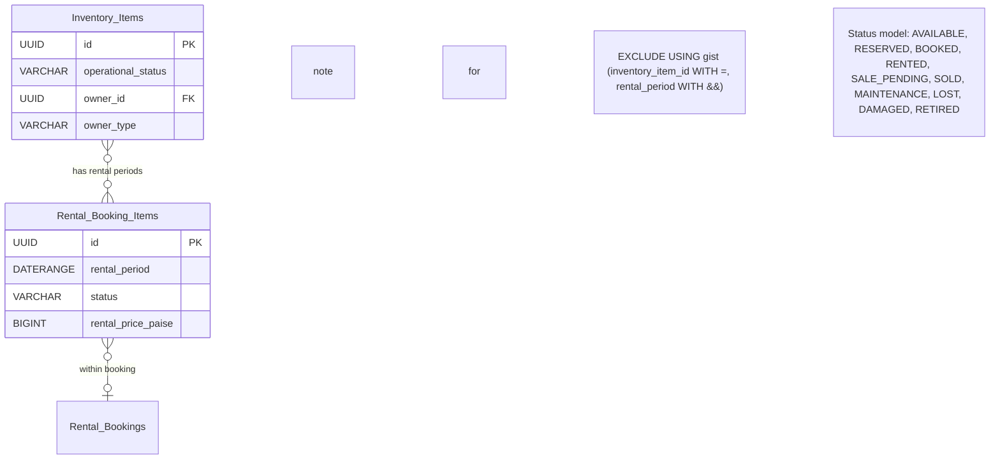
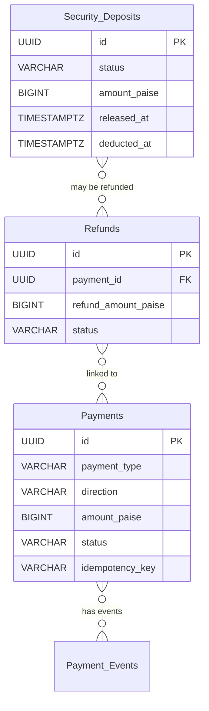

# Exchange24 — Database Schema Specification

*Generated for the Exchange24 fashion marketplace.*
*Database: PostgreSQL 17. Currency: INR. Timezone: Asia/Kolkata. Timestamps: UTC using TIMESTAMPTZ.*
*API prefix: /api/v1. Architecture: Modular monolith.*

---

## 1. Executive Summary

This specification defines the complete PostgreSQL database schema for Exchange24, a fashion marketplace enabling clothing rental, second-hand resale, and inventory management. The schema separates **listings** (commercial offers) from **inventory_items** (physically identifiable physical units), supporting both unique items and multiple units of the same product.

Key design decisions:

- **Listings** describe the commercial offer: title, description, category, brand, size, colour, condition, images, rental/sale prices, deposit policy, and status.
- **Inventory items** represent individually identifiable physical units, each with an owner, operational status, and lifecycle state.
- A single listing may reference multiple inventory items (e.g., five copies of the same dress in different sizes).
- **Rental bookings** use `daterange` with GiST exclusion constraints to prevent overlapping confirmed rentals for the same physical unit.
- **Sale claims** use a partial unique index to ensure one physical unit cannot be sold to two buyers.
- Monetary values are stored as integer **paise** (`BIGINT`), never floating point.
- UUID primary keys with `gen_random_uuid()`.
- All timestamps stored in `TIMESTAMPTZ`, UTC.
- One user account can act as both renter and rental provider; roles are assigned per-transaction, not per-table.
- KYC, reviews, disputes, and financial records are fully modeled with audit trails.
- The future domain `exchange24.fashion` is NOT configured; all URLs and origins are configurable via environment variables.

Tables are separated into **initial implementation** and **future phases**. No tables are created here beyond the specification; this is documentation only.

---

## 2. Existing Project State

| Item | Status |
|------|--------|
| Project root | `C:\Users\user\Desktop\exchange` (local folder named `exchange`) |
| Brand name | `Exchange24` (configured as `Exchnage` in environment; configurable via environment variable PLATFORM_NAME) |
| Future domain | `exchange24.fashion` — NOT purchased or configured |
| Backend | Node.js, Express 5, ES modules, `pg` driver |
| Frontend | React 19, Vite 8, React Router |
| Database | PostgreSQL 17 in Docker, `exchnage_dev` database |
| API prefix | `/api/v1` |
| Currency | `INR` (configured in `PLATFORM_CURRENCY`) |
| Business timezone | `Asia/Kolkata` (configured in `PLATFORM_TIMEZONE`) |
| Current tables | **None** — `exchnage_dev` database is empty apart from system schemas |
| Migrations | `backend/database/migrations/` exists, intentionally empty |
| Seed data | `backend/database/seeds/` exists, intentionally empty |
| Factories | `backend/database/factories/` exists, intentionally empty |
| Tests | `backend/tests/integration/health.test.js` only — read-only health checks |
| Docker compose | Starts PostgreSQL + pgAdmin; Express and React run on host |
| Environment files | Root `.env`, `backend/.env`, `frontend/.env.example` all configured |
| Brand configuration | Centralized in `backend/src/config/platform.js` and `frontend/src/config/appConfig.js` |
| Middleware | `requestId`, `notFound`, `errorHandler` implemented; `authenticate`, `authorize`, `validateRequest` pending |
| Key existing files read | `README.md`, `docs/architecture.md`, `docs/database-design.md`, `backend/src/config/database.js`, `backend/src/config/env.js`, `backend/src/routes/index.js`, `backend/package.json`, `docker-compose.yml`, `.env.example` |

### Verified Facts

- The backend uses `pg` v8.23.1 with a `Pool`; connection settings are in `backend/src/config/database.js`.
- Environment validation is in `backend/src/config/env.js`; it validates `DB_HOST`, `DB_PORT`, `DB_NAME`, `DB_USER`, `DB_PASSWORD`, `PLATFORM_CURRENCY` (must be 3-letter code), `PLATFORM_TIMEZONE`.
- The health endpoint `GET /api/v1/health` runs `SELECT 1` and returns database connectivity status.
- CORS is configured via `backend/src/config/cors.js` with explicit allowed origins (not `*`).
- Platform brand name, currency, and timezone are read from environment and frozen at startup.
- No TypeScript is used; all JavaScript ES modules.
- The project deliberately avoids ORMs; raw parameterized SQL via `pg` is the intended approach.

### Assumptions (reversible defaults)

1. **Market and currency**: India (INR), business timezone `Asia/Kolkata`; UTC in database. Affects money types, tax copy, date display.
2. **Launch supply mix**: Support both platform-owned and peer-to-peer inventory; MVP may seed primarily platform-owned items.
3. **Authentication**: Access JWT + rotating refresh cookie in HttpOnly cookie (decision to be confirmed in Phase 4).
4. **Rental granularity**: Date-based first; hourly later. Affects `daterange` vs `tstzrange`.
5. **Logistics**: Seller/platform self-ships with manually recorded tracking in the first release.
6. **Payments**: Provider not selected; development adapter only, no live capture.
7. **Commission**: 5% rental commission as configurable placeholder, not final.
8. **Media**: Local private storage in development; S3-compatible in production.
9. **Brand**: "Exchange24" — the currently configured label is `Exchnage` (set via PLATFORM_NAME environment variable); URLs and origins are configurable.

### Unknowns (require approval before schema finalization)

- Authentication approach (pure server-side session vs hybrid JWT + refresh cookie).
- Launch inventory mix percentage (platform-owned vs peer-to-peer).
- Exact commission rate and security deposit percentages.
- Whether to use organization model for business-owned inventory.
- Full-text search engine (PostgreSQL GIN vs dedicated service).
- Object storage provider (local adapter vs S3 vs other).

---

## 3. Verified Facts, Assumptions, and Unknowns

| Category | Detail |
|----------|--------|
| **IDs** | UUID primary keys, `gen_random_uuid()` for new rows. |
| **Timestamps** | `created_at`, `updated_at` on mutable entities. `TIMESTAMPTZ`, UTC storage. Display in `Asia/Kolkata` where business-facing. |
| **Money** | Integer paise in `BIGINT`. No floating-point monetary columns. Percentage rates as integer basis points (1% = 100 bps). |
| **Listings vs inventory** | Listings = commercial offers. Inventory items = physical units. A listing may map to many inventory items. |
| **User roles** | One user can be both renter and rental provider. No separate user tables. Roles assigned per-transaction. |
| **Currency** | INR. All monetary amounts in paise. |
| **Timezone** | `Asia/Kolkata` for business display; UTC for storage. |
| **Organization model** | Not yet approved. If used, ownership references would go through `organizations` table. Currently designed for unified user ownership. |
| **Future domain** | `exchange24.fashion` is a future plan only. No DNS, SSL, or domain-dependent authentication assumed. |
| **Payment provider** | Not selected. Financial records designed provider-agnostic. |
| **Commission rate** | Placeholder 5% rental commission; not final. |
| **Security deposit %** | Not finalized. Design must work for any percentage. |

---

## 4. Business Requirements

Exchange24 must eventually support:

1. User registration and authentication.
2. User profiles and addresses.
3. Users acting as rental providers and renters using one account.
4. KYC and identity verification.
5. Product listings and categories.
6. Individual physical garments and accessories.
7. Inventory quantities and availability.
8. Date-based rental bookings.
9. Second-hand product sales.
10. Platform-owned and user-owned inventory.
11. Security deposits.
12. Payments, refunds, and platform commissions.
13. Reviews for both rental providers and renters.
14. Item condition records and inspections.
15. Disputes, complaints, and administrative decisions.
16. Audit logs and authentication sessions.
17. Future notifications, delivery tracking, memberships, and subscriptions.

**Core MVP scope** (initial implementation):
- Users, profiles, addresses.
- Categories, listings, listing images.
- Inventory items with status tracking.
- Rental bookings with exclusion constraints (no overlap).
- Sale orders with physical-item exclusivity.
- Security deposits tracked independently from rental revenue.
- Reviews qualifying through transactions.
- KYC verification records.
- Audit logs.

**Deferred features** (future phases):
- Membership plans and subscriptions.
- Delivery and shipment tracking with carrier integration.
- Advanced notification system (email/SMS).
- Listing moderation queue.
- Appeals and account restrictions.
- Fraud investigation workflow.
- Full-text search engine.
- Payments with live provider integration.
- Complex dispute resolution with evidence.
- Membership credit/ledger systems.

---

## 5. Complete Proposed Table Inventory

| Table | Phase | Description |
|-------|-------|-------------|
| `users` | Initial | Account credentials and state. |
| `user_profiles` | Initial | Public/private profile data. |
| `user_addresses` | Initial | Shipping and service addresses. |
| `refresh_sessions` | Initial | Refresh token records for hybrid auth. |
| `user_roles` | Initial | User-to-role assignments (customer, seller, admin). |
| `user_role_permissions` | Initial | Fine-grained permission mappings (optional, can be derived from roles). |
| `organizations` | Future | Entity representing businesses/boutiques; optional polymorphic ownership. |
| `kyc_verifications` | Initial | KYC verification attempts, status, providers. |
| `categories` | Initial | Product category tree. |
| `listings` | Initial | Commercial offers (rental, sale, or both). |
| `listing_images` | Initial | Object-storage references for listing images. |
| `inventory_items` | Initial | Individible physical units, ownership, lifecycle state. |
| `rental_bookings` | Initial | Rental booking headers. |
| `rental_booking_items` | Initial | Individual rental periods per inventory item (with daterange). |
| `rental_booking_status_history` | Initial | Immutable history of every status transition. |
| `orders` | Initial | Sale order headers. |
| `order_items` | Initial | Sale order line items (link to inventory_item). |
| `payments` | Initial | Payment transaction records (provider-agnostic). |
| `payment_events` | Initial | Immutable event history for idempotency and reconciliation. |
| `security_deposits` | Initial | Deposit ledger liabilities, separate from revenue. |
| `refunds` | Initial | Refund records linked to payments. |
| `inspections` | Future | Pre-dispatch and return inspection records. |
| `inspection_evidence` | Future | Private evidence references (object storage keys). |
| `disputes` | Future | Dispute workflow records. |
| `audit_logs` | Initial | Sensitive administrative actions and state changes. |
| `reviews` | Initial | Eligibility-checked reviews and rating aggregation. |
| `categories` | Initial | Product categories with attribute definitions. |
| `notifications` | Future | In-app and event delivery (deferred). |
| `memberships` | Future | Subscription plans and entitlements (deferred). |
| `subscriptions` | Future | User subscriptions to membership plans (deferred). |
| `delivery_tracking` | Future | Shipment tracking records (deferred). |
| `moderation_queue` | Future | Listing moderation actions (deferred). |

---

## 6. Detailed Column Specifications

### 6.1 `users`

| Column | Type | Nullable | Default | PK / FK | Unique | Check | Purpose & Business Rules |
|--------|------|----------|---------|---------|--------|-------|--------------------------|
| `id` | `UUID` | NO | `gen_random_uuid()` | PK | — | — | Primary identifier. Uses `gen_random_uuid()`. |
| `email` | `VARCHAR(255)` | NO | — | — | YES (lowered) | `email ~* '^[A-Z0-9._%+-]+@[A-Z0-9.-]+\.[A-Z]{2,}$'` | Unique, normalized to lowercase. Used for login. |
| `password_hash` | `VARCHAR(255)` | NO | — | — | — | — | Argon2id hash with per-password salt. Never stored in plain text. |
| `status` | `VARCHAR(20)` | NO | `active` | — | — | `IN ('active', 'suspended', 'deleted')` | Account state. Suspended accounts cannot book or list. |
| `created_at` | `TIMESTAMPTZ` | NO | `clock_timestamp()` | — | — | — | UTC creation time. |
| `updated_at` | `TIMESTAMPTZ` | NO | `clock_timestamp()` | — | — | — | UTC last-update time, on every row write. |
| `last_login_at` | `TIMESTAMPTZ` | YES | — | — | — | — | Optional; set on successful login. |

**FK deletion behavior**: `ON DELETE RESTRICT` if referenced by `user_profiles`, `kyc_verifications`, `audit_logs`.

**Immutable**: `id`, `email`, `password_hash`, `created_at`.
**Mutable**: `status`, `last_login_at`.
**Derived**: none.

---

### 6.2 `user_profiles`

| Column | Type | Nullable | Default | PK / FK | Unique | Check | Purpose & Business Rules |
|--------|------|----------|---------|---------|--------|-------|--------------------------|
| `id` | `UUID` | NO | `gen_random_uuid()` | PK | — | — | Surrogate key. |
| `user_id` | `UUID` | NO | — | FK → `users.id` | UNIQUE | — | One profile per user. |
| `display_name` | `VARCHAR(100)` | YES | — | — | — | `length(display_name) >= 2` | Public-facing name. |
| `phone_number` | `VARCHAR(30)` | YES | — | — | — | `phone_number ~* '^[+]?[0-9\\s-]+$'` | Optional. Normalized E.164 format preferred. |
| `avatar_url` | `VARCHAR(500)` | YES | — | — | — | — | Reference to object-storage image. |
| `bio` | `TEXT` | YES | — | — | — | — | Optional seller/buyer description. |
| `gender_preference` | `VARCHAR(20)` | YES | — | — | — | `IN ('male', 'female', 'neutral', 'unspecified')` | For rental matching preferences. |
| `created_at` | `TIMESTAMPTZ` | NO | `clock_timestamp()` | — | — | — | UTC creation time. |
| `updated_at` | `TIMESTAMPTZ` | NO | `clock_timestamp()` | — | — | — | UTC last-update time. |

**FK deletion behavior**: `ON DELETE CASCADE` — profile cannot exist without user.

**Immutable**: `id`, `user_id`, `created_at`.
**Mutable**: `display_name`, `phone_number`, `avatar_url`, `bio`, `gender_preference`.

---

### 6.3 `user_addresses`

| Column | Type | Nullable | Default | PK / FK | Unique | Check | Purpose & Business Rules |
|--------|------|----------|---------|---------|--------|-------|--------------------------|
| `id` | `UUID` | NO | `gen_random_uuid()` | PK | — | — | Surrogate key. |
| `user_id` | `UUID` | NO | — | FK → `users.id` | — | — | Belongs to a user. Multiple addresses allowed. |
| `address_type` | `VARCHAR(20)` | NO | — | — | — | `IN ('shipping', 'service', 'both')` | Shipping address vs service/warehouse. |
| `line1` | `VARCHAR(255)` | NO | — | — | — | `length(line1) > 0` | Primary address line. |
| `line2` | `VARCHAR(255)` | YES | — | — | — | — | Optional second line. |
| `city` | `VARCHAR(100)` | NO | — | — | — | `length(city) > 0` | — |
| `state` | `VARCHAR(100)` | YES | — | — | — | — | Optional. |
| `postal_code` | `VARCHAR(20)` | YES | — | — | — | `postal_code ~* '^[0-9]{6}$'` (India) or comparable | Optional; validated against country. |
| `country` | `VARCHAR(100)` | NO | `India` | — | — | `country IN ('India', 'USA', 'UK', 'Canada', 'Australia')` | Default India; configurable. |
| `is_default` | `BOOLEAN` | NO | `false` | — | — | — | Only one default per user allowed via partial unique index. |
| `created_at` | `TIMESTAMPTZ` | NO | `clock_timestamp()` | — | — | — | UTC creation time. |
| `updated_at` | `TIMESTAMPTZ` | NO | `clock_timestamp()` | — | — | — | UTC last-update time. |

**FK deletion behavior**: `ON DELETE CASCADE` — addresses cannot outlive their user.

**Partial unique index**: `(user_id, is_default) WHERE is_default = true` — ensures at most one default address per user.

**Immutable**: `id`, `user_id`, `created_at`.
**Mutable**: `line1`, `line2`, `city`, `state`, `postal_code`, `country`, `is_default`.

---

### 6.4 `refresh_sessions`

| Column | Type | Nullable | Default | PK / FK | Unique | Check | Purpose & Business Rules |
|--------|------|----------|---------|---------|--------|-------|--------------------------|
| `id` | `UUID` | NO | `gen_random_uuid()` | PK | — | — | Surrogate key. |
| `user_id` | `UUID` | NO | — | FK → `users.id` | — | — | Associated refresh token. |
| `token_hash` | `VARCHAR(128)` | NO | — | — | YES | — | Argon2id hash of the opaque refresh token value. Never store plain token. |
| `expires_at` | `TIMESTAMPTZ` | NO | — | — | — | `expires_at > now()` at creation | Must be in future at insertion. |
| `created_at` | `TIMESTAMPTZ` | NO | `clock_timestamp()` | — | — | — | UTC creation time. |
| `revoked_at` | `TIMESTAMPTZ` | YES | — | — | — | — | Set when logout or "sign out all devices" occurs. |

**FK deletion behavior**: `ON DELETE CASCADE` — refresh sessions cannot outlive their user.

**Immutable**: `id`, `user_id`, `created_at` (until revocation).
**Mutable**: `expires_at` (set at creation only), `revoked_at`.

**Query pattern**: Look up by `token_hash` to validate refresh requests. Index on `token_hash` is the primary access path.

---

### 6.5 `user_roles`

| Column | Type | Nullable | Default | PK / FK | Unique | Check | Purpose & Business Rules |
|--------|------|----------|---------|---------|--------|-------|--------------------------|
| `id` | `UUID` | NO | `gen_random_uuid()` | PK | — | — | Surrogate key. |
| `user_id` | `UUID` | NO | — | FK → `users.id` | — | — | The user. |
| `role_name` | `VARCHAR(30)` | NO | — | — | — | `IN ('customer', 'seller', 'renter', 'admin', 'platform')` | Assignable roles. A user may have multiple rows. |
| `assigned_at` | `TIMESTAMPTZ` | NO | `clock_timestamp()` | — | — | — | UTC when role was assigned. |
| `assigned_by` | `UUID` | YES | — | FK → `users.id` | — | — | Admin user who assigned the role (null = self-assignment). |
| `revoked_at` | `TIMESTAMPTZ` | YES | — | — | — | — | Set if role is revoked. |

**FK deletion behavior**: `ON DELETE CASCADE` — roles cannot outlive their user.

**Note**: `role_name = 'platform'` represents platform-owned inventory (see `inventory_items.owner_type`).

**Immutable**: `id`, `user_id`, `assigned_at`.
**Mutable**: `revoked_at`.

---

### 6.6 `kyc_verifications`

| Column | Type | Nullable | Default | PK / FK | Unique | Check | Purpose & Business Rules |
|--------|------|----------|---------|---------|--------|-------|--------------------------|
| `id` | `UUID` | NO | `gen_random_uuid()` | PK | — | — | Surrogate key. |
| `user_id` | `UUID` | NO | — | FK → `users.id` | — | — | The user being verified. |
| `status` | `VARCHAR(30)` | NO | — | — | — | `IN ('pending', 'verified', 'rejected', 'expired')` | Current verification status. |
| `verification_type` | `VARCHAR(30)` | NO | — | — | — | `IN ('aadhaar', 'pan', 'passport', 'driver_license', 'manual')` | Type of KYC. |
| `provider` | `VARCHAR(100)` | YES | — | — | — | — | External verification provider name (e.g., "authkit", "manual_review"). |
| `provider_reference_id` | `VARCHAR(255)` | YES | — | — | — | — | ID from external provider (e.g., Aadhaar number **masked**, not raw). |
| `document_url` | `VARCHAR(500)` | YES | — | — | — | — | Reference to object-storage evidence. |
| `reviewed_by` | `UUID` | YES | — | FK → `users.id` | — | — | Admin user who reviewed the verification. |
| `reviewed_at` | `TIMESTAMPTZ` | YES | — | — | — | — | When reviewed. |
| `rejection_reason` | `TEXT` | YES | — | — | — | — | Human-readable reason if rejected. |
| `attempt_number` | `INTEGER` | NO | 1 | — | — | `attempt_number >= 1` | Sequential attempt number for re-verification. |
| `expires_at` | `TIMESTAMPTZ` | YES | — | — | — | `expires_at` must be in future if status is `pending` | KYC has retention period. |
| `created_at` | `TIMESTAMPTZ` | NO | `clock_timestamp()` | — | — | — | UTC creation time. |
| `updated_at` | `TIMESTAMPTZ` | NO | `clock_timestamp()` | — | — | — | UTC last-update time. |

**FK deletion behavior**: `ON DELETE CASCADE` — KYC records cannot outlive their user.

**Immutable**: `id`, `user_id`, `created_at`, `attempt_number` (set at creation).
**Mutable**: `status`, `reviewed_by`, `reviewed_at`, `rejection_reason`, `updated_at`, `expires_at`.

**Query pattern**: Most common query — `SELECT * FROM kyc_verifications WHERE user_id = $1 ORDER BY created_at DESC LIMIT 1`.

---

### 6.7 `categories`

| Column | Type | Nullable | Default | PK / FK | Unique | Check | Purpose & Business Rules |
|--------|------|----------|---------|---------|--------|-------|--------------------------|
| `id` | `UUID` | NO | `gen_random_uuid()` | PK | — | — | Surrogate key. |
| `parent_id` | `UUID` | YES | — | FK → `categories.id` | — | — | Self-referential for category tree. NULL = top-level. |
| `name` | `VARCHAR(100)` | NO | — | — | YES (lowered) | `length(name) >= 2` | Unique, normalized to lowercase. |
| `slug` | `VARCHAR(120)` | NO | — | — | YES | `slug ~* '^[a-z0-9-]+$'` | URL-friendly identifier. Derived from name or set manually. |
| `description` | `TEXT` | YES | — | — | — | — | Optional long description. |
| `image_url` | `VARCHAR(500)` | YES | — | — | — | — | Reference to category icon/image. |
| `display_order` | `INTEGER` | NO | 0 | — | — | `display_order >= 0` | For sorted listing. Lower = higher display priority. |
| `is_active` | `BOOLEAN` | NO | `true` | — | — | — | Inactive categories are omitted from public discovery. |
| `created_at` | `TIMESTAMPTZ` | NO | `clock_timestamp()` | — | — | — | UTC creation time. |
| `updated_at` | `TIMESTAMPTZ` | NO | `clock_timestamp()` | — | — | — | UTC last-update time. |

**FK deletion behavior**: `ON DELETE SET NULL` — child categories retain rows but parent_id becomes NULL when parent is deleted.

**Immutable**: `id`, `created_at`.
**Mutable**: `name`, `slug`, `description`, `image_url`, `display_order`, `is_active`, `updated_at`.

**Partial unique index**: `(parent_id, name) WHERE is_active = true` — allows same name in different branches of the tree.

**Query pattern**: Recursive queries for category trees (`WITH RECURSIVE ...`). Most common: `SELECT * FROM categories WHERE parent_id IS NULL AND is_active = true`.

---

### 6.8 `listings`

| Column | Type | Nullable | Default | PK / FK | Unique | Check | Purpose & Business Rules |
|--------|------|----------|---------|---------|--------|-------|--------------------------|
| `id` | `UUID` | NO | `gen_random_uuid()` | PK | — | — | Primary identifier. |
| `owner_id` | `UUID` | NO | — | FK → `users.id` | — | — | User who created the listing. Can be platform-owned (see ownership model). |
| `owner_type` | `VARCHAR(20)` | NO | `SELLER` | — | — | `IN ('SELLER', 'PLATFORM')` | Distinguishes user-owned vs platform-owned inventory. |
| `category_id` | `UUID` | NO | — | FK → `categories.id` | — | — | Classification of the listing. |
| `title` | `VARCHAR(200)` | NO | — | — | — | `length(title) >= 3` | Listing title. |
| `description` | `TEXT` | YES | — | — | — | — | Detailed description. |
| `condition` | `VARCHAR(30)` | NO | — | — | — | `IN ('new', 'like_new', 'good', 'fair', 'poor')` | Item condition. |
| `size` | `VARCHAR(50)` | YES | — | — | — | — | Free-form size string (e.g., "S", "M", "L", "34", "36"). |
| `colour` | `VARCHAR(100)` | YES | — | — | — | — | Free-form colour description. |
| `brand` | `VARCHAR(100)` | YES | — | — | — | — | Free-form brand name. |
| `rental_price_paise` | `BIGINT` | YES | NULL | — | — | `rental_price_paise >= 0 WHEN NULL OR present` | Rental price per day in paise. NULL if sale-only. |
| `sale_price_paise` | `BIGINT` | YES | NULL | — | — | `sale_price_paise >= 0 WHEN NULL OR present` | Sale price in paise. NULL if rental-only. |
| `deposit_paise` | `BIGINT` | YES | NULL | — | — | `deposit_paise >= 0 WHEN NULL OR present` | Refundable security deposit in paise. NULL if no deposit. |
| `listing_status` | `VARCHAR(30)` | NO | `active` | — | — | `IN ('active', 'inactive', 'pending_approval', 'rejected', 'retired')` | Whether the offer is live. |
| `is_rental` | `BOOLEAN` | NO | `true` | — | — | — | Whether this listing offers rentals. |
| `is_sale` | `BOOLEAN` | NO | `true` | — | — | — | Whether this listing offers for sale. |
| `replacement_value_paise` | `BIGINT` | YES | NULL | — | — | `replacement_value_paise >= 0` | Insured value for loss/damage. Optional. |
| `created_at` | `TIMESTAMPTZ` | NO | `clock_timestamp()` | — | — | — | UTC creation time. |
| `updated_at` | `TIMESTAMPTZ` | NO | `clock_timestamp()` | — | — | — | UTC last-update time. |

**FK deletion behavior**: 
- `ON DELETE RESTRICT` if `owner_id` referenced by `rental_booking_items` or `order_items`.
- `ON DELETE CASCADE` if `category_id` referenced (categories can be deleted, listings become orphaned with SET NULL — actually restrict is safer).

Wait, let me reconsider. If a category is deleted, we should probably set it to NULL or restrict. Let me check the requirements... The spec says "Foreign-key deletion behavior" should be documented. Let me use `ON DELETE RESTRICT` for category_id to prevent accidental category deletion when listings reference it. Actually, for `owner_id`, we should restrict if bookings/orders reference the listing. But if a user is deleted, we might want to reassign or restrict. Let me think about this more carefully.

Actually, for `owner_id` → `users.id`: If a user is deleted, their listings should probably be restricted (cannot delete a user with listings). But we may want to reassign to platform. Let me use `ON DELETE RESTRICT` for safety.

For `category_id` → `categories.id`: `ON DELETE RESTRICT` prevents deleting active categories with listings. Admins can soft-delete via `is_active = false`.

**Immutable**: `id`, `owner_id`, `owner_type`, `category_id`, `title`, `description`, `is_rental`, `is_sale`, `created_at`.
**Mutable**: `condition`, `size`, `colour`, `brand`, `rental_price_paise`, `sale_price_paise`, `deposit_paise`, `listing_status`, `replacement_value_paise`, `updated_at`.

**Check constraint note**: `rental_price_paise` must be NULL or >= 0. Same for `sale_price_paise` and `deposit_paise`. The `listing_status` default is `active`.

**Partial unique indexes** (see Section 11):
- `listings` has no global unique constraint (a user can have many listings).
- But there may be business rules about duplicate titles — handled at service layer.

---

### 6.9 `listing_images`

| Column | Type | Nullable | Default | PK / FK | Unique | Check | Purpose & Business Rules |
|--------|------|----------|---------|---------|--------|-------|--------------------------|
| `id` | `UUID` | NO | `gen_random_uuid()` | PK | — | — | Surrogate key. |
| `listing_id` | `UUID` | NO | — | FK → `listings.id` | — | — | Parent listing. |
| `object_key` | `VARCHAR(500)` | NO | — | — | — | — | Object-storage key (e.g., S3 path or local relative path). |
| `mime_type` | `VARCHAR(100)` | NO | — | — | — | `mime_type ~* '^image/'` | Validated at upload. |
| `size_bytes` | `BIGINT` | NO | — | — | — | `size_bytes > 0` | File size in bytes. |
| `visibility` | `VARCHAR(20)` | NO | `private` | — | — | `IN ('private', 'public')` | Whether the image is publicly accessible. |
| `is_primary` | `BOOLEAN` | NO | `false` | — | — | — | Exactly one primary image per listing recommended (enforced by service layer). |
| `created_at` | `TIMESTAMPTZ` | NO | `clock_timestamp()` | — | — | — | UTC creation time. |
| `updated_at` | `TIMESTAMPTZ` | NO | `clock_timestamp()` | — | — | — | UTC last-update time. |

**FK deletion behavior**: `ON DELETE CASCADE` — images cannot outlive their listing.

**Check constraint**: `visibility IN ('private', 'public')`.

**Immutable**: `id`, `listing_id`, `object_key`, `mime_type`, `size_bytes`, `created_at`.
**Mutable**: `visibility`, `is_primary`, `updated_at`.

**Partial unique index**: `(listing_id) WHERE is_primary = true` — ensures at most one primary image per listing (enforced at DB level; service layer also validates before setting a new primary).

**Query pattern**: Most common — `SELECT * FROM listing_images WHERE listing_id = $1 ORDER BY created_at ASC`. Index on `listing_id` is critical.

---

### 6.10 `inventory_items`

| Column | Type | Nullable | Default | PK / FK | Unique | Check | Purpose & Business Rules |
|--------|------|----------|---------|---------|--------|-------|--------------------------|
| `id` | `UUID` | NO | `gen_random_uuid()` | PK | — | — | Surrogate key. |
| `listing_id` | `UUID` | YES | — | FK → `listings.id` | — | — | Reference to commercial offer. NULL = platform-owned with no listing. |
| `owner_id` | `UUID` | NO | — | FK → `users.id` | — | — | The physical item's owner. |
| `owner_type` | `VARCHAR(20)` | NO | `SELLER` | — | — | `IN ('SELLER', 'PLATFORM')` | Who owns this physical unit. |
| `serial_or_sku` | `VARCHAR(100)` | YES | — | — | — | — | Internal identifier; unique per physical unit if applicable. |
| `condition` | `VARCHAR(30)` | NO | — | — | — | `IN ('new', 'like_new', 'good', 'fair', 'poor')` | Physical item condition. |
| `operational_status` | `VARCHAR(30)` | NO | `AVAILABLE` | — | — | `IN ('AVAILABLE', 'RESERVED', 'BOOKED', 'RENTED', 'SALE_PENDING', 'SOLD', 'MAINTENANCE', 'LOST', 'DAMAGED', 'RETIRED')` | Lifecycle state. |
| `acquired_at` | `TIMESTAMPTZ` | YES | — | — | — | — | When the owner acquired this physical unit. |
| `created_at` | `TIMESTAMPTZ` | NO | `clock_timestamp()` | — | — | — | UTC creation time. |
| `updated_at` | `TIMESTAMPTZ` | NO | `clock_timestamp()` | — | — | — | UTC last-update time. |

**FK deletion behavior**: 
- `ON DELETE RESTRICT` if `listing_id` referenced by `rental_booking_items` or `order_items`.
- `ON DELETE SET NULL` for `listing_id` — if a listing is deleted, inventory items remain (they are physical units, not dependent on the listing record). Actually, let me reconsider. If a listing is retired, the inventory items should probably keep their listing reference for historical accuracy, or we SET NULL and let the inventory item stand on its own. The business requirement says "A single listing may reference multiple physical inventory units." If the listing is retired, the inventory items should probably keep the reference for auditability. So `ON DELETE RESTRICT` might be better, or `SET NULL` with the understanding that retired listings still have their units.

Actually, re-reading the requirements: "A single listing may reference multiple physical inventory units." And "One garment permanently sold." The inventory items exist independently. If a listing is retired/removed, the physical units still exist. So `ON DELETE SET NULL` on `listing_id` makes sense — the inventory item survives the listing.

But wait, we also need to think about what happens when a user is deleted. If `owner_id` references a user and that user is deleted, we cannot SET NULL because `owner_id` is NOT NULL. We should use `ON DELETE RESTRICT` to prevent user deletion if they own inventory items.

Let me use:
- `ON DELETE RESTRICT` on `owner_id` → `users.id` (cannot delete user with inventory items)
- `ON DELETE SET NULL` on `listing_id` → `listings.id` (inventory items survive listing deletion)
- `ON DELETE RESTRICT` if we add organization ownership later

**Immutable**: `id`, `owner_id`, `owner_type`, `operational_status` (set at creation, transitions via bookings/management), `created_at`.
**Mutable**: `condition` (can be updated via inspections), `acquired_at` (set once, may be updated), `operational_status` (changes through state machine), `updated_at`.

**Note**: `operational_status` is the key status field. It is not a free-form string; it uses the allowed values defined in the check constraint.

---

### 6.11 `rental_bookings`

| Column | Type | Nullable | Default | PK / FK | Unique | Check | Purpose & Business Rules |
|--------|------|----------|---------|---------|--------|-------|--------------------------|
| `id` | `UUID` | NO | `gen_random_uuid()` | PK | — | — | Primary identifier. |
| `user_id` | `UUID` | NO | — | FK → `users.id` | — | — | The renter/user who initiated the booking. |
| `status` | `VARCHAR(30)` | NO | `confirmed` | — | — | `IN ('pending', 'confirmed', 'cancelled', 'expired', 'completed', 'returned', 'disputed')` | Booking state machine status. |
| `deposit_paid` | `BOOLEAN` | NO | `false` | — | — | — | Whether the security deposit has been paid. |
| `platform_commission_paise` | `BIGINT` | YES | NULL | — | — | `platform_commission_paise >= 0` | Snapshot of commission at booking time. |
| `rental_price_paise` | `BIGINT` | YES | NULL | — | — | `rental_price_paise >= 0` | Snapshot of rental price at booking time. |
| `total_amount_paise` | `BIGINT` | YES | NULL | — | — | `total_amount_paise >= 0` | Total collected amount. |
| `security_deposit_paise` | `BIGINT` | YES | NULL | — | — | `security_deposit_paise >= 0` | Snapshot of deposit amount. |
| `scheduled_start` | `DATE` | NO | — | — | — | `scheduled_start > now()::date` (application-level check) | First day of rental period. |
| `scheduled_end` | `DATE` | NO | — | — | — | `scheduled_end >= scheduled_start` | Last day of rental period (inclusive). |
| `actual_return_date` | `DATE` | YES | — | — | — | — | Set when item is returned. NULL = not yet returned. |
| `inspection_status` | `VARCHAR(30)` | YES | NULL | — | — | `IN ('pending', 'passed', 'failed', 'pending_deductions')` | Inspection result. |
| `created_at` | `TIMESTAMPTZ` | NO | `clock_timestamp()` | — | — | — | UTC creation time. |
| `updated_at` | `TIMESTAMPTZ` | NO | `clock_timestamp()` | — | — | — | UTC last-update time. |

**FK deletion behavior**: 
- `ON DELETE RESTRICT` on `user_id` → `users.id` (cannot delete user with active bookings).
- `ON DELETE SET NULL` not applicable here; bookings must outlive their initiating user or be reassigned.

**Status transition rules** (documented in business rules, Section 14):

**`rental_bookings` status transitions**:
- `pending` → `confirmed` (after payment/deposit confirmed)
- `confirmed` → `completed` (after item returned and inspection passed)
- `confirmed` → `cancelled` (before `scheduled_start`; deposit refunded)
- `confirmed` → `expired` (after `scheduled_end` without return; deposit handled per policy)
- `completed` / `cancelled` / `expired` → no further transitions (terminal states)

**`rental_booking_items` status transitions** (mirrors booking status for the associated item):
- `pending` → `confirmed` (when booking is confirmed)
- `confirmed` → `cancelled` (when booking is cancelled)
- `confirmed` → `expired` (when booking expires without return)
- `expired` / `cancelled` → no further transitions (terminal item-level states)

**`inventory_items.operational_status` transitions** (driven by booking lifecycle):
- `AVAILABLE` → `RESERVED` (when booking initiated, before payment)
- `RESERVED` → `BOOKED` (when booking confirmed via payment)
- `BOOKED` → `RENTED` (when rental period starts, `scheduled_start` reached)
- `RENTED` → `AVAILABLE` (after return and inspection passed)
- `RENTED` → `DAMAGED` (after return and inspection failed)
- `AVAILABLE` → `SALE_PENDING` / `BOOKED` / `MAINTENANCE` / `LOST` / `DAMAGED` / `RETIRED` (other operations)
- `SOLD` → no further transitions (permanent)
- Terminal states: `completed`, `cancelled`, `expired` map back to `AVAILABLE` for the inventory item

**Immutable**: `id`, `user_id`, `scheduled_start`, `scheduled_end`, `created_at`, `rental_price_paise`, `security_deposit_paise`, `platform_commission_paise`, `total_amount_paise` (snapshots at booking time).
**Mutable**: `status`, `deposit_paid`, `actual_return_date`, `inspection_status`, `updated_at`.

**Note**: `scheduled_start` and `scheduled_end` are `DATE` type (not `TIMESTAMPTZ`). This is intentional — rental periods are date-based in the first release. The due date is the end of the day of `scheduled_end`.
- Key point: `inventory_items.operational_status` and `rental_bookings.status` are related but distinct concepts. The booking status tracks the rental state machine, while the inventory status tracks the physical item's availability. Changes to one drive updates to the other via service-layer logic.

---

### 6.12 `rental_booking_items`

| Column | Type | Nullable | Default | PK / FK | Unique | Check | Purpose & Business Rules |
|--------|------|----------|---------|---------|--------|-------|--------------------------|
| `id` | `UUID` | NO | `gen_random_uuid()` | PK | — | — | Surrogate key. |
| `rental_booking_id` | `UUID` | NO | — | FK → `rental_bookings.id` | — | — | Parent booking. |
| `inventory_item_id` | `UUID` | NO | — | FK → `inventory_items.id` | — | — | The physical unit being rented. |
| `rental_period` | `DATERANGE` | NO | — | — | — | — | Half-open interval `[start, end)` in days. |
| `rental_price_paise` | `BIGINT` | NO | — | — | — | `rental_price_paise >= 0` | Snapshot of price for this unit. |
| `status` | `VARCHAR(30)` | NO | `confirmed` | — | — | `IN ('pending', 'confirmed', 'cancelled', 'expired')` | Item-level status within the booking. |
| `created_at` | `TIMESTAMPTZ` | NO | `clock_timestamp()` | — | — | — | UTC creation time. |
| `updated_at` | `TIMESTAMPTZ` | NO | `clock_timestamp()` | — | — | — | UTC last-update time. |

**PK**: `(id)` — surrogate. There may be a composite unique constraint or exclusion constraint seen below.

**FK deletion behavior**: 
- `ON DELETE CASCADE` on `rental_booking_id` → `rental_bookings.id` (items cannot outlive their booking).
- `ON DELETE RESTRICT` on `inventory_item_id` → `inventory_items.id` (cannot delete a physical unit if it has active booking items — actually, we might want RESTRICT or SET STATUS to RETIRED. Let me use RESTRICT for safety, and the service layer handles the logic).

**Check constraint**: `rental_period && !('[inf,inf]'::daterange)` — daterange must not be infinite. Must have both lower and upper bounds.

**Gist exclusion constraint** (see Section 11): 
`EXCLUDE USING gist (inventory_item_id WITH =, rental_period WITH &&)` 
RESTRICTED to block only bookings with status `confirmed` or `pending`. This is partial — we'll document it in the constraints section.

**Immutable**: `id`, `inventory_item_id`, `rental_price_paise`, `created_at` (until cancellation).
**Mutable**: `status`, `updated_at`.

**Query pattern**: 
- Check availability: `SELECT * FROM rental_booking_items WHERE inventory_item_id = $1 AND status IN ('confirmed', 'pending') AND rental_period && $2;`
- Get booking items for a rental: `SELECT * FROM rental_booking_items WHERE rental_booking_id = $1`.
- Note: The `status IN ('confirmed', 'pending')` filter in the availability query matches the partial exclusion constraint's `WHERE status IN ('confirmed', 'pending')`. Items with `status = 'cancelled'` or `status = 'expired'` do not block availability.

---

### 6.13 `rental_booking_status_history`

| Column | Type | Nullable | Default | PK / FK | Unique | Check | Purpose & Business Rules |
|--------|------|----------|---------|---------|--------|-------|--------------------------|
| `id` | `UUID` | NO | `gen_random_uuid()` | PK | — | — | Surrogate key. |
| `rental_booking_id` | `UUID` | NO | — | FK → `rental_bookings.id` | — | — | Parent booking. |
| `inventory_item_id` | `UUID` | NO | — | FK → `inventory_items.id` | — | — | Physical unit (denormalized for performance). |
| `from_status` | `VARCHAR(30)` | NO | — | — | — | `IN ('pending', 'confirmed', 'cancelled', 'expired', 'completed', 'returned', 'disputed')` | Previous status. |
| `to_status` | `VARCHAR(30)` | NO | — | — | — | `IN ('pending', 'confirmed', 'cancelled', 'expired', 'completed', 'returned', 'disputed')` | New status. |
| `changed_by` | `UUID` | YES | — | FK → `users.id` | — | — | User or admin who effected the transition. |
| `changed_at` | `TIMESTAMPTZ` | NO | `clock_timestamp()` | — | — | — | UTC when the transition occurred. |
| `reason` | `TEXT` | YES | — | — | — | — | Optional human-readable reason. |

**PK**: `id`. May also have a composite unique or index on `(rental_booking_id, from_status, to_status, changed_at)` for query performance.

**FK deletion behavior**: 
- `ON DELETE CASCADE` on `rental_booking_id` → `rental_bookings.id`.
- `ON DELETE RESTRICT` on `changed_by` → `users.id` (cannot delete user with audit history).

**Immutable**: All columns. This table is append-only; never updated.

**Query pattern**: 
- Get full history for a booking: `SELECT * FROM rental_booking_status_history WHERE rental_booking_id = $1 ORDER BY changed_at ASC`.
- Check if a booking was ever in a particular state.

---

### 6.14 `orders`

| Column | Type | Nullable | Default | PK / FK | Unique | Check | Purpose & Business Rules |
|--------|------|----------|---------|---------|--------|-------|--------------------------|
| `id` | `UUID` | NO | `gen_random_uuid()` | PK | — | — | Primary identifier. |
| `buyer_id` | `UUID` | NO | — | FK → `users.id` | — | — | The user who purchased the item. |
| `listing_id` | `UUID` | NO | — | FK → `listings.id` | — | — | The listing that was purchased from. |
| `inventory_item_id` | `UUID` | NO | — | FK → `inventory_items.id` | — | — | The physical unit sold. |
| `status` | `VARCHAR(30)` | NO | `paid` | — | — | `IN ('pending', 'paid', 'cancelled', 'returned', 'refunded', 'disputed')` | Order state machine. |
| `sale_price_paise` | `BIGINT` | NO | — | — | — | `sale_price_paise >= 0` | Snapshot of price at transaction time. |
| `platform_commission_paise` | `BIGINT` | YES | NULL | — | — | `platform_commission_paise >= 0` | Snapshot of commission at transaction time. |
| `security_deposit_paise` | `BIGINT` | YES | NULL | — | — | `security_deposit_paise >= 0` | Deposit included in this sale (if any). |
| `total_amount_paise` | `BIGINT` | YES | NULL | — | — | `total_amount_paise >= 0` | Amount paid by buyer. |
| `actual_return_date` | `DATE` | YES | — | — | — | — | Set if the item was returned after purchase (rare). |
| `cancelled_at` | `TIMESTAMPTZ` | YES | — | — | — | — | When the order was cancelled. NULL = not cancelled. |
| `created_at` | `TIMESTAMPTZ` | NO | `clock_timestamp()` | — | — | — | UTC creation time. |
| `updated_at` | `TIMESTAMPTZ` | NO | `clock_timestamp()` | — | — | — | UTC last-update time. |

**FK deletion behavior**: 
- `ON DELETE RESTRICT` on `buyer_id` → `users.id` (cannot delete buyer with orders).
- `ON DELETE RESTRICT` on `listing_id` → `listings.id` (cannot delete listing with orders).
- `ON DELETE RESTRICT` on `inventory_item_id` → `inventory_items.id` (cannot delete physical unit with sales history).

**Status transition rules**:
- `pending` → `paid` (after payment capture)
- `paid` → `cancelled` (before shipment/return window)
- `paid` → `refunded` (after refund process)
- `paid` → `returned` (after item return, if applicable)
- Terminal states: `cancelled`, `refunded`, `returned`

**Immutable**: `id`, `buyer_id`, `listing_id`, `inventory_item_id`, `sale_price_paise`, `platform_commission_paise`, `security_deposit_paise`, `created_at`.
**Mutable**: `status`, `actual_return_date`, `cancelled_at`, `updated_at`.

---

### 6.15 `order_items`

Actually, looking at this more carefully, the `orders` table already has `inventory_item_id` as a column, and a sale typically involves one physical unit. But we might want `order_items` for extensibility if a sale can include multiple items. Let me reconsider...

Actually, re-reading the requirements, a sale is for one physical unit. But an order might have multiple line items if, for example, multiple accessories are sold together. However, the simplest model is that `orders.inventory_item_id` identifies the single physical unit. Let me skip `order_items` as a separate table and just use the `orders` table with the `inventory_item_id` column. If we need line-item granularity later, we can add it.

Wait, actually the task spec mentions `order_items` as a table group. Let me include it but keep it simple.

| Column | Type | Nullable | Default | PK / FK | Unique | Check | Purpose & Business Rules |
|--------|------|----------|---------|---------|--------|-------|--------------------------|
| `id` | `UUID` | NO | `gen_random_uuid()` | PK | — | — | Surrogate key. |
| `order_id` | `UUID` | NO | — | FK → `orders.id` | — | — | Parent order. |
| `inventory_item_id` | `UUID` | NO | — | FK → `inventory_items.id` | — | — | Physical unit in this order. |
| `quantity` | `INTEGER` | NO | 1 | — | — | `quantity >= 1` | Number of copies of this unit (usually 1). |
| `price_paise` | `BIGINT` | NO | — | — | — | `price_paise >= 0` | Price per unit at time of purchase. |
| `created_at` | `TIMESTAMPTZ` | NO | `clock_timestamp()` | — | — | — | UTC creation time. |

**PK**: `id`. Composite unique: `(order_id, inventory_item_id)` — a given physical unit appears at most once per order.

**FK deletion behavior**: 
- `ON DELETE CASCADE` on `order_id` → `orders.id` (order items cannot outlive their order).
- `ON DELETE RESTRICT` on `inventory_item_id` → `inventory_items.id`.

**Immutable**: `id`, `order_id`, `inventory_item_id`, `quantity`, `price_paise`, `created_at`.

**Note**: Usually `quantity = 1` and there's one row per order, but the model supports multiple items per order.

---

### 6.16 `payments`

| Column | Type | Nullable | Default | PK / FK | Unique | Check | Purpose & Business Rules |
|--------|------|----------|---------|---------|--------|-------|--------------------------|
| `id` | `UUID` | NO | `gen_random_uuid()` | PK | — | — | Surrogate key. |
| `transaction_id` | `VARCHAR(255)` | YES | — | — | UNIQUE | — | External provider's transaction ID (e.g., Razorpay, Stripe). May be NULL for internal transfers. |
| `order_id` | `UUID` | YES | — | FK → `orders.id` | — | — | Link to sale order (NULL for rental payments). |
| `rental_booking_id` | `UUID` | YES | — | FK → `rental_bookings.id` | — | — | Link to rental booking (NULL for sale payments). |
| `payment_type` | `VARCHAR(30)` | NO | — | — | — | `IN ('rental', 'sale', 'deposit', 'refund', 'commission', 'payout')` | Type of financial transaction. |
| `direction` | `VARCHAR(30)` | NO | — | — | — | `IN ('in', 'out')` | Money flowing INTO the platform (in) or OUT of the platform (out). |
| `amount_paise` | `BIGINT` | NO | — | — | — | `amount_paise != 0` | Signed amount? Actually, we store absolute paise and direction. Let me use `amount_paise BIGINT NOT NULL CHECK (amount_paise != 0)` and direction tells us in/out. Or we can use signed amount. Let me use signed amount for simplicity: `amount_paise BIGINT NOT NULL` with `direction IN ('in', 'out')`. |
| `status` | `VARCHAR(30)` | NO | `success` | — | — | `IN ('pending', 'success', 'failed', 'refunded', 'chargeback')` | Payment lifecycle state. |
| `provider` | `VARCHAR(100)` | YES | — | — | — | — | External provider name (e.g., "razorpay", "stripe"). NULL for internal records. |
| `provider_transaction_id` | `VARCHAR(255)` | YES | — | — | — | — | Provider-specific reference. |
| `ip_address` | `INET` | YES | — | — | — | — | Client IP at time of payment. |
| `user_agent` | `VARCHAR(500)` | YES | — | — | — | — | Client user agent at time of payment. |
| `idempotency_key` | `VARCHAR(255)` | YES | — | — | — | — | Key for idempotent request deduplication. |
| `created_at` | `TIMESTAMPTZ` | NO | `clock_timestamp()` | — | — | — | UTC creation time. |
| `updated_at` | `TIMESTAMPTZ` | NO | `clock_timestamp()` | — | — | — | UTC last-update time. |

**FK deletion behavior**: 
- `ON DELETE CASCADE` on `order_id` → `orders.id` (payment records tied to order).
- `ON DELETE CASCADE` on `rental_booking_id` → `rental_bookings.id`.
- `ON DELETE SET NULL` on `transaction_id` if the provider changes and old IDs are discarded. Actually, let me use `ON DELETE RESTRICT` or just keep it as is since `transaction_id` is optional.

Wait, if an order is deleted, should its payments be deleted too? Probably yes, for cleanliness. `ON DELETE CASCADE`.

**Check constraint**: `payment_type IN ('rental', 'sale', 'deposit', 'refund', 'commission', 'payout')`.
**Check constraint**: `direction IN ('in', 'out')`.
**Check constraint**: `status IN ('pending', 'success', 'failed', 'refunded', 'chargeback')`.

**Immutable**: `id`, `transaction_id` (set at creation, may be updated if provider changes but we treat as mutable), `order_id`/`rental_booking_id`, `payment_type`, `direction`, `amount_paise`, `provider`, `provider_transaction_id`, `idempotency_key`, `created_at`.
**Mutable**: `status`, `ip_address`, `user_agent`, `updated_at`.

**Query pattern**: 
- Get payments for an order: `SELECT * FROM payments WHERE order_id = $1 ORDER BY created_at ASC`.
- Get payments for a rental booking: `SELECT * FROM payments WHERE rental_booking_id = $1 ORDER BY created_at ASC`.
- Find pending payments: `SELECT * FROM payments WHERE status = 'pending'`.
- Idempotency check: `SELECT * FROM payments WHERE idempotency_key = $1`.

---

### 6.17 `payment_events`

| Column | Type | Nullable | Default | PK / FK | Unique | Check | Purpose & Business Rules |
|--------|------|----------|---------|---------|--------|-------|--------------------------|
| `id` | `UUID` | NO | `gen_random_uuid()` | PK | — | — | Surrogate key. |
| `payment_id` | `UUID` | NO | — | FK → `payments.id` | — | — | Parent payment record. |
| `event_type` | `VARCHAR(50)` | NO | — | — | — | `IN ('initiated', 'success', 'failed', 'refund_initiated', 'refund_success', 'refund_failed', 'chargeback', 'chargeback_resolved')` | Type of event. |
| `provider_event_id` | `VARCHAR(255)` | YES | — | — | — | — | External provider's event ID. |
| `amount_paise` | `BIGINT` | YES | — | — | — | `amount_paise != 0` | Amount snapshot for this event. |
| `status` | `VARCHAR(30)` | YES | — | — | — | — | Event-specific status. |
| `occurred_at` | `TIMESTAMPTZ` | NO | `clock_timestamp()` | — | — | — | When the event happened. |
| `created_at` | `TIMESTAMPTZ` | NO | `clock_timestamp()` | — | — | — | When this row was inserted. |

**PK**: `id`. 
**FK deletion behavior**: `ON DELETE CASCADE` on `payment_id` → `payments.id` (events tied to payment).

**Immutable**: All columns. Append-only table.

**Query pattern**: 
- Get all events for a payment: `SELECT * FROM payment_events WHERE payment_id = $1 ORDER BY occurred_at ASC`.
- Check last event status: `SELECT status FROM payment_events WHERE payment_id = $1 ORDER BY occurred_at DESC LIMIT 1`.

**Important**: This table is the source of truth for idempotency. Before creating a new payment record, check `payment_events` for a successful `success` event with the same `provider_event_id` or `idempotency_key`. This prevents duplicate financial effects from webhook re-deliveries.

---

### 6.18 `security_deposits`

| Column | Type | Nullable | Default | PK / FK | Unique | Check | Purpose & Business Rules |
|--------|------|----------|---------|---------|--------|-------|--------------------------|
| `id` | `UUID` | NO | `gen_random_uuid()` | PK | — | — | Surrogate key. |
| `user_id` | `UUID` | NO | — | FK → `users.id` | — | — | The user whose deposit is held. |
| `rental_booking_id` | `UUID` | NO | — | FK → `rental_bookings.id` | — | — | The booking this deposit belongs to. |
| `amount_paise` | `BIGINT` | NO | — | — | — | `amount_paise >= 0` | Deposit amount in paise. |
| `status` | `VARCHAR(30)` | NO | `held` | — | — | `IN ('held', 'releasing', 'released', 'deducted', 'returned')` | Deposit lifecycle state. |
| `deduction_reason` | `TEXT` | YES | — | — | — | — | Reason if deposit is partially or fully deducted. |
| `released_at` | `TIMESTAMPTZ` | YES | — | — | — | — | When the deposit was fully released. NULL if still held. |
| `deducted_at` | `TIMESTAMPTZ` | YES | — | — | — | — | When a deduction was made. NULL if no deduction. |
| `created_at` | `TIMESTAMPTZ` | NO | `clock_timestamp()` | — | — | — | UTC creation time. |
| `updated_at` | `TIMESTAMPTZ` | NO | `clock_timestamp()` | — | — | — | UTC last-update time. |

**FK deletion behavior**: 
- `ON DELETE CASCADE` on `rental_booking_id` → `rental_bookings.id` (deposit records tied to booking).
- `ON DELETE RESTRICT` on `user_id` → `users.id` (cannot delete user with held deposits).

**Status transition rules**:
- `held` → `releasing` (after rental period ends, before inspection)
- `releasing` → `released` (after inspection passes, full refund)
- `releasing` → `deducted` (after inspection fails, partial/full keeps)
- `deducted` → `returned` (if dispute resolved in user's favor and remaining refunded)
- Terminal states: `released`, `deducted` (though `deducted` may have remaining refunded portion)

**Immutable**: `id`, `user_id`, `amount_paise`, `created_at`.
**Mutable**: `status`, `deduction_reason`, `released_at`, `deducted_at`, `updated_at`.

**Query pattern**: 
- Get deposit for a booking: `SELECT * FROM security_deposits WHERE rental_booking_id = $1`.
- Get deposits for a user: `SELECT * FROM security_deposits WHERE user_id = $1 ORDER BY created_at ASC`.
- Check if deposit is still held: `SELECT status FROM security_deposits WHERE rental_booking_id = $1 AND status = 'held'`.

---

### 6.19 `refunds`

Actually, refunds are already partially captured in `payments` (with `payment_type = 'refund'` and `payment_events`). But let me add a dedicated `refunds` table for clarity and to separate refund-specific logic.

| Column | Type | Nullable | Default | PK / FK | Unique | Check | Purpose & Business Rules |
|--------|------|----------|---------|---------|--------|-------|--------------------------|
| `id` | `UUID` | NO | `gen_random_uuid()` | PK | — | — | Surrogate key. |
| `payment_id` | `UUID` | NO | — | FK → `payments.id` | — | — | The original payment being refunded. |
| `rental_booking_id` | `YES` | — | — | FK → `rental_bookings.id` | — | — | NULL for sale refunds; booking ID for rental refunds. |
| `order_id` | `YES` | — | — | FK → `orders.id` | — | — | NULL for rental refunds; order ID for sale refunds. |
| `refund_amount_paise` | `BIGINT` | NO | — | — | — | `refund_amount_paise >= 0` | Amount being refunded. |
| `reason` | `VARCHAR(100)` | NO | — | — | — | `IN ('customer_request', 'item_returned', 'quality_issue', 'duplicate_charge', 'cancellation', 'platform_initiated')` | Human-readable reason (coded, not free text). |
| `status` | `VARCHAR(30)` | NO | `pending` | — | — | `IN ('pending', 'processing', 'success', 'failed')` | Refund lifecycle. |
| `processed_at` | `TIMESTAMPTZ` | YES | — | — | — | — | When the refund was processed. NULL if still pending. |
| `created_at` | `TIMESTAMPTZ` | NO | `clock_timestamp()` | — | — | — | UTC creation time. |
| `updated_at` | `TIMESTAMPTZ` | NO | `clock_timestamp()` | — | — | — | UTC last-update time. |

**PK**: `id`.
**FK deletion behavior**: 
- `ON DELETE CASCADE` on `payment_id` → `payments.id`.
- `ON DELETE RESTRICT` on `rental_booking_id` → `rental_bookings.id`.
- `ON DELETE RESTRICT` on `order_id` → `orders.id`.

**Immutable**: `id`, `payment_id`, `refund_amount_paise`, `reason`, `created_at`.
**Mutable**: `status`, `processed_at`, `updated_at`.

**Query pattern**: 
- Get refunds for a payment: `SELECT * FROM refunds WHERE payment_id = $1 ORDER BY created_at ASC`.
- Get pending refunds: `SELECT * FROM refunds WHERE status = 'pending'`.

**Note**: The `refunds` table works alongside `payments` with `payment_type = 'refund'`. The `payments` table records the financial transaction, and `refunds` tracks the refund process. They are linked by `payments.id = refunds.payment_id`.

---

### 6.20 `inspections`

| Column | Type | Nullable | Default | PK / FK | Unique | Check | Purpose & Business Rules |
|--------|------|----------|---------|---------|--------|-------|--------------------------|
| `id` | `UUID` | NO | `gen_random_uuid()` | PK | — | — | Surrogate key. |
| `rental_booking_id` | `YES` | — | — | FK → `rental_bookings.id` | — | — | NULL for sale inspections. |
| `order_id` | `YES` | — | — | FK → `orders.id` | — | — | NULL for rental inspections. |
| `inventory_item_id` | `UUID` | NO | — | FK → `inventory_items.id` | — | — | The physical unit being inspected. |
| `inspection_type` | `VARCHAR(30)` | NO | — | — | — | `IN ('pre_dispatch', 'return', 'damage_assessment', 'quality_check')` | Type of inspection. |
| `condition_before` | `VARCHAR(30)` | YES | — | — | — | `IN ('new', 'like_new', 'good', 'fair', 'poor')` | Condition before event (for return inspections). |
| `condition_after` | `VARCHAR(30)` | YES | — | — | — | `IN ('new', 'like_new', 'good', 'fair', 'poor')` | Condition after event. |
| `notes` | `TEXT` | YES | — | — | — | — | Free-form inspection notes. |
| `evidence_object_key` | `VARCHAR(500)` | YES | — | — | — | — | Reference to object-storage evidence. |
| `inspected_by` | `UUID` | YES | — | FK → `users.id` | — | — | Admin or user who performed inspection. |
| `inspected_at` | `TIMESTAMPTZ` | NO | `clock_timestamp()` | — | — | — | UTC when inspection occurred. |
| `created_at` | `TIMESTAMPTZ` | NO | `clock_timestamp()` | — | — | — | UTC creation time. |
| `updated_at` | `TIMESTAMPTZ` | NO | `clock_timestamp()` | — | — | — | UTC last-update time. |

**FK deletion behavior**: 
- `ON DELETE CASCADE` on `rental_booking_id` → `rental_bookings.id`.
- `ON DELETE CASCADE` on `order_id` → `orders.id`.
- `ON DELETE RESTRICT` on `inventory_item_id` → `inventory_items.id`.

**Immutable**: `id`, `inventory_item_id`, `inspection_type`, `inspected_at`, `created_at`.
**Mutable**: `condition_before`, `condition_after`, `notes`, `evidence_object_key`, `inspected_by`, `updated_at`.

**Query pattern**: 
- Get inspections for a booking: `SELECT * FROM inspections WHERE rental_booking_id = $1`.
- Get inspections for an item: `SELECT * FROM inspections WHERE inventory_item_id = $1 ORDER BY inspected_at DESC`.

---

### 6.21 `inspection_evidence`

| Column | Type | Nullable | Default | PK / FK | Unique | Check | Purpose & Business Rules |
|--------|------|----------|---------|---------|--------|-------|--------------------------|
| `id` | `UUID` | NO | `gen_random_uuid()` | PK | — | — | Surrogate key. |
| `inspection_id` | `UUID` | NO | — | FK → `inspections.id` | — | — | Parent inspection. |
| `object_key` | `VARCHAR(500)` | NO | — | — | — | — | Object-storage key for evidence file. |
| `mime_type` | `VARCHAR(100)` | NO | — | — | — | `mime_type ~* '^image/'` or `^video/` or `^application/pdf` | Validated at upload. |
| `size_bytes` | `BIGINT` | NO | — | — | — | `size_bytes > 0` | File size. |
| `checksum` | `VARCHAR(64)` | NO | — | — | — | SHA-256 hex checksum of the file. |
| `purpose` | `VARCHAR(50)` | NO | — | — | — | `IN ('original', 'annotation', 'comparison')` | Purpose of this evidence record. |
| `visibility` | `VARCHAR(20)` | NO | `private` | — | — | `IN ('private', 'restricted', 'public')` | Access control. |
| `created_at` | `TIMESTAMPTZ` | NO | `clock_timestamp()` | — | — | — | UTC creation time. |
| `updated_at` | `TIMESTAMPTZ` | NO | `clock_timestamp()` | — | — | — | UTC last-update time. |

**PK**: `id`.
**FK deletion behavior**: `ON DELETE CASCADE` on `inspection_id` → `inspections.id`.

**Immutable**: `id`, `inspection_id`, `object_key`, `mime_type`, `size_bytes`, `checksum`, `purpose`, `visibility`, `created_at`.

**Query pattern**: 
- Get evidence for an inspection: `SELECT * FROM inspection_evidence WHERE inspection_id = $1 ORDER BY created_at ASC`.

---

### 6.22 `disputes`

| Column | Type | Nullable | Default | PK / FK | Unique | Check | Purpose & Business Rules |
|--------|------|----------|---------|---------|--------|-------|--------------------------|
| `id` | `UUID` | NO | `gen_random_uuid()` | PK | — | — | Surrogate key. |
| `rental_booking_id` | `YES` | — | — | FK → `rental_bookings.id` | — | — | NULL for sale disputes. |
| `order_id` | `YES` | — | — | FK → `orders.id` | — | — | NULL for rental disputes. |
| `user_id` | `UUID` | NO | — | FK → `users.id` | — | — | The user raising the dispute. |
| `dispute_type` | `VARCHAR(30)` | NO | — | — | — | `IN ('damage', 'late_return', 'not_as_described', 'payment_issue', 'quality', 'other')` | Type of dispute. |
| `status` | `VARCHAR(30)` | NO | `open` | — | — | `IN ('open', 'under_review', 'decided', 'appealed', 'resolved')` | Dispute lifecycle. |
| `claimed_amount_paise` | `BIGINT` | YES | — | — | — | `claimed_amount_paise >= 0` | Amount the user is claiming. NULL if no monetary claim. |
| `decision` | `VARCHAR(100)` | YES | — | — | — | `IN ('user_favorable', 'platform_favorable', 'settled', 'withdrawn')` | Administrative decision. NULL if still open. |
| `decided_by` | `UUID` | YES | — | FK → `users.id` | — | — | Admin user who made the decision. NULL if not yet decided. |
| `decided_at` | `TIMESTAMPTZ` | YES | — | — | — | — | When the decision was made. NULL if not yet decided. |
| `resolution_notes` | `TEXT` | YES | — | — | — | — | Free-form resolution notes. |
| `created_at` | `TIMESTAMPTZ` | NO | `clock_timestamp()` | — | — | — | UTC creation time. |
| `updated_at` | `TIMESTAMPTZ` | NO | `clock_timestamp()` | — | — | — | UTC last-update time. |

**PK**: `id`.
**FK deletion behavior**: 
- `ON DELETE CASCADE` on `rental_booking_id` → `rental_bookings.id`.
- `ON DELETE CASCADE` on `order_id` → `orders.id`.
- `ON DELETE RESTRICT` on `user_id` → `users.id`.

**Immutable**: `id`, `user_id`, `dispute_type`, `created_at`.
**Mutable**: `status`, `claimed_amount_paise`, `decision`, `decided_by`, `decided_at`, `resolution_notes`, `updated_at`.

**Query pattern**: 
- Get open disputes: `SELECT * FROM disputes WHERE status = 'open' ORDER BY created_at ASC`.
- Get user's disputes: `SELECT * FROM disputes WHERE user_id = $1 ORDER BY created_at DESC`.

---

### 6.23 `audit_logs`

| Column | Type | Nullable | Default | PK / FK | Unique | Check | Purpose & Business Rules |
|--------|------|----------|---------|---------|--------|-------|--------------------------|
| `id` | `UUID` | NO | `gen_random_uuid()` | PK | — | — | Surrogate key. |
| `user_id` | `UUID` | YES | — | FK → `users.id` | — | — | The user who performed the action (NULL for system actions). |
| `action` | `VARCHAR(100)` | NO | — | — | — | — | Descriptive action name (e.g., "LISTING_CREATE", "USER_SUSPEND"). |
| `entity_type` | `VARCHAR(50)` | NO | — | — | — | `IN ('user', 'listing', 'inventory_item', 'rental_booking', 'order', 'payment', 'security_deposit', 'dispute', 'audit_log')` | The type of entity affected. |
| `entity_id` | `UUID` | YES | — | — | — | — | The ID of the entity affected. |
| `previous_value` | `JSONB` | YES | — | — | — | — | JSON of the state before the change (for mutable entities). |
| `new_value` | `JSONB` | YES | — | — | — | — | JSON of the state after the change. |
| `ip_address` | `INET` | YES | — | — | — | — | Client IP at time of action. |
| `user_agent` | `VARCHAR(500)` | YES | — | — | — | — | Client user agent at time of action. |
| `created_at` | `TIMESTAMPTZ` | NO | `clock_timestamp()` | — | — | — | UTC creation time. |

**PK**: `id`.
**Immutable**: All columns. Append-only table.

**Query pattern**: 
- Get audit trail for an entity: `SELECT * FROM audit_logs WHERE entity_id = $1 AND entity_type = $2 ORDER BY created_at ASC`.
- System-wide admin queries for suspicious activity.

**Note**: `previous_value` and `new_value` are `JSONB` for flexibility. They store the relevant state at the time of the action. Not all actions have both values (e.g., a CREATE action has `previous_value = NULL`).

---

### 6.24 `reviews`

| Column | Type | Nullable | Default | PK / FK | Unique | Check | Purpose & Business Rules |
|--------|------|----------|---------|---------|--------|-------|--------------------------|
| `id` | `UUID` | NO | `gen_random_uuid()` | PK | — | — | Surrogate key. |
| `reviewer_id` | `UUID` | NO | — | FK → `users.id` | — | — | The user who wrote the review. |
| `reviewee_id` | `UUID` | NO | — | FK → `users.id` | — | — | The user being reviewed. |
| `reviewee_role` | `VARCHAR(30)` | NO | — | — | — | `IN ('renter', 'provider', 'seller', 'renter')` | The role of the reviewee in this transaction. |
| `qualifying_booking_id` | `UUID` | YES | — | FK → `rental_bookings.id` | — | — | NULL for sale reviews; booking ID for rental reviews. |
| `qualifying_order_id` | `UUID` | YES | — | FK → `orders.id` | — | — | NULL for rental reviews; order ID for sale reviews. |
| `rating` | `INTEGER` | NO | — | — | — | `rating >= 1 AND rating <= 5` | 1 to 5 star rating. |
| `comment` | `TEXT` | YES | — | — | — | — | Optional free-form comment. |
| `status` | `VARCHAR(30)` | NO | `published` | — | — | `IN ('published', 'edited', 'rejected', 'hidden')` | Moderation status. |
| `created_at` | `TIMESTAMPTZ` | NO | `clock_timestamp()` | — | — | — | UTC creation time. |
| `updated_at` | `TIMESTAMPTZ` | NO | `clock_timestamp()` | — | — | — | UTC last-update time (for edits). |

**PK**: `id`.
**FK deletion behavior**: 
- `ON DELETE RESTRICT` on `reviewer_id` → `users.id` (cannot delete reviewer).
- `ON DELETE RESTRICT` on `reviewee_id` → `users.id` (cannot delete reviewee).
- `ON DELETE CASCADE` on `qualifying_booking_id` → `rental_bookings.id`.
- `ON DELETE CASCADE` on `qualifying_order_id` → `orders.id`.

**Check constraint**: `rating BETWEEN 1 AND 5`.

**Business rules** (documented in Section 14):
- A user cannot review themselves (`reviewer_id != reviewee_id`).
- A review must reference a qualifying transaction (either `qualifying_booking_id` or `qualifying_order_id` is set, but not both).
- Once published, a review can be edited (status changes to `edited`, and a new row may be created or the same row updated — service layer decision).
- Moderation can reject a review (status = `rejected`) or hide it (status = `hidden`) without deleting it.
- Duplicate-review prevention: a user can only write one review per qualifying transaction per reviewed user.

**Partial unique index**: `(reviewer_id, reviewee_id, qualifying_booking_id) WHERE qualifying_booking_id IS NOT NULL AND status IN ('published', 'edited')` — prevents duplicate rental reviews for the same booking. Similarly for sales: `(reviewer_id, reviewee_id, qualifying_order_id) WHERE qualifying_order_id IS NOT NULL`.

**Immutable**: `id`, `reviewer_id`, `reviewee_id`, `reviewee_role`, `rating`, `comment` (content is immutable once published; only status changes for edits), `created_at`.
**Mutable**: `status`, `updated_at`.

**Query pattern**: 
- Get reviews for a user: `SELECT * FROM reviews WHERE reviewee_id = $1 ORDER BY created_at DESC`.
- Get qualifying reviews for a booking: `SELECT * FROM reviews WHERE qualifying_booking_id = $1`.
- Check if a user already reviewed: `SELECT * FROM reviews WHERE reviewer_id = $1 AND reviewee_id = $2 AND qualifying_booking_id = $3 LIMIT 1`.

---

### 6.25 `user_role_permissions` (optional, can be derived from roles)

Actually, let me reconsider whether we need this table. The `user_roles` table already assigns roles to users. Permissions can be derived from the role_name. Having a separate `user_role_permissions` table adds complexity without much benefit unless we need fine-grained per-resource permissions. Let me omit this table and document that permissions are derived from `user_roles.role_name`.

Actually, on second thought, let me include it but make it optional. The spec says "Additional tables only if justified." Let me omit it from the initial implementation and note it as a future possibility.

---

### 6.26 `organizations` (future phase)

| Column | Type | Nullable | Default | PK / FK | Unique | Check | Purpose & Business Rules |
|--------|------|----------|---------|---------|--------|-------|--------------------------|
| `id` | `UUID` | NO | `gen_random_uuid()` | PK | — | — | Surrogate key. |
| `name` | `VARCHAR(200)` | NO | — | — | YES | `length(name) >= 2` | Organization name. |
| `description` | `TEXT` | YES | — | — | — | — | Optional description. |
| `owner_user_id` | `UUID` | YES | — | FK → `users.id` | — | — | The user who founded/organizes this entity. |
| `category_id` | `UUID` | YES | — | FK → `categories.id` | — | — | Optional category. |
| `created_at` | `TIMESTAMPTZ` | NO | `clock_timestamp()` | — | — | — | UTC creation time. |
| `updated_at` | `TIMESTAMPTZ` | NO | `clock_timestamp()` | — | — | — | UTC last-update time. |

**FK deletion behavior**: 
- `ON DELETE RESTRICT` on `owner_user_id` → `users.id` (cannot delete user with organization).
- `ON DELETE SET NULL` on `category_id` → `categories.id`.

**Immutable**: `id`, `created_at`.
**Mutable**: `name`, `description`, `owner_user_id`, `category_id`, `updated_at`.

**Phase**: Future — not implemented in initial schema. Included for completeness and planned extensibility.

---

## 7. Full Mermaid ER Diagrams

### 7.1 High-Level ER Diagram

```mermaid
erDiagram
    Users ||--o{ User_Profiles : has
    Users ||--o{ User_Addresses : has
    Users ||--o{ Refresh_Sessions : uses
    Users ||--o{ User_Roles : assigns
    Users ||--o{ KYC_Verifications : undergoes
    Users ||--o{ Reviews : writes
    Users ||--o{ Audit_Logs : creates
    Users ||--o{ Security_Deposits : holds
    Users ||--o{ Disputes : raises
    Users ||--o{ Orders : buys
    Users ||--o{ Payments : makes
    Users ||--o{ Refunds : receives
    Users ||--o{ Inspections : inspected_by
    Users ||--o{ Inspection_Evidence : creates
    
    Organizations }o--|{o Users : owns
    Categories ||--o{ Listings : classifies
    Categories }o--o{ Categories : has_child
    Listings }o--o{ Listing_Images : has
    Listings }o--o{ Inventory_Items : references
    Inventory_Items }o--o{ Rental_Booking_Items : rented
    Inventory_Items }o--o{ Orders : sold
    Inventory_Items }o--o{ Rental_Booking_Items : reserved
    Rental_Bookings }o--o{ Rental_Booking_Items : contains
    Rental_Bookings }o--o{ Rental_Booking_Status_History : records
    Orders }o--o{ Order_Items : contains
    Orders }o--o{ Payments : generates
    Orders }o--o{ Refunds : receives
    Orders }o--o{ Inspections : triggers
    Payments }o--o{ Payment_Events : generates
    Security_Deposits }o--o{ Refunds : may_refund
    Reviews }o--o{ Users : between
    
    User_ID {
        UUID id PK
        VARCHAR email UNIQUE
        VARCHAR password_hash
        VARCHAR status
        TIMESTAMPTZ created_at
        TIMESTAMPTZ updated_at
    }
    
    User_Profiles {
        UUID id PK
        UUID user_id FK UNIQUE
        VARCHAR display_name
        VARCHAR phone_number
        VARCHAR avatar_url
        TEXT bio
        VARCHAR gender_preference
        TIMESTAMPTZ created_at
        TIMESTAMPTZ updated_at
    }
    
    User_Addresses {
        UUID id PK
        UUID user_id FK
        VARCHAR address_type
        VARCHAR line1
        VARCHAR line2
        VARCHAR city
        VARCHAR state
        VARCHAR postal_code
        VARCHAR country
        BOOLEAN is_default
        TIMESTAMPTZ created_at
        TIMESTAMPTZ updated_at
    }
    
    Refresh_Sessions {
        UUID id PK
        UUID user_id FK
        VARCHAR token_hash UNIQUE
        TIMESTAMPTZ expires_at
        TIMESTAMPTZ created_at
        TIMESTAMPTZ revoked_at
    }
    
    User_Roles {
        UUID id PK
        UUID user_id FK
        VARCHAR role_name
        TIMESTAMPTZ assigned_at
        UUID assigned_by FK
        TIMESTAMPTZ revoked_at
    }
    
    KYC_Verifications {
        UUID id PK
        UUID user_id FK
        VARCHAR status
        VARCHAR verification_type
        VARCHAR provider
        VARCHAR provider_reference_id
        VARCHAR document_url
        UUID reviewed_by FK
        TEXT rejection_reason
        INTEGER attempt_number
        TIMESTAMPTZ expires_at
        TIMESTAMPTZ created_at
        TIMESTAMPTZ updated_at
    }
    
    Categories {
        UUID id PK
        UUID parent_id FK
        VARCHAR name UNIQUE
        VARCHAR slug UNIQUE
        TEXT description
        VARCHAR image_url
        INTEGER display_order
        BOOLEAN is_active
        TIMESTAMPTZ created_at
        TIMESTAMPTZ updated_at
    }
    
    Listings {
        UUID id PK
        UUID owner_id FK
        VARCHAR owner_type
        UUID category_id FK
        VARCHAR title
        TEXT description
        VARCHAR condition
        VARCHAR size
        VARCHAR colour
        VARCHAR brand
        BIGINT rental_price_paise
        BIGINT sale_price_paise
        BIGINT deposit_paise
        VARCHAR listing_status
        BOOLEAN is_rental
        BOOLEAN is_sale
        BIGINT replacement_value_paise
        TIMESTAMPTZ created_at
        TIMESTAMPTZ updated_at
    }
    
    Listing_Images {
        UUID id PK
        UUID listing_id FK
        VARCHAR object_key
        VARCHAR mime_type
        BIGINT size_bytes
        VARCHAR visibility
        BOOLEAN is_primary
        TIMESTAMPTZ created_at
        TIMESTAMPTZ updated_at
    }
    
    Inventory_Items {
        UUID id PK
        UUID listing_id FK
        UUID owner_id FK
        VARCHAR owner_type
        VARCHAR serial_or_sku
        VARCHAR condition
        VARCHAR operational_status
        TIMESTAMPTZ acquired_at
        TIMESTAMPTZ created_at
        TIMESTAMPTZ updated_at
    }
    
    Rental_Bookings {
        UUID id PK
        UUID user_id FK
        VARCHAR status
        BOOLEAN deposit_paid
        BIGINT platform_commission_paise
        BIGINT rental_price_paise
        BIGINT security_deposit_paise
        DATE scheduled_start
        DATE scheduled_end
        DATE actual_return_date
        VARCHAR inspection_status
        TIMESTAMPTZ created_at
        TIMESTAMPTZ updated_at
    }
    
    Rental_Booking_Items {
        UUID id PK
        UUID rental_booking_id FK
        UUID inventory_item_id FK
        DATERANGE rental_period
        BIGINT rental_price_paise
        VARCHAR status
        TIMESTAMPTZ created_at
        TIMESTAMPTZ updated_at
    }
    
    Rental_Booking_Status_History {
        UUID id PK
        UUID rental_booking_id FK
        UUID inventory_item_id FK
        VARCHAR from_status
        VARCHAR to_status
        UUID changed_by FK
        TIMESTAMPTZ changed_at
        TEXT reason
    }
    
    Orders {
        UUID id PK
        UUID buyer_id FK
        UUID listing_id FK
        UUID inventory_item_id FK
        VARCHAR status
        BIGINT sale_price_paise
        BIGINT platform_commission_paise
        BIGINT security_deposit_paise
        BIGINT total_amount_paise
        DATE actual_return_date
        TIMESTAMPTZ cancelled_at
        TIMESTAMPTZ created_at
        TIMESTAMPTZ updated_at
    }
    
    Order_Items {
        UUID id PK
        UUID order_id FK
        UUID inventory_item_id FK
        INTEGER quantity
        BIGINT price_paise
        TIMESTAMPTZ created_at
    }
    
    Payments {
        UUID id PK
        VARCHAR transaction_id UNIQUE
        UUID order_id FK
        UUID rental_booking_id FK
        VARCHAR payment_type
        VARCHAR direction
        BIGINT amount_paise
        VARCHAR status
        VARCHAR provider
        VARCHAR provider_transaction_id
        VARCHAR idempotency_key
        TIMESTAMPTZ created_at
        TIMESTAMPTZ updated_at
    }
    
    Payment_Events {
        UUID id PK
        UUID payment_id FK
        VARCHAR event_type
        VARCHAR provider_event_id
        BIGINT amount_paise
        VARCHAR status
        TIMESTAMPTZ occurred_at
        TIMESTAMPTZ created_at
    }
    
    Security_Deposits {
        UUID id PK
        UUID user_id FK
        UUID rental_booking_id FK
        BIGINT amount_paise
        VARCHAR status
        TEXT deduction_reason
        TIMESTAMPTZ released_at
        TIMESTAMPTZ deducted_at
        TIMESTAMPTZ created_at
        TIMESTAMPTZ updated_at
    }
    
    Refunds {
        UUID id PK
        UUID payment_id FK
        UUID rental_booking_id FK
        UUID order_id FK
        BIGINT refund_amount_paise
        VARCHAR reason
        VARCHAR status
        TIMESTAMPTZ processed_at
        TIMESTAMPTZ created_at
        TIMESTAMPTZ updated_at
    }
    
    Inspections {
        UUID id PK
        UUID rental_booking_id FK
        UUID order_id FK
        UUID inventory_item_id FK
        VARCHAR inspection_type
        VARCHAR condition_before
        VARCHAR condition_after
        TEXT notes
        VARCHAR evidence_object_key
        UUID inspected_by FK
        TIMESTAMPTZ inspected_at
        TIMESTAMPTZ created_at
        TIMESTAMPTZ updated_at
    }
    
    Inspection_Evidence {
        UUID id PK
        UUID inspection_id FK
        VARCHAR object_key
        VARCHAR mime_type
        BIGINT size_bytes
        VARCHAR checksum
        VARCHAR purpose
        VARCHAR visibility
        TIMESTAMPTZ created_at
        TIMESTAMPTZ updated_at
    }
    
    Disputes {
        UUID id PK
        UUID rental_booking_id FK
        UUID order_id FK
        UUID user_id FK
        VARCHAR dispute_type
        VARCHAR status
        BIGINT claimed_amount_paise
        VARCHAR decision
        UUID decided_by FK
        TIMESTAMPTZ decided_at
        TEXT resolution_notes
        TIMESTAMPTZ created_at
        TIMESTAMPTZ updated_at
    }
    
    Audit_Logs {
        UUID id PK
        UUID user_id FK
        VARCHAR action
        VARCHAR entity_type
        UUID entity_id
        JSONB previous_value
        JSONB new_value
        INET ip_address
        VARCHAR user_agent
        TIMESTAMPTZ created_at
    }
    
    Reviews {
        UUID id PK
        UUID reviewer_id FK
        UUID reviewee_id FK
        VARCHAR reviewee_role
        UUID qualifying_booking_id FK
        UUID qualifying_order_id FK
        INTEGER rating
        TEXT comment
        VARCHAR status
        TIMESTAMPTZ created_at
        TIMESTAMPTZ updated_at
    }
```

### 7.2 Inventory and Rental Availability Diagram



### 7.3 Payments and Security-Deposit Diagram



---

## 8. Inventory Quantities and Availability Model

### 8.1 Design Approach: Hybrid Model (Recommended)

We choose **approach 3: A hybrid model** that combines individual physical-unit rows with quantity-based aggregation. This supports both unique second-hand items and listings with multiple physical units.

**Why not approach 1 (one row per physical unit only)?**
- Would require creating 5 separate rows for "five copies of the same dress in different sizes," which is correct but makes quantity calculations (`available`, `total`, etc.) require `COUNT()` queries every time. Still valid, but the hybrid model is more explicit.

**Why not approach 2 (quantity-based stock model only)?**
- Cannot track individual physical units, their unique conditions, serial numbers, or lifecycle states independently. Lost for items that need individual tracking (maintenance, loss, damage, different sizes).

**Why hybrid?**
- Each physical unit gets its own `inventory_items` row with its own `operational_status`, `condition`, `acquired_at`, etc.
- Quantity-derived values (available, rented, reserved) are computed by aggregating over `inventory_items` for a given `listing_id`.
- The model supports both:
  - One unique second-hand saree → 1 `inventory_items` row with `operational_status = SOLD`.
  - Five physical copies of the same dress → 5 `inventory_items` rows, all referencing the same `listing_id`, with individual statuses.
- Quantities are **derived using SQL**, not stored as redundant counters that can become inconsistent. However, we document the SQL queries and consider adding materialized views for performance if needed.

### 8.2 Derived Quantity Calculations

For a given `listing_id`, the following quantities are computed via SQL (not stored as columns on `inventory_items` or `listings` to avoid inconsistency):

| Quantity | SQL Expression | Description |
|----------|---------------|-------------|
| **Total inventory quantity** | `SELECT COUNT(*) FROM inventory_items WHERE listing_id = $1` | Count of all `inventory_items` rows for the listing. If `listing_id` is NULL (platform-owned with no listing), this counts items without a listing reference. |
| **Available quantity** | `SELECT COUNT(*) FROM inventory_items WHERE listing_id = $1 AND operational_status = 'AVAILABLE'` | Items that can be rented/sold immediately. |
| **Reserved quantity** | `SELECT COUNT(*) FROM inventory_items WHERE listing_id = $1 AND operational_status = 'RESERVED'` | Items temporarily reserved (e.g., awaiting payment confirmation). |
| **Booked quantity** | `SELECT COUNT(*) FROM inventory_items WHERE listing_id = $1 AND operational_status = 'BOOKED'` | Items with confirmed rental bookings (overlapping dateranges blocked by exclusion constraint). |
| **Currently rented quantity** | `SELECT COUNT(*) FROM inventory_items WHERE listing_id = $1 AND operational_status = 'RENTED'` | Items currently out on rental. |
| **Unavailable quantity** | `SELECT COUNT(*) FROM inventory_items WHERE listing_id = $1 AND operational_status IN ('RENTED', 'BOOKED', 'MAINTENANCE', 'SOLD', 'LOST', 'DAMAGED')` | Sum of all non-AVAILABLE states. |
| **Sold quantity** | `SELECT COUNT(*) FROM inventory_items WHERE listing_id = $1 AND operational_status = 'SOLD'` | Items that have been permanently sold. |

**Alternative: single-row aggregation model**

If performance becomes a concern, we could add counter columns to `listings`:
- `total_inventory_count` BIGINT
- `available_count` BIGINT
- `reserved_count` BIGINT
- `booked_count` BIGINT
- `rented_count` BIGINT
- `sold_count` BIGINT

These would be maintained through **triggers** or **service-layer reconciliation** after every `inventory_items` INSERT/UPDATE/DELETE. The trigger approach keeps the counters consistent without application-level bookkeeping.

**Recommendation**: Start with **derived quantities via SQL** (no extra columns on `listings`). Add materialized views or counter columns only if profiling shows `COUNT(*)` queries are too slow for the expected workload. The hybrid model with individual `inventory_items` rows is the foundation; the aggregation method is an implementation detail.

**Important**: `inventory_items.operational_status` is the source of truth. The derived quantities are just aggregations. Never store `available_count` or similar on `inventory_items` rows individually — that would be the "quantity column on a physical-unit row" anti-pattern the spec warns against.

### 8.3 Status-to-Quantity Mapping

| `operational_status` | Contributes to quantity |
|----------------------|----------------------|
| `AVAILABLE` | +1 to available, +0 to others |
| `RESERVED` | +1 to reserved, +0 to available |
| `BOOKED` | +1 to booked, +0 to available |
| `RENTED` | +1 to rented, +0 to available |
| `SALE_PENDING` | +1 to unavailable (treated like booked for rental purposes) |
| `SOLD` | +1 to sold, +0 to available |
| `MAINTENANCE` | +1 to unavailable |
| `LOST` | +1 to unavailable |
| `DAMAGED` | +1 to unavailable |
| `RETIRED` | +1 to unavailable |

### 8.4 Availability for Date Ranges

**Critical**: An item's `operational_status` being `AVAILABLE` does NOT guarantee it can be rented for an arbitrary date range. The `rental_booking_items` table with its `daterange` exclusion constraint determines actual availability.

**Query to check availability for a listing's inventory items for date range `[start, end)`**:

```sql
SELECT ii.id, ii.operational_status
FROM inventory_items ii
WHERE ii.listing_id = $1
  AND ii.operational_status = 'AVAILABLE'
  AND NOT EXISTS (
    SELECT 1 FROM rental_booking_items rbi
    WHERE rbi.inventory_item_id = ii.id
      AND rbi.status IN ('confirmed', 'pending')
      AND rbi.rental_period && daterange($2, $3, '[]')
  );
```

This query:
1. Starts from items with `operational_status = 'AVAILABLE'`.
2. Excludes items that have confirmed/pending bookings overlapping the requested date range.
3. Returns only items truly available for the requested dates.

**The exclusion constraint** (documented in Section 11) prevents two `rental_booking_items` with `status IN ('confirmed', 'pending')` from having overlapping `rental_period` for the same `inventory_item_id`. This is enforced at the database level via:

```sql
EXCLUDE USING gist (inventory_item_id WITH =, rental_period WITH &&)
WHERE status IN ('confirmed', 'pending');
```

This is a **partial exclusion constraint** — it only applies to rows with `status IN ('confirmed', 'pending')`. Rows with `status = 'cancelled'` or `status = 'expired'` do not block availability.

### 8.5 Treatment of Various Statuses and Their Effect on Availability

| Status | Blocks rental booking? | Blocks sale? | Explanation |
|--------|----------------------|--------------|-------------|
| `AVAILABLE` | No (can be booked) | No (can be sold) | Item is operationally available. |
| `RESERVED` | Partially | No | `RESERVED` means temporarily held awaiting payment/confirmation. The exclusion constraint does NOT automatically block new bookings for `RESERVED` items — this is a business decision. The service layer may choose to block bookings on `RESERVED` items, or allow them and transition to `BOOKED` upon confirmation. |
| `BOOKED` | Yes (confirmed bookings block) | No | `BOOKED` means a confirmed rental exists. The exclusion constraint prevents overlapping confirmed bookings. |
| `RENTED` | Yes (item is currently out) | No | Item is currently rented out. No new bookings possible. |
| `SALE_PENDING` | Yes (treated as booked) | Yes (sale in progress) | Item has a pending sale. No new rentals or sales. |
| `SOLD` | No (item no longer available) | Yes (permanently sold) | Item is marked sold. No further bookings or sales. |
| `MAINTENANCE` | Yes (item unavailable) | Yes (item unavailable) | Item is under maintenance. |
| `LOST` | No (item gone) | No (item gone) | Item is lost; should be removed from inventory or marked RETIRED. |
| `DAMAGED` | Yes (unavailable) | Yes (unavailable) | Item is damaged and not available. |
| `RETIRED` | No (removed from marketplace) | No (removed) | Item is retired from sale/rental. Historically kept for audit. |

**Transition policies** (service layer, not DB-enforced beyond the exclusion constraint):

- `RESERVED` → `BOOKED`: When payment is confirmed and the booking is confirmed. The service layer should check availability before transitioning.
- `AVAILABLE` → `RESERVED`: When a user initiates a rental but hasn't completed payment. The service layer sets this status and must transition to `BOOKED` or release the reservation within a timeout.
- `AVAILABLE` → `RENTED`: Only via the booking flow with the exclusion constraint. Two concurrent attempts cannot both succeed.
- `AVAILABLE` → `SALE_PENDING`: When a buyer initiates purchase. Similar to reservation.
- `AVAILABLE` → `SOLD`: When a sale is completed. The `order_items` row is created, `inventory_item.operational_status` is set to `SOLD`.

---

## 9. Rental and Sale Lifecycle Definitions

### 9.1 Rental Lifecycle

A rental booking progresses through these states, enforced by the database and service layer:

1. **Booking initiation**: User selects an available inventory item and date range.
   - Service checks availability (operational_status = AVAILABLE + no overlapping confirmed bookings).
   - Service creates `rental_bookings` with status `pending`.
   - Service creates `rental_booking_items` with status `pending` and a `rental_period` daterange.
   - Service sets `inventory_item.operational_status = 'RESERVED'`.

2. **Payment/deposit**: User pays rental charge and optionally security deposit.
   - Payment record created in `payments` with `payment_type = 'rental'`.
   - `rental_bookings.deposit_paid` set to `true`.
   - `rental_bookings.status` transitioned from `pending` to `confirmed`.
   - `inventory_item.operational_status` transitioned from `RESERVED` to `BOOKED`.
   - `rental_booking_items.status` set to `confirmed`.

3. **Rental period**: Item is with the renter.
   - `rental_bookings.status` = `confirmed`.
   - `rental_booking_items.status` = `confirmed`.
   - No new bookings possible for this item (enforced by exclusion constraint).

4. **Return**: Renter returns the item.
   - `actual_return_date` set on `rental_bookings`.
   - Inspection creates `inspections` record.
   - `inventory_item.operational_status` transitioned to `AVAILABLE` if inspection passes, or `DAMAGED` if it fails.

5. **Completion**: Inspection passes, deposit refunded.
   - `rental_bookings.status` transitioned to `completed`.
   - `rental_booking_items.status` transitioned to `completed` (or kept as history).
   - `security_deposits.status` transitioned from `held` to `releasing` → `released`.
   - `payments` record with `payment_type = 'refund'` created for deposit refund.

6. **Cancellation** (before start date):
   - `rental_bookings.status` transitioned to `cancelled`.
   - `inventory_item.operational_status` transitioned back to `AVAILABLE`.
   - Security deposit refunded via `refunds` table and `payments` with `payment_type = 'refund'`.

7. **Expiration** (past start date, not returned):
   - `rental_bookings.status` transitioned to `expired`.
   - `inventory_item.operational_status` transitioned to `AVAILABLE` (or `MAINTENANCE` if inspection needed).
   - Security deposit handling per policy.

**Key database mechanisms**:
- **Partial exclusion constraint** on `rental_booking_items` prevents overlapping confirmed bookings.
- **Status check constraints** on all tables ensure only allowed values are stored.
- **All price snapshots** (`rental_price_paise`, `security_deposit_paise`, `platform_commission_paise`) are immutable and stored at booking time.

### 9.2 Sale Lifecycle

A sale order progresses through these states:

1. **Purchase initiation**: Buyer selects an inventory item listed for sale.
   - Service checks `inventory_item.operational_status != 'SOLD'` and != 'RENTED' (or per business policy, may allow sale while rented with restrictions).
   - Service creates `orders` with status `pending`.
   - `inventory_item.operational_status` set to `SALE_PENDING`.

2. **Payment**: Buyer pays the sale price.
   - `payments` record created with `payment_type = 'sale'`.
   - `orders.status` transitioned from `pending` to `paid`.
   - `inventory_item.operational_status` transitioned from `SALE_PENDING` to `SOLD`.

3. **Fulfillment**: Item shipped to buyer.
   - `orders.status` may transition to `shipped` (if tracked).
   - `actual_return_date` may be set if the buyer previously had a rental (rare).

4. **Return/Refund** (if applicable):
   - `orders.status` transitioned to `refunded` or `returned`.
   - `inventory_item.operational_status` transitioned back to `AVAILABLE` (if returned within window).
   - Refund processed via `refunds` table and `payments` with `payment_type = 'refund'`.

5. **Cancellation** (before shipment):
   - `orders.status` transitioned to `cancelled`.
   - `inventory_item.operational_status` transitioned back to `AVAILABLE` (if no shipment started).

**Key database mechanisms**:
- **Partial unique index** (or trigger) to prevent double-selling: ensures one physical unit cannot be sold to two buyers. See Section 11 for the exact implementation.
- **Sale price snapshot** stored in `orders.sale_price_paise` and `payments.amount_paise` — immutable after order creation.
- **Security deposit handling**: Some sales may include a deposit (e.g., for high-value items). Track via `security_deposits` linked to `orders.id`.

### 9.3 Rental-and-Sale Coexistence

When a listing offers **both rental and sale** (`is_rental = true AND is_sale = true`):

- The same physical `inventory_item` can be rented OR sold, but not both simultaneously.
- **Priority rule**: If an item has an active confirmed rental (`operational_status = 'RENTED'` or `='BOOKED'` with confirmed booking), a sale should be rejected or queued.
- **Sale while rented policy** (business decision, service layer):
  - *Option A*: Sale is blocked entirely while a confirmed rental exists. The buyer is waitlisted.
  - *Option B*: Sale proceeds, but the renter's rights take precedence. The sale is recorded but fulfillment is deferred until the rental completes.
  - *Option C*: Sale can be listed, but the `operational_status` transition logic prevents a new sale from being confirmed if the item is already rented.
  
  The schema supports all three options via the `operational_status` field and the service-layer logic. The default recommended behavior is **Option C**: a sale cannot be confirmed (status → `paid`) if the item's `operational_status` is `RENTED` or `BOOKED` with a confirmed rental. The sale can be created with `SALE_PENDING` status and queued until the rental ends.

- **Rental while sold**: Impossible by definition — once `operational_status = 'SOLD'`, the item is no longer available for rental. The service layer enforces this.

- **Price snapshots**: Both rental and sale prices are snapshotted at transaction time. A rental booking stores `rental_price_paise`; an order stores `sale_price_paise`. These must not be changed after creation.

---

## 10. Foreign-Keys and Ownership Strategy

### 10.1 Ownership Model

**Unified user ownership** (initial implementation): All inventory is owned by a `user.id`. There is no separate `organizations` table in the initial phase.

- `listings.owner_id` → `users.id` — the user who created the listing.
- `inventory_items.owner_id` → `users.id` — the physical item's owner.
- `inventory_items.owner_type` → `IN ('SELLER', 'PLATFORM')` — distinguishes user-owned vs platform-owned.

**Platform-owned inventory**: Represented by setting `owner_type = 'PLATFORM'` and `owner_id` pointing to a synthetic "platform user" or leaving `owner_id` with a specific convention. Actually, let me reconsider...

Looking at the requirements again: "How platform-owned inventory is represented." The options are:

1. **Synthetic platform user**: `owner_id` references a `users` row with a special role or flag. This is the simplest approach and keeps all ownership in the `users` table.
2. **`owner_type = 'PLATFORM'` with `owner_id` NULL or referencing a known user**: We can use `owner_type` to distinguish, and `owner_id` always references `users.id`. For platform-owned, we might use a specific user ID (e.g., the first user account, or a dedicated "system" user).
3. **Separate `organizations` table**: Added in future phase.

**Recommendation**: Use **approach 1** (synthetic platform user) for the initial implementation. Create a user account representing the platform (e.g., `user_id = '00000000-0000-0000-0000-000000000001'` or similar convention). All platform-owned inventory has `owner_type = 'PLATFORM'` and `owner_id` referencing this platform user.

Actually, re-reading the spec: "If polymorphic owner columns are proposed, document how referential integrity is enforced." The `owner_id` column is NOT polymorphic in the PostgreSQL sense — it always references `users.id`. The `owner_type` column is a discriminator that tells us the *kind* of owner, but the foreign key always goes to `users`.

Wait, but if we use `ON DELETE RESTRICT` on `owner_id → users.id`, we cannot delete the platform user if it has inventory items. And we shouldn't delete the platform user anyway. Let me think about this differently.

Actually, the simplest approach: `owner_id` always references `users.id`. For platform-owned items, we designate one user as the "platform" user. This user can have the role `'platform'` (in `user_roles` table). The service layer ensures this user always exists.

Alternatively, we could make `owner_id` nullable and use `owner_type` as the sole discriminator, but that loses the FK reference. Let me keep `owner_id NOT NULL FK → users.id` and use a dedicated platform user.

**How to identify the platform user at runtime**: The platform user ID can be stored in environment configuration or discovered via `SELECT id FROM users WHERE role_name = 'platform' LIMIT 1`. The service layer caches this.

**Referential integrity**: `ON DELETE RESTRICT` on `owner_id → users.id` — prevents accidental deletion of the platform user or any user with owned inventory/item references.

**Organization model** (deferred): If organizations are needed later, we can add `organizations` table and change `owner_id` to reference either `users.id` or `organizations.id` via a polymorphic pattern or separate columns. But for now, unified user ownership is sufficient.

### 10.2 Ownership Consistency Checks

The service layer must validate the following before creating/updating records:

1. **Listing owner consistency**: `listings.owner_id` must match the authenticated user who created the listing, OR the user must have the `admin` role, OR `listings.owner_type = 'PLATFORM'`.

2. **Inventory owner consistency**: `inventory_items.owner_id` must match the listing's `owner_id` (if `listing_id` is set), OR the item must have `owner_type = 'PLATFORM'`. Actually, `inventory_items.owner_id` and `listings.owner_id` can differ — a listing can be created by one user, and the physical inventory items can be owned by another (e.g., a boutique seller using the platform). But typically they should be consistent.

   Actually, re-reading: "How ownership is preserved in historical rental and sale records." The key point is that when a rental or sale happens, the ownership records are snapshotted. The `rental_bookings.user_id` records who rented it, and `orders.buyer_id` records who bought it. The `inventory_items.owner_id` represents the current owner, which may change through transfers (rare in MVP).

   Let me simplify: 
   - `listings.owner_id` = the user who created the listing (seller).
   - `inventory_items.owner_id` = the current physical item owner. Initially same as listing owner. Can be updated if ownership transfers.
   - `rental_bookings.user_id` = the renter (different from owner).
   - `orders.buyer_id` = the buyer (different from owner).

3. **Booking owner consistency**: `rental_bookings.user_id` must be a different user from `inventory_items.owner_id` (the renter is not the owner, typically). Although a user can rent their own listed items — this depends on business policy. The schema doesn't prevent a user from creating a listing and then renting it, but the service layer may block or allow this.

4. **Sale owner consistency**: `orders.buyer_id` must be different from `inventory_items.owner_id` typically, but again, a seller buying their own item may be allowed or blocked by service layer.

The schema **does not enforce** cross-table ownership consistency beyond FK constraints. This is a **service-layer business rule**. The database ensures FK validity (every `owner_id` references an existing `users.id`), but the business rule of "a user cannot rent from themselves" or "a seller cannot buy their own item" is enforced in the service layer.

### 10.3 Polymorphic Ownership Note

The proposed design uses **non-polymorphic** foreign keys: every `owner_id` column explicitly references `users.id`. The `owner_type` column (`'SELLER'`, `'PLATFORM'`) is a denormalized discriminator, not a true polymorphic type. This means:

- FK constraints are simple: `FK → users.id` with `ON DELETE RESTRICT`.
- No need for `pg_extension btree_gist` or custom operators for basic ownership lookups.
- If we later need true polymorphic ownership (one FK referencing multiple tables), we would introduce a `owner_type` that references different tables, but this is deferred.

The trade-off: `owner_type` requires application-level validation that the value is valid, but gives simpler FK constraints and index design. The alternative (true polymorphism with `pg_typeof` or separate tables) adds complexity for minimal gain at this stage.

---

## 11. Constraints and Indexes

### 11.1 Primary Keys (all tables)

Every table uses `id UUID PRIMARY KEY DEFAULT gen_random_uuid()`.

### 11.2 Unique Constraints

| Table | Columns | Constraint Name (proposed) | Description |
|-------|---------|---------------------------|-------------|
| `users` | `email` (lowered) | `users_email_lower_key` | Unique, case-insensitive email. Enforced via `UNIQUE (lower(email))` index. |
| `user_profiles` | `user_id` | `user_profiles_user_id_key` | UNIQUE — one profile per user. |
| `categories` | `(parent_id, name)` WHERE `is_active = true` | `categories_parent_name_key` | Same category name allowed in different tree branches. |
| `categories` | `slug` | `categories_slug_key` | Unique slug across all categories. |
| `listing_images` | `(listing_id) WHERE is_primary = true` | `listing_images_primary_key` | At most one primary image per listing. |
| `refresh_sessions` | `token_hash` | `refresh_sessions_token_hash_key` | Unique refresh token hash. |
| `rental_booking_items` | (partial) | `rental_booking_items_exclusion` | Partial exclusion constraint (see below). |
| `orders` | (partial) | `orders_unique_sale_claim` | Partial unique index to prevent double-selling (see below). |
| `security_deposits` | `(rental_booking_id) WHERE status = 'held'` | `security_deposits_held_key` | At most one held deposit per booking. |
| `refunds` | `payment_id` | `refunds_payment_id_key` | One refund per original payment. |
| `audit_logs` | (no natural unique) | — | Append-only; no unique constraints needed. |
| `reviews` | `(reviewer_id, reviewee_id, qualifying_booking_id) WHERE qualifying_booking_id IS NOT NULL` | `reviews_unique_rental` | Prevents duplicate rental reviews. |
| `reviews` | `(reviewer_id, reviewee_id, qualifying_order_id) WHERE qualifying_order_id IS NOT NULL` | `reviews_unique_sale` | Prevents duplicate sale reviews. |

### 11.3 Partial Exclusion Constraint (Rental Conflict Prevention)

```sql
-- This partial exclusion constraint prevents overlapping confirmed rentals
-- for the same physical inventory unit.
--
-- It only applies to rows with status IN ('confirmed', 'pending').
-- Cancelled or expired bookings do not block availability.
EXCLUDE USING gist (inventory_item_id WITH =, rental_period WITH &&)
WHERE status IN ('confirmed', 'pending')
ON rental_booking_items;
```

**Dependencies**: GiST extension `btree_gist` must be enabled in the database.

**Enablement**: In PostgreSQL 17, run `CREATE EXTENSION IF NOT EXISTS btree_gist;` once per database.

**Behavior**: 
- Two `INSERT` or `UPDATE` attempts that would create overlapping `rental_period` dateranges for the same `inventory_item_id` with `status IN ('confirmed', 'pending')` will fail with a `unique violation` error.
- This works within a single transaction. Concurrent attempts: one will succeed, the other will fail (as expected for an exclusion constraint).
- The `WHERE` clause makes it partial — only `confirmed` and `pending` statuses block. `cancelled`, `expired`, `completed`, `returned` do not participate.

**Query to verify the constraint is active**:
```sql
SELECT * FROM pg_constraint WHERE conname = 'rental_booking_items_exclusion';
```

### 11.4 Partial Unique Index (Sale Conflict Prevention)

To prevent double-selling the same physical unit:

```sql
-- This partial unique index ensures one physical unit cannot be sold
-- to two buyers simultaneously.
--
-- It only applies to inventory_items with operational_status IN ('AVAILABLE', 'SALE_PENDING').
-- Items that are RENTED, SOLD, etc. are excluded from the constraint.
CREATE UNIQUE INDEX orders_unique_sale_claim
ON orders (inventory_item_id)
WHERE operational_status IN ('AVAILABLE', 'SALE_PENDING');
```

Wait, this index is on `orders`, but `orders.inventory_item_id` references `inventory_items.id`. The uniqueness should be at the `inventory_item` level, not the `order` level. Let me reconsider.

Actually, the constraint should be: **one order per inventory_item** where the item is available/sale-pending. But an order can have multiple inventory items (unlikely but possible). And an inventory item can only have one order at a time.

Let me put the partial unique index on `inventory_items` instead, or better yet, on `orders` referencing `inventory_item_id`.

Actually, the simplest approach: a partial unique index on `orders(inventory_item_id)` where the associated `inventory_item.operational_status` is `AVAILABLE` or `SALE_PENDING`. But index conditions can only reference the table's own columns, not joined table columns.

So we have options:

**Option A**: Put the partial unique index on `inventory_items`:
```sql
CREATE UNIQUE INDEX inventory_items_unique_sale_claim
ON inventory_items (id)
WHERE operational_status IN ('AVAILABLE', 'SALE_PENDING');
```
But this prevents having two rows in `inventory_items` with the same status, which isn't the goal. The goal is to prevent two orders for the same physical unit.

**Option B**: Put the partial unique index on `orders(inventory_item_id)`:
```sql
CREATE UNIQUE INDEX orders_unique_sale_claim
ON orders (inventory_item_id)
WHERE inventory_item_id IS NOT NULL;
```
This is simpler but doesn't filter by `inventory_item.operational_status`. The service layer must ensure that only available items get orders. The partial index prevents two orders from referencing the same `inventory_item_id` regardless of status, which may be too restrictive (what if one order is cancelled?).

Actually, let me reconsider. The requirement is: "Ensure that two customers cannot purchase the same physical unit." The simplest DB-level approach:

1. When creating an order, the service checks `inventory_item.operational_status` is not `SOLD` or `RENTED`.
2. The `orders` table has `UNIQUE (inventory_item_id)` — but this is too strict if we want to allow order cancellations and re-sales.

**Recommended approach**: Use a **total order constraint** combined with status management:

- `orders.inventory_item_id` has a **unique constraint** (not partial), meaning one order per physical unit at a time.
- When an order is `cancelled` or `refunded`, the `inventory_item.operational_status` is set back to `AVAILABLE`.
- When an order is `paid`/`SOLD`, the `inventory_item.operational_status` is set to `SOLD`.

With a total unique constraint (not partial), we cannot have two rows in `orders` referencing the same `inventory_item_id` ever — even if one is cancelled. But that's actually fine for the business rule: "two customers cannot purchase the same physical unit." If one customer has an order (even cancelled), another should be able to purchase only after the first order is fully cancelled and the item status is reset.

Hmm, but a total unique constraint on `orders(inventory_item_id)` means we can only ever have one order row per inventory item. If an order is cancelled and deleted, we can insert a new order. If we keep the order row (soft-delete via status), then the unique constraint prevents a second order.

Let me use a **partial unique index** that allows multiple rows but ensures at most one *active* order:

```sql
CREATE UNIQUE INDEX orders_active_sale_claim
ON orders (inventory_item_id)
WHERE status IN ('pending', 'paid');
```

This allows:
- One order with status `pending` or `paid` per `inventory_item_id`.
- Multiple orders with status `cancelled`, `refunded`, `returned` per `inventory_item_id` (they're in the past).

This is the recommended approach. When a new order is created with status `pending`, the database ensures no other active order exists for the same `inventory_item_id`.

### 11.5 Summary of Indexes

| Index Name | Table | Columns | Type | Purpose |
|------------|-------|---------|------|---------|
| `users_email_lower_key` | `users` | `lower(email)` | Unique B-tree | Email login lookup, case-insensitive |
| `users_pkey` | `users` | `id` | PK | Primary key lookup |
| `user_profiles_user_id_key` | `user_profiles` | `user_id` | Unique | One profile per user |
| `categories_pkey` | `categories` | `id` | PK | Primary key |
| `categories_parent_name_key` | `categories` | `(parent_id, name)` WHERE `is_active=true` | Partial unique | Category tree name uniqueness |
| `categories_slug_key` | `categories` | `slug` | Unique | URL slug |
| `listing_images_pkey` | `listing_images` | `id` | PK | Primary key |
| `listing_images_listing_primary_ix` | `listing_images` | `listing_id WHERE is_primary=true` | Partial unique | One primary image per listing |
| `refresh_sessions_pkey` | `refresh_sessions` | `id` | PK | Primary key |
| `refresh_sessions_token_hash_key` | `refresh_sessions` | `token_hash` | Unique | Refresh token lookup |
| `inventory_items_pkey` | `inventory_items` | `id` | PK | Primary key |
| `rental_bookings_pkey` | `rental_bookings` | `id` | PK | Primary key |
| `rental_booking_items_pkey` | `rental_booking_items` | `id` | PK | Primary key |
| `rental_booking_items_exclusion` | `rental_booking_items` | `(inventory_item_id WITH =, rental_period WITH &&)` WHERE `status IN ('confirmed', 'pending')` | Partial GiST exclusion | Prevent overlapping confirmed rentals |
| `orders_pkey` | `orders` | `id` | PK | Primary key |
| `orders_active_sale_claim` | `orders` | `(inventory_item_id) WHERE status IN ('pending', 'paid')` | Partial unique | Prevent double-selling active orders |
| `order_items_pkey` | `order_items` | `id` | PK | Primary key |
| `payments_pkey` | `payments` | `id` | PK | Primary key |
| `payments_transaction_id_key` | `payments` | `transaction_id` | Unique | External provider transaction reference |
| `payment_events_pkey` | `payment_events` | `id` | PK | Primary key |
| `security_deposits_pkey` | `security_deposits` | `id` | PK | Primary key |
| `refunds_pkey` | `refunds` | `id` | PK | Primary key |
| `inspections_pkey` | `inspections` | `id` | PK | Primary key |
| `inspection_evidence_pkey` | `inspection_evidence` | `id` | PK | Primary key |
| `disputes_pkey` | `disputes` | `id` | PK | Primary key |
| `audit_logs_pkey` | `audit_logs` | `id` | PK | Primary key |
| `reviews_pkey` | `reviews` | `id` | PK | Primary key |
| `reviews_unique_rental` | `reviews` | `(reviewer_id, reviewee_id, qualifying_booking_id) WHERE qualifying_booking_id IS NOT NULL` | Partial unique | Prevent duplicate rental reviews |
| `reviews_unique_sale` | `reviews` | `(reviewer_id, reviewee_id, qualifying_order_id) WHERE qualifying_order_id IS NOT NULL` | Partial unique | Prevent duplicate sale reviews |

### 11.6 Additional Indexes for Query Performance

| Index Name | Table | Columns | Type | Purpose |
|------------|-------|---------|------|---------|
| `idx_inventory_listing_id` | `inventory_items` | `listing_id` | B-tree | Find all items for a listing. |
| `idx_inventory_owner_id` | `inventory_items` | `owner_id` | B-tree | Find all items owned by a user. |
| `idx_inventory_operational_status` | `inventory_items` | `operational_status` | B-tree | Filter by status (availability queries). |
| `idx_listings_owner_id` | `listings` | `owner_id` | B-tree | Find all listings by a user. |
| `idx_listings_category_id` | `listings` | `category_id` | B-tree | Filter listings by category. |
| `idx_listings_status` | `listings` | `listing_status` | B-tree | Filter active listings. |
| `idx_listings_is_rental` | `listings` | `is_rental` | B-tree | Filter rental listings. |
| `idx_listings_is_sale` | `listings` | `is_sale` | B-tree | Filter sale listings. |
| `idx_rental_bookings_user_id` | `rental_bookings` | `user_id` | B-tree | Find bookings by a user. |
| `idx_rental_bookings_status` | `rental_bookings` | `status` | B-tree | Filter bookings by status. |
| `idx_rental_bookings_scheduled_start` | `rental_bookings` | `scheduled_start` | B-tree | Filter bookings by start date. |
| `idx_rental_bookings_scheduled_end` | `rental_bookings` | `scheduled_end` | B-tree | Filter bookings by end date. |
| `idx_rental_booking_items_booking_id` | `rental_booking_items` | `rental_booking_id` | B-tree | Get items for a booking. |
| `idx_rental_booking_items_inventory_id` | `rental_booking_items` | `inventory_item_id` | B-tree | Get bookings for an item. |
| `idx_orders_buyer_id` | `orders` | `buyer_id` | B-tree | Find orders by a buyer. |
| `idx_orders_listing_id` | `orders` | `listing_id` | B-tree | Find orders for a listing. |
| `idx_orders_inventory_item_id` | `orders` | `inventory_item_id` | B-tree | Find order for a physical unit. |
| `idx_orders_status` | `orders` | `status` | B-tree | Filter orders by status. |
| `idx_payments_order_id` | `payments` | `order_id` | B-tree | Get payments for an order. |
| `idx_payments_rental_booking_id` | `payments` | `rental_booking_id` | B-tree | Get payments for a rental. |
| `idx_payments_type_status` | `payments` | `(payment_type, status)` | B-tree | Find payments by type and status. |
| `idx_payment_events_payment_id` | `payment_events` | `payment_id` | B-tree | Get events for a payment. |
| `idx_security_deposits_user_id` | `security_deposits` | `user_id` | B-tree | Get deposits for a user. |
| `idx_security_deposits_booking_id` | `security_deposits` | `rental_booking_id` | B-tree | Get deposit for a booking. |
| `idx_inspections_inventory_item_id` | `inspections` | `inventory_item_id` | B-tree | Get inspections for an item. |
| `idx_inspections_booking_id` | `inspections` | `rental_booking_id` | B-tree | Get inspections for a booking. |
| `idx_disputes_user_id` | `disputes` | `user_id` | B-tree | Get disputes for a user. |
| `idx_disputes_status` | `disputes` | `status` | B-tree | Filter disputes by status. |
| `idx_audit_logs_entity` | `audit_logs` | `(entity_type, entity_id)` | B-tree | Audit trail by entity. |
| `idx_audit_logs_created_at` | `audit_logs` | `created_at` | B-tree | chronological audit queries. |
| `idx_reviews_reviewee_id` | `reviews` | `reviewee_id` | B-tree | Get reviews for a user. |
| `idx_reviews_qualifying_booking_id` | `reviews` | `qualifying_booking_id` | B-tree | Get rental reviews for a booking. |
| `idx_reviews_qualifying_order_id` | `reviews` | `qualifying_order_id` | B-tree | Get sale reviews for an order. |

### 11.7 Implicit Indexes (created by FK constraints and UNIQUE/PK)

PostgreSQL automatically creates indexes for:
- Primary key columns (`id` on every table).
- Foreign key columns (e.g., `user_id → users.id`, `category_id → categories.id`, etc.).
- Unique constraint columns.

These are created by PostgreSQL implicitly. The explicit indexes listed above are for query patterns that are not covered by the automatic indexes (e.g., composite indexes, partial indexes, GiST indexes).

---

## 12. Financial Data Model

### 12.1 Money Representation

- **All monetary amounts stored as integer paise** in `BIGINT` columns.
- 1 INR = 100 paise. Maximum representable amount: 9,223,372,036,854,775,807 paise ≈ 92 quadrillion INR (effectively unlimited).
- **No floating-point columns** for monetary values anywhere in the schema.
- **API responses**: integer paise values sent to the frontend, which formats them with the currency separator (e.g., `12345` → `₹123.45`).

### 12.2 Financial Records Design

#### Payments Table (`payments`)

Records all financial transactions. Key fields:

- `amount_paise BIGINT NOT NULL` — signed? No. Use `direction` to indicate in/out, and store absolute amount. Actually, let me reconsider: it's simpler to store the amount as signed paise (positive = IN flowing into platform, negative = OUT flowing out of platform). Or use `direction` and store absolute amount.

  Let me use the `direction` + `amount_paise` approach:
  - `amount_paise BIGINT NOT NULL` — absolute positive amount in paise.
  - `direction IN ('in', 'out')` — money flowing into the platform or out.
  
  This avoids confusion with negative amounts and makes it clear whether money is coming or going.

- `payment_type IN ('rental', 'sale', 'deposit', 'refund', 'commission', 'payout')` — categorizes the transaction.
- `status IN ('pending', 'success', 'failed', 'refunded', 'chargeback')` — lifecycle state.
- `idempotency_key VARCHAR(255)` — for deduplication. Before creating a payment, check if a payment with the same `idempotency_key` already exists (or a `payment_events` entry with a successful `success` event).

#### Payment Events Table (`payment_events`)

Immutable event history. Critical for idempotency:

- Each webhook delivery from the payment provider creates a row.
- Before processing a webhook, check `payment_events` for an existing event with the same `provider_event_id`.
- If a `success` event already exists for this transaction, **do not create a new payment record** — the payment was already processed.
- If a `refund_success` event exists, do not process another refund.

#### Security Deposits Table (`security_deposits`)

Tracks deposit liabilities separate from revenue:

- `amount_paise BIGINT NOT NULL` — deposit amount in paise.
- `status IN ('held', 'releasing', 'released', 'deducted', 'returned')` — lifecycle.
- Linked to `rental_bookings.id` (or potentially `orders.id` for sales with deposits).
- `released_at` — when the deposit was fully returned.
- `deducted_at` — when a partial or full deduction was made.
- `deduction_reason TEXT` — reason for deduction (e.g., "damage assessment from inspection").

**Deposits are NOT platform revenue**. They are liabilities. The `payments` table records the collection and release of deposits as separate `payment_type` entries (`'deposit'`, `'refund'`).

#### Refunds Table (`refunds`)

Separate from `payments` with `payment_type = 'refund'`:

- Tracks the refund process independently.
- `refund_amount_paise` — amount being refunded (may be less than original if partial).
- `reason IN ('customer_request', 'item_returned', 'quality_issue', 'duplicate_charge', 'cancellation', 'platform_initiated')`.
- `status IN ('pending', 'processing', 'success', 'failed')`.
- Linked to `payments.id` via `payment_id FK`.

**Reconciliation pattern**:
1. Original payment created → `payments` row with `status = 'success'`, `payment_events` with `event_type = 'success'`.
2. Refund requested → `refunds` row created with `status = 'pending'`.
3. Refund processed → `refunds.status = 'processing'` → `payments` new row with `payment_type = 'refund'` → `payment_events` with `event_type = 'refund_success'`.
4. Refund completed → `refunds.status = 'success'`.

#### Commission Handling

- `payments.platform_commission_paise` — snapshot of commission at time of booking/order creation. This is stored on `rental_bookings` and `orders` tables, and also reflected in `payments` with `payment_type = 'commission'`.
- Commission rates are configurable via platform settings but not stored in the database as a rate — the paise amount is snapshotted at transaction time, so changes to the commission rate do not affect historical transactions.

#### Transaction History and Reconciliation

- Every financial effect goes through `payments` → `payment_events` → (optional) `refunds`.
- The `payment_events` table is the **source of truth** for idempotency. Never rely on client-supplied amounts or IDs.
- To reconcile: sum all `payments.amount_paise` where `direction = 'in'` and `status = 'success'`, minus all refunds. Compare against `security_deposits` lifecycle states.
- Historical snapshots (`rental_price_paise` on `rental_bookings`, `sale_price_paise` on `orders`) must not be overwritten. If commission rates change, recalculate only *future* transactions.

### 12.3 Idempotency Pattern

**Before creating any financial record**:

1. Check `payments` for `idempotency_key = $1`. If found, return the existing record (idempotent re-call).
2. Check `payment_events` for `provider_event_id = $1` (if the provider sent an event). If a `success` event exists, the payment was already processed.
3. If not found, create the new `payment` row and/or `payment_events` row.

**Webhook delivery guarantee**: Payment providers may deliver webhooks at least once (at-least-once). The `idempotency_key` + `payment_events` pattern ensures exactly-once semantics from the database perspective.

---

## 13. KYC, Security, and Privacy

### 13.1 KYC Verifications Design

KYC records support multiple verification attempts, providers, and status changes:

| Field | Purpose |
|-------|---------|
| `attempt_number` | Sequential attempt number. `attempt_number = 1` for first attempt, `2` for re-verification, etc. |
| `status` | Current state: `pending`, `verified`, `rejected`, `expired`. |
| `verification_type` | Type: `aadhaar`, `pan`, `passport`, `driver_license`, `manual`. |
| `provider` | External provider name (e.g., `"authkit"`, `"manual_review"`). |
| `provider_reference_id` | ID from external provider. **Important**: This should be the **masked** Aadhaar/PAN, not the raw full number. The spec says "Do not store full Aadhaar or PAN numbers." |
| `document_url` | Reference to object-storage evidence (e.g., scanned document upload). |
| `expires_at` | KYC has a retention period. After expiry, re-verification is required. |
| `attempt_number` | Allows tracking how many times verification was attempted. |

**Key principles**:

1. **Do not store full Aadhaar or PAN numbers** in ordinary columns. If a provider reference is needed, store only the masked portion (e.g., first 4 and last 4 digits, or a hashed version). The `provider_reference_id` column should store the provider's internal ID, not the document number itself.

2. **Consent**: KYC verification should only proceed with user consent. The fact that a user has started/ completed KYC is recorded, but the raw document data is in object storage with access controls.

3. **Separation from roles**: KYC status ≠ user role. A user may have `kyc_verifications.status = 'verified'` but `user_roles.role_name = 'customer'`. KYC is about identity verification; roles are about capabilities. These are independent.

4. **Provider references**: The `provider` column tells which system performed the verification. This is useful for audit and support, but should not be used for marketing or sharing.

5. **Retention**: `expires_at` defines when KYC needs to be renewed. Typical periods: 1 year for KYC, longer for trusted users. The service layer enforces re-verification when `expires_at < now()`.

6. **Access control**: KYC records are **private**. They should not appear in any public API response. Only admins can view KYC status via protected endpoints.

7. **Deletion and archival**: KYC records should NOT be soft-deleted (set `status = 'deleted'`). Instead, they can be archived (moved to a separate schema or tagged for retention cleanup after X years). The `audit_logs` table records when KYC was reviewed/rejected/verified.

8. **Audit logging**: Every KYC status change creates an `audit_logs` entry with `action = 'KYC_STATUS_CHANGE'` or similar.

### 13.2 Private Evidence and Addresses

- **Private addresses** (`user_addresses`): Not exposed in public listing data. Only available to the address owner and authorized admins/service staff.
- **Inspection evidence** (`inspection_evidence`): Object-storage keys are stored in `inspection_evidence`. Access is checked against the related `rental_booking_id` or `order_id`. URLs should be short-lived signed URLs, not direct public paths.
- **Full identity documents** (Aadhaar/PAN scans): Never stored in PostgreSQL columns. Stored in object storage with `mime_type`, `size_bytes`, `checksum`. Metadata (uploader, upload time, visibility) in `kyc_verifications.document_url`.
- **Facial images**: Same as above — object storage only. Database references only.

### 13.3 Data Retention and Privacy

| Data Type | Retention Period | Action After Retention |
|-----------|-----------------|----------------------|
| `users` | Indefinite, until account deletion | `status = 'deleted'` (soft delete) or hard delete with data anonymization. |
| `user_profiles` | Indefinite | Same as users. |
| `kyc_verifications` | 3 years after last activity (or per regulatory requirement) | Archive or purge. Must comply with local data protection laws. |
| `audit_logs` | 7 years (or per regulatory requirement) | Never purged; legal requirement to retain. |
| `payments`, `payment_events`, `refunds` | 7 years (financial records) | Never purged; tax/legal requirement. |
| `security_deposits` | Until released/returned, then 7 years after | Archive after release. |
| `disputes` | 3 years after resolution | Archive or purge. |
| `reviews` | Indefinite (part of reputation) | Never purge (they're part of the user's reputation history). |
| `inventory_items` | Until retired/removed | May be soft-retired (status = 'RETIRED') and kept for historical accuracy. |
| `listings` | Until retired | Soft-delete via `listing_status = 'retired'`. |
| `booking/order history` | 7 years | Never purge. |

**Privacy by design**:
- No full Aadhaar/PAN in DB.
- No raw document images in DB.
- Addresses not exposed publicly.
- KYC private and access-controlled.
- Reviews reference transactions, not personal details beyond what's necessary.
- Audit logs capture who did what, but not necessarily all personal data.

### 13.4 Access Control Summary

| Data | Publicly Exposed | Admin Access | Owner Access |
|------|-----------------|--------------|--------------|
| User profiles (display_name, avatar, bio) | Yes (partial, with consent) | Full | Owner + admins |
| KYC status | No | Yes | No (user can view their own status) |
| Addresses | No (own only) | Yes | Owner only |
| Inspection evidence | No | Yes (with justification) | No |
| Payment amounts | No (except user's own transaction history) | Yes | Owner (own transactions) |
| Reviews (ratings, comments) | Yes (publicly on marketplace) | Yes (moderation) | Reviewer and reviewee (own) |
| Inventory item status | Yes (via listings) | Yes | Owner |
| Audit logs | No | Yes | Never |

---

## 14. Reviews and Reputation

### 14.1 Review Model

| Field | Purpose & Rules |
|-------|-----------------|
| `reviewer_id` | The user who wrote the review. FK → `users.id`. Cannot be the same as `reviewee_id`. |
| `reviewee_id` | The user being reviewed. FK → `users.id`. |
| `reviewee_role` | The role of the reviewee in this transaction: `IN ('renter', 'provider', 'seller', 'renter')`. Note: `'renter'` appears twice because a user can be reviewed as either a renter or a provider in different transactions. Actually, let me use: `IN ('renter', 'provider', 'seller')`. The distinction of who reviewed whom captures the context. |
| `qualifying_booking_id` | FK → `rental_bookings.id`. NULL for sale reviews. Must reference a booking where the reviewer was a participant. |
| `qualifying_order_id` | FK → `orders.id`. NULL for rental reviews. Must reference an order where the reviewer was a participant. |
| **Exactly one of** `qualifying_booking_id` or `qualifying_order_id` must be set. A review cannot have both NULL, and cannot have both set. |
| `rating` | INTEGER, `BETWEEN 1 AND 5`. |
| `comment` | TEXT, optional. Free-form. Once published, the comment content is immutable (only `status` changes for edits). |
| `status` | `IN ('published', 'edited', 'rejected', 'hidden')`. |
| `created_at` | UTC creation time. |
| `updated_at` | UTC last-update time (for edits). |

**Key constraints**:

1. **Self-review prevention**: `reviewer_id != reviewee_id`. This is enforced via a check constraint or application logic. In PostgreSQL, we can add `CHECK (reviewer_id != reviewee_id)`.

2. **Qualifying transaction prevention**: A review must reference a qualifying transaction. The service layer enforces:
   - If `qualifying_booking_id` is set, the reviewer must be either `rental_bookings.user_id` (the renter) or... actually, who else would review? Let me think about this.
   
   For rental reviews: the reviewer is typically the renter (who rented the item) or the provider (who rented out the item). Both should be able to review the other party.
   
   - `rental_bookings.user_id` = the renter who initiated the booking.
   - The provider is the `inventory_items.owner_id` (or `listings.owner_id`).
   
   So a rental review can have `reviewer_id = rental_bookings.user_id` (renter reviewing the provider) or `reviewer_id = inventory_items.owner_id` (provider reviewing the renter). The service layer must verify that the reviewer was actually a participant in the booking.
   
   For sale reviews: similar logic with `orders.buyer_id` and `orders.listing_id.owner_id`.

3. **Duplicate-review prevention**: A user can only write one review per qualifying transaction. The partial unique index prevents:
   ```sql
   CREATE UNIQUE INDEX reviews_unique_rental
   ON reviews (reviewer_id, reviewee_id, qualifying_booking_id)
   WHERE qualifying_booking_id IS NOT NULL;
   ```
   Similarly for sales:
   ```sql
   CREATE UNIQUE INDEX reviews_unique_sale
   ON reviews (reviewer_id, reviewee_id, qualifying_order_id)
   WHERE qualifying_order_id IS NOT NULL;
   ```

4. **Review editing**: Once a review is `published`, it can be edited. The service layer:
   - Changes `status` to `'edited'`.
   - Optionally creates a new review row or updates the existing one.
   - The `comment` text is preserved; only the `status` changes.
   - Admins can set `status = 'rejected'` or `status = 'hidden'` to remove from public display without deleting.

5. **Moderation**: admins can set `status = 'rejected'` (review doesn't pass content guidelines) or `status = 'hidden'` (review is removed from public display but kept in DB for audit). `status = 'published'` is the default visible state.

6. **How provider reputation differs from renter reputation**:
   - **Provider reputation**: Based on reviews from renters who rented the provider's items. Aggregates rating over time. Used to surface trusted sellers/providers.
   - **Renter reputation**: Based on reviews from providers who rented to the renter. Aggregates rating over time. Used to surface reliable renters.
   - The `reviews` table stores both types, distinguished by `reviewee_role` and the qualifying transaction type (rental vs sale).
   - The service layer calculates reputation scores (e.g., average rating, number of reviews) separately for providers and renters.

7. **A user cannot review themselves**: `CHECK (reviewer_id != reviewee_id)`.

8. **Database enforcement of eligibility**:
   - The partial unique indexes prevent duplicate reviews.
   - The `qualifying_booking_id` / `qualifying_order_id` FK constraints ensure the reference is valid.
   - However, the **qualifying transaction check** (was the reviewer actually a participant?) is a **service-layer business rule**, not a database constraint. The database only ensures the FK reference points to existing rows; it does not verify that the reviewer's user ID matches the participant in the booking/order. This validation happens in the service layer before inserting the review.

### 14.2 Review SQL Constraints

```sql
-- Prevent self-review
CHECK (reviewer_id != reviewee_id),

-- Exactly one of qualifying_booking_id or qualifying_order_id must be set
CHECK (
  (qualifying_booking_id IS NOT NULL AND qualifying_order_id IS NULL)
  OR
  (qualifying_booking_id IS NULL AND qualifying_order_id IS NOT NULL)
),
```

### 14.3 Indexes for Reviews

| Index | Purpose |
|-------|---------|
| `reviews_pkey` | Primary key on `id`. |
| `reviews_unique_rental` | `(reviewer_id, reviewee_id, qualifying_booking_id) WHERE qualifying_booking_id IS NOT NULL` — prevents duplicate rental reviews. |
| `reviews_unique_sale` | `(reviewer_id, reviewee_id, qualifying_order_id) WHERE qualifying_order_id IS NOT NULL` — prevents duplicate sale reviews. |
| `idx_reviews_reviewee_id` | `reviewee_id` — get all reviews for a user. |
| `idx_reviews_qualifying_booking_id` | `qualifying_booking_id` — get rental reviews for a booking. |
| `idx_reviews_qualifying_order_id` | `qualifying_order_id` — get sale reviews for an order. |
| `idx_reviews_rating` | `rating` — aggregate rating queries (less selective, but useful for star-based filtering). |

---

## 15. Business Rules

### 15.1 Core Database-Enforceable Rules

| # | Rule | Enforced By |
|---|------|-------------|
| 1 | One user can be both a rental provider and renter. | Service layer; `users` table is shared. No separate user tables. |
| 2 | A listing may have multiple physical inventory units. | `listings.id → inventory_items.listing_id` one-to-many. |
| 3 | Inventory quantities must remain consistent with physical stock. | `inventory_items.operational_status` is the source of truth. Derived quantities (available, rented, etc.) are computed via SQL aggregation. No redundant counter columns (unless performance requires materialized views). |
| 4 | One physical unit cannot have conflicting confirmed rentals. | Partial GiST exclusion constraint on `rental_booking_items`: `EXCLUDE USING gist (inventory_item_id WITH =, rental_period WITH &&) WHERE status IN ('confirmed', 'pending')`. |
| 5 | One physical unit cannot be sold to two buyers. | Partial unique index on `orders(inventory_item_id) WHERE status IN ('pending', 'paid')` prevents active double-selling. |
| 6 | Rental and sale prices are snapshotted at transaction time. | `rental_price_paise` on `rental_bookings`, `sale_price_paise` on `orders`, `platform_commission_paise` on both. These are set at creation and are immutable. |
| 7 | A listing cannot be booked if it is inactive or the relevant unit is unavailable. | Service-layer check: `listings.listing_status = 'active'` AND `inventory_items.operational_status = 'AVAILABLE'` AND no overlapping bookings (exclusion constraint). |
| 8 | KYC status does not automatically determine reputation. | Separate tables: `kyc_verifications` and `reviews`. KYC status is verified identity; reputation is based on transaction reviews. One does not imply the other. |
| 9 | Reviews must reference qualifying transactions. | FK constraints on `qualifying_booking_id` / `qualifying_order_id` + partial unique indexes prevent orphan reviews and duplicates. |
| 10 | Security deposits must be tracked independently from rental revenue. | `security_deposits` table is separate from `payments`. Deposits have their own lifecycle (`held` → `releasing` → `released`/`deducted`) and are not revenue until `status = 'deducted'` (and even then, recorded as a financial event, not revenue). |
| 11 | Historical transaction records must remain auditable. | `payment_events` and `audit_logs` tables are append-only. Historical snapshots (`rental_price_paise`, `sale_price_paise`) are immutable. |
| 12 | Ownership and authorization must be validated. | FK constraints on `owner_id → users.id`, `created_by` references. Service-layer authorization checks for every operation. |

### 15.2 Service-Layer Business Rules (not database-enforced)

| # | Rule | Enforced By |
|---|------|-------------|
| 13 | A user cannot review themselves. | Service layer: `CHECK (reviewer_id != reviewee_id)` before insert. |
| 14 | A user can only write one review per qualifying transaction. | Partial unique indexes in DB + service-layer validation before insert. |
| 15 | Rental bookings must be within a valid date range. | Service layer: `scheduled_start > now()` and `scheduled_end >= scheduled_start`. DB has check constraints but they reference `now()` which cannot be used in a CHECK on a column with a default; these are enforced at insertion time. |
| 16 | Security deposit refunds follow a specific timeline. | Service layer: transit `held` → `releasing` → `released`/`deducted` based on inspection results and time elapsed. |
| 17 | Commission rates changes do not affect historical transactions. | Snapshot pattern: `platform_commission_paise` is stored at booking/order time. Future transactions use the new rate. |
| 18 | Cancelled/expired bookings must release reservations. | Service layer: on `rental_bookings.status → cancelled` or `expired`, transition `inventory_item.operational_status` back to `AVAILABLE` and delete/archive `rental_booking_items`. |
| 19 | Sale orders can be cancelled before shipment; after shipment, return process applies. | Service layer: `orders.status → cancelled` sets `inventory_item.operational_status` back to `AVAILABLE`. |
| 20 | Dispute decisions are administrative, not automatic. | Service layer: `disputes.status → decided` requires an admin `decision` and `decided_by`. No automatic penalty from an accusation. |
| 21 | Rental-and-sale coexistence: sale cannot be confirmed if item is already rented. | Service layer: before `orders.status → paid`, check `inventory_item.operational_status != 'RENTED'` and no confirmed bookings. |
| 22 | Platform-owned inventory is represented via `owner_type = 'PLATFORM'`. | Service layer and UI conventions. The platform user ID is discovered via `SELECT id FROM users WHERE role_name = 'platform'`. |
| 23 | Organization-owned inventory (future) will use `owner_type = 'ORGANIZATION'` or separate ownership model. | Deferred; not in initial schema. |

### 15.3 Database-Enforced vs Service-Layer Distinction

| Category | DB-Enforced | Service-Layer |
|----------|-------------|---------------|
| **FK constraints** | ✅ Yes | ✅ Validated on write |
| **Unique constraints** | ✅ Yes | ✅ Additional app-level checks |
| **Check constraints** (status values, rating ranges) | ✅ Yes | ✅ Additional business logic |
| **Exclusion constraints** (rental overlap) | ✅ Yes (partial GiST) | ✅ Concurrency handling |
| **Qualifying transaction verification** | ❌ No (FK only checks reference exists, not eligibility) | ✅ Yes (service verifies reviewer was participant) |
| **Self-review prevention** | ❌ No (would require complex CHECK) | ✅ Yes (application logic) |
| **Double-selling prevention** | ✅ Yes (partial unique index) | ✅ Also service-layer check before order creation |
| **KYC → reputation mapping** | ❌ No | ✅ Yes (separate concern) |
| **Deposit lifecycle transitions** | ❌ No (status check constraint only) | ✅ Yes (full state machine with timing) |
| **Price snapshot immutability** | ✅ Yes (check constraints + app convention) | ✅ Yes (service layer never updates snapshot columns) |
| **Availability for date ranges** | ❌ No (only operational_status + exclusion for confirmed bookings) | ✅ Yes (full date-range availability query) |

---

## 16. Migration Plan

### 16.1 Migration Ordering and Dependencies

Migrations are versioned SQL files applied in order. The initial schema has the following dependency chain:

1. **Phase 1 (Foundation)** — Already complete: Docker, PostgreSQL, pgAdmin, Express foundation, health endpoint.
2. **Phase 2 (Identity & Auth)** — Create: `users`, `user_profiles`, `user_addresses`, `refresh_sessions`, `user_roles`, `categories`. These have no dependencies on each other except `user_profiles.user_id → users.id` and `user_addresses.user_id → users.id`.
3. **Phase 3 (Catalog & Listings)** — Create: `listings`, `listing_images`, `kyc_verifications`. Depends on Phases 1-2 (FK references to `users`, `categories`).
4. **Phase 4 (Inventory & Rentals)** — Create: `inventory_items`, `rental_bookings`, `rental_booking_items`, `rental_booking_status_history`, plus the GiST exclusion constraint and `btree_gist` extension. Depends on Phases 1-3 (FK references to `users`, `inventory_items`, `rental_bookings`).
5. **Phase 5 (Sales & Orders)** — Create: `orders`, `order_items`, `payments`, `payment_events`, `security_deposits`, `refunds`. Depends on Phases 1-4 (FK references to `users`, `listings`, `inventory_items`, `rental_bookings`).
6. **Phase 6 (Reputation & Administration)** — Create: `reviews`, `disputes`, `audit_logs`, `inspections`, `inspection_evidence`. Depends on Phases 1-5 (FK references to `users`, `orders`, `rental_bookings`, `inventory_items`, `payments`).

**Migration naming convention**: `V{VERSION}__{DESCRIPTION}.sql`, e.g., `V1__initial_schema.sql`, `V2__add_users_roles.sql`, etc. The version numbers are sequential and assigned when the migration is created.

**Rollback strategy**: Each migration file has a `down()` section that reverses the changes. Rollbacks are tested in a development/test environment only; production rollbacks are performed by re-applying migrations or restoring from backups. **Do not implement migrations here** — this is documentation only.

### 16.2 SQL Migration Naming Conventions

- Format: `V{version}__{descriptive_name}.sql`
- Version numbers are sequential integers starting from 1.
- Descriptive names use lowercase with underscores, e.g., `V1__create_users_table.sql`, `V4__add_rental_exclusion_constraint.sql`.
- No spaces in filenames.
- Example: `V3__create_listings_and_categories.sql`.

### 16.3 Proposed Migration Order (Illustrative)

| Migration ID | Description |
|--------------|-------------|
| V1__create_core_tables.sql | `users`, `user_profiles`, `user_addresses`, `refresh_sessions`, `user_roles`, `categories` |
| V2__create_catalog_tables.sql | `listings`, `listing_images`, `kyc_verifications` |
| V3__create_inventory_and_rentals.sql | `inventory_items`, `rental_bookings`, `rental_booking_items`, exclusion constraint, `btree_gist` extension |
| V4__create_sales_and_payments.sql | `orders`, `order_items`, `payments`, `payment_events`, `security_deposits`, `refunds` |
| V5__create_reputation_and_admin.sql | `reviews`, `disputes`, `audit_logs`, `inspections`, `inspection_evidence` |

### 16.4 Test Database Isolation

- Integration tests use a **separate test database** (e.g., `exchnage_dev_test`).
- Test database is created by applying the same migration sequence from scratch.
- Seed data uses explicit fixtures (not factories that generate random data including personal info).
- No real personal data in test fixtures.
- After tests, the test database is dropped and recreated for the next test run.

### 16.5 Referential-Integrity Tests

- Verify that FK constraints work: attempting to INSERT a row with a non-existent FK reference fails.
- Verify `ON DELETE` behavior: attempting to DELETE a referenced row fails (RESTRICT) or cascades as expected.
- Test edge cases: NULL FK values, self-references (none in this schema).

### 16.6 Inventory Quantity Tests

- Verify that `SELECT COUNT(*) FROM inventory_items WHERE listing_id = X` returns the correct count.
- Verify that derived quantities (available, rented, etc.) match the `operational_status` distribution.
- Test that status transitions update the inventory correctly.

### 16.7 Rental Overlap Tests

- Test that two concurrent `INSERT` attempts with overlapping `rental_period` for the same `inventory_item_id` both fail (one succeeds, one gets unique violation).
- Test that `cancelled` or `expired` bookings do not block new bookings (the exclusion constraint's `WHERE` clause).
- Test the exclusion constraint with the `btree_gist` extension enabled.

### 16.8 Concurrent Booking Tests

- Simulate two requests trying to book the same item for overlapping dates.
- Verify that only one succeeds and the other receives a `409 Conflict` or appropriate error.
- Test with different isolation levels (Read Committed is the default; the exclusion constraint works correctly under RC).

### 16.9 Duplicate Sale Tests

- Test that two `INSERT` attempts to create orders for the same `inventory_item_id` with active status both fail (one succeeds, one gets unique violation on the partial index).
- Test that cancelled orders release the claim (the partial index allows a new order after cancellation).

### 16.10 Payment Idempotency Tests

- Test that sending the same `idempotency_key` twice creates only one `payment` row.
- Test that webhook re-deliveries don't create duplicate `payment_events` rows.
- Test that refunds are not duplicated.

### 16.11 Review Eligibility Tests

- Test that a user cannot review themselves.
- Test that a review must reference a valid `qualifying_booking_id` or `qualifying_order_id`.
- Test that duplicate reviews are rejected (partial unique index).
- Test that only one of `qualifying_booking_id` or `qualifying_order_id` is set (not both, not neither).

### 16.12 Ownership Consistency Tests

- Test that `inventory_items.owner_id` always references an existing `users.id`.
- Test that `listings.owner_id` always references an existing `users.id`.
- Test that deleting a user with owned inventory/restrictions works as expected (`ON DELETE RESTRICT`).

### 16.13 Privacy and Authorization Tests

- Test that KYC records are not exposed in public API responses.
- Test that user addresses are only accessible by the owner and admins.
- Test that payment amounts are not exposed for other users' transactions.
- Test that audit logs capture the correct actor and action.

---

## 17. Implementation Phases

### 17.1 Phase 1: Foundation (Complete)

- Docker, PostgreSQL, pgAdmin, Express backend, React frontend.
- Health endpoint, CORS, request ID, error handling.
- No application tables.

### 17.2 Phase 2: Identity, Authentication, and Basic Catalog

**Tables created**: `users`, `user_profiles`, `user_addresses`, `refresh_sessions`, `user_roles`, `categories`.

**Goals**:
- User registration with email/password (Argon2id hashing).
- Login with refresh token rotation in HttpOnly cookie.
- Profile management (display name, phone, avatar).
- Address management (multiple addresses, one default).
- Category tree for product classification.
- API health confirms database connectivity.

**Gate before Phase 3**: Authentication flow is stable; users can register/login; CORS is configured; no 500 errors on basic endpoints.

### 17.3 Phase 3: Catalog, Listings, and KYC

**Tables created**: `listings`, `listing_images`, `kyc_verifications`.

**Goals**:
- Seller creates listings (rental, sale, or both).
- Images uploaded and referenced.
- KYC verification records created and reviewed by admins.
- Public discovery of listings by category, brand, price, status.

**Gate before Phase 4**: Listings can be created and displayed; image upload works; KYC status is visible to admins only.

### 17.4 Phase 4: Inventory, Availability, and Rentals

**Tables created**: `inventory_items`, `rental_bookings`, `rental_booking_items`, `rental_booking_status_history`.

**Critical additions**:
- `btree_gist` extension enabled.
- Partial exclusion constraint: `EXCLUDE USING gist (inventory_item_id WITH =, rental_period WITH &&) WHERE status IN ('confirmed', 'pending')`.
- Inventory status model with full lifecycle.
- Availability checking queries (operational_status + daterange overlap check).

**Goals**:
- Physical units are tracked individually.
- Overlapping confirmed rentals cannot both confirm (database enforcement).
- Availability is checked via operational_status + exclusion constraint.
- Rental booking flow works end-to-end.

**Gate before Phase 5**: Concurrent booking attempts are tested; no double-bookings; availability queries return correct results.

### 17.5 Phase 5: Sales, Orders, and Payments

**Tables created**: `orders`, `order_items`, `payments`, `payment_events`, `security_deposits`, `refunds`.

**Critical additions**:
- Partial unique index: `UNIQUE (inventory_item_id) WHERE status IN ('pending', 'paid')` on `orders`.
- Payment provider-agnostic `payments` table.
- Deposit ledger separate from revenue.
- Idempotency via `idempotency_key` and `payment_events`.

**Goals**:
- Sale orders create exclusive claims on physical units.
- Security deposits are tracked independently.
- Payment records are idempotent.
- Financial records reconcile.

**Gate before Phase 6**: Payment flow works; deposits are collected and released correctly; idempotency is verified; no double-sales.

### 17.6 Phase 6: Reviews, Reputation, and Administration

**Tables created**: `reviews`, `disputes`, `audit_logs`, `inspections`, `inspection_evidence`.

**Critical additions**:
- Review eligibility checking (qualifying transaction, self-review prevention).
- Dispute workflow with decisions.
- Audit trail for all state changes.
- Inspection records with private evidence.

**Goals**:
- Users can review qualifying transactions.
- Moderation can reject/hide reviews.
- Disputes are resolved with administrative decisions.
- Audit logs capture all sensitive actions.

**Gate before production**: Review eligibility is tested; dispute workflow works; audit logs capture all required fields; privacy checks pass.

### 17.7 Phase 7: Future Features (Deferred)

- Membership plans and subscriptions.
- Delivery and shipment tracking.
- Notification system.
- Advanced search/full-text search.
- Payment provider integration (live).
- Complex dispute resolution with evidence.
- Membership credit/ledger systems.

---

## 18. Unresolved Business Decisions Requiring Approval

| # | Decision | Options | Impact on Schema | Recommended |
|---|----------|---------|------------------|-------------|
| 1 | **Authentication approach** | A) Access JWT + rotating refresh cookie in HttpOnly browser cookie. B) Pure server-side session cookie. | A: Requires `refresh_sessions` table, JWT validation logic, cookie management. B: Simpler session table, no JWT rotation, less mobile-friendly. | **A** (hybrid) — supports future mobile clients; documented in spec. |
| 2 | **Launch inventory mix** | A) MVP seeded primarily with platform-owned inventory. B) Equal mix of platform-owned and peer-to-peer from day 1. | A: Simpler ownership; platform user always exists. B: Immediate need for organization model or `owner_type` variations. | **A** — start with platform-owned; add peer-to-peer later. |
| 3 | **Commission rate** | A) 5% rental commission (configurable placeholder). B) Different percentage. C) No commission in MVP. | Affects `platform_commission_paise` snapshots on `rental_bookings` and `orders`. Not a column design change, but affects default values and service-layer calculations. | **A** — 5% as placeholder, configurable via platform settings UI later. |
| 4 | **Security deposit percentage** | A) Fixed percentage of rental price (e.g., 20%). B) Fixed amount in INR. C) No deposits in MVP. | Affects `security_deposits.amount_paise` and `rental_bookings.security_deposit_paise`. | **A** — 20% of rental price as placeholder; configurable later. |
| 5 | **Organization model** | A) Deferred; unified user ownership for MVP. B) Approved from start; `organizations` table added in Phase 1. | A: `listings.owner_id` and `inventory_items.owner_id` always reference `users.id`. B: Additional table, polymorphic ownership, complex FKs. | **A** — organizations deferred to Phase 7 or later. |
| 6 | **Full-text search engine** | A) PostgreSQL GIN/pg_trgm indexes (initial). B) Dedicated search service (Elasticsearch, etc.) later. | A: Indexes on `listings.title`, `listings.description` using `tsvector`/`pg_trgm`. B: Additional table for search docs, separate indexing pipeline. | **A** — start with PostgreSQL full-text; migrate to dedicated service if needed. |
| 7 | **Payment provider selection** | A) No live provider in MVP (development adapter only). B) Provider selected from start (Razorpay, Stripe, etc.). | A: `payments` table designed provider-agnostic; `provider` column, `provider_transaction_id`, `idempotency_key` used but with test/dummy values. B: Provider-specific columns, webhook handling, live test credentials. | **A** — MVP uses development adapter; live provider integration deferred to Phase 8. |
| 8 | **Rental-sale coexistence policy** | A) Sale blocked while confirmed rental exists. B) Sale allowed, renter rights take precedence (queued). C) Sale always possible, inventory status manages transitions. | A: Service layer blocks `orders` creation if `inventory_item.operational_status in ('RENTED', 'BOOKED')`. B: Sale created with `SALE_PENDING`; queued until rental ends. C: Same as B but with different status transitions. | **C** — simplest: sale cannot be confirmed if item is rented/ booked; queued with `SALE_PENDING`. |

### 18.1 Final Approval Checklist

Before implementing the database schema, confirm the following:

- [ ] **Authentication approach** approved (hybrid JWT + refresh cookie vs pure session).
- [ ] **Launch inventory mix** decided (platform-owned vs peer-to-peer).
- [ ] **Commission rate** placeholder agreed (5% rental, configurable later).
- [ ] **Security deposit percentage** agreed (e.g., 20% of rental price).
- [ ] **Organization model** decided (deferred vs from start).
- [ ] **Full-text search** approach agreed (PostgreSQL GIN vs dedicated service).
- [ ] **Payment provider** status confirmed (MVP: development adapter only).
- [ ] **Rental-sale coexistence policy** approved (sale blocked while rented).
- [ ] **KYC retention period** agreed (e.g., 3 years, then re-verification).
- [ ] **Database extension enabling** confirmed: `CREATE EXTENSION IF NOT EXISTS btree_gist;` must be run before rental migrations.
- [ ] **Migration tooling** selected (e.g., `pg-migrate`, `node-pg-migrate`, custom versioned SQL).
- [ ] **Test database** strategy confirmed (separate test DB, migration from scratch).
- [ ] **Brand name** configurable (currently `Exchnage` via PLATFORM_NAME env var; can be changed to `Exchange24` or another value via environment).
- [ ] **Future domain** `exchange24.fashion` not configured; all URLs origins configurable via env.
- [ ] **No tables, migrations, or application functionality implemented yet** — this specification is documentation only.

---

## 19. Final Approval Checklist

- [ ] Review all 20 sections of this specification.
- [ ] Verify all column data types, constraints, and defaults match requirements.
- [ ] Confirm Mermaid ER diagrams accurately reflect table specifications.
- [ ] Ensure no floating-point monetary columns exist.
- [ ] Verify UUID primary keys with `gen_random_uuid()`.
- [ ] Verify `TIMESTAMPTZ` for all timestamps, UTC storage.
- [ ] Confirm INR currency and paise representation (`BIGINT`).
- [ ] Check that the inventory hybrid model (derived quantities) is clear.
- [ ] Verify the partial exclusion constraint for rental overlap prevention.
- [ ] Verify the partial unique index for sale conflict prevention.
- [ ] Confirm KYC does not store full Aadhaar/PAN numbers.
- [ ] Verify self-review prevention in reviews.
- [ ] Confirm ownership model: unified user ownership, `owner_type` discriminator.
- [ ] Ensure all partial unique indexes and exclusion constraints have correct `WHERE` clauses.
- [ ] Review business rules section for completeness.
- [ ] Confirm migration plan is documented but not implemented.
- [ ] Verify no implementation was done (no tables created, no migrations run).
- [ ] Check that `exchange24.fashion` is NOT purchased or deployed.
- [ ] Verify brand name is configurable via environment.

---

## 20. Reference: Existing Project Conventions

| Convention | Source |
|------------|--------|
| UUID primary keys, `gen_random_uuid()` | `backend/src/config/database.js` style, project standard |
| `TIMESTAMPTZ`, UTC storage | `backend/src/config/env.js` validation; `platform.js` timezone |
| INR currency, paise representation | `backend/src/config/env.js` `PLATFORM_CURRENCY = 'INR'` |
| Asia/Kolkata business timezone | `backend/src/config/env.js` `PLATFORM_TIMEZONE = 'Asia/Kolkata'` |
| API prefix `/api/v1` | `backend/src/config/env.js` `API_PREFIX`; `routes/index.js` |
| CORS explicit origins (not `*`) | `backend/src/config/cors.js` |
| Brand name from environment | `backend/src/config/platform.js`; `frontend/src/config/appConfig.js` |
| `pg` driver, parameterized SQL | `backend/package.json` dependency |
| ES module type (`"type": "module"`) | `backend/package.json` |
| Health endpoint `GET /api/v1/health` | `backend/src/routes/index.js` |
| Request ID middleware | `backend/src/middleware/requestId.js` |
| Centralized error handling | `backend/src/middleware/errorHandler.js` |
| No TypeScript | Project-wide convention |
| No ORMs | `backend/package.json` has no ORM dependency |
| Modular monolith architecture | `docs/architecture.md` |
| Empty module directories as boundaries | `docs/architecture.md` |
| Docker compose: postgres + pgAdmin only | `docker-compose.yml` |
| Environment files: root `.env`, `backend/.env`, `frontend/.env.example` | Project structure |
| Read-only integration tests (health, CORS, 404) | `backend/tests/integration/health.test.js` |

---

*End of Specification.*

*Document generated for Exchange24 database schema design. This specification is documentation only — no tables, migrations, or application functionality have been implemented. All decisions are documented and can be reviewed before implementation begins.*