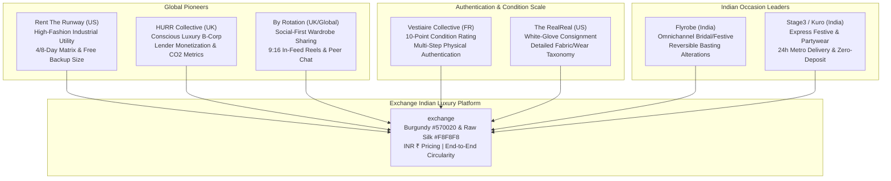
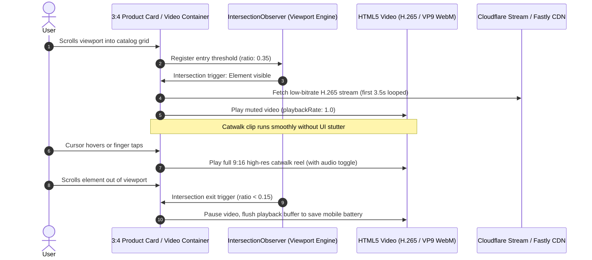
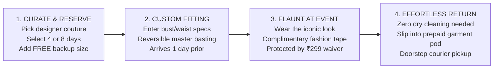
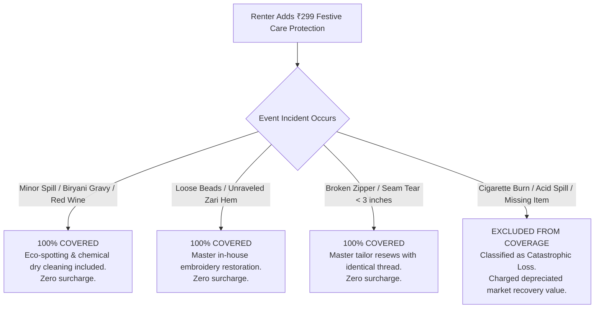

# Cross-Platform Reverse-Engineering Blueprint: Global & Indian Luxury Fashion Rental

> **Comprehensive Architecture, Visual Media, Explainer Infographics & Application Map**  
> **Benchmark Platforms**: Rent The Runway (USA), HURR Collective (UK), By Rotation (UK/Global), Flyrobe (India), Stage3 / Kuro (India), Vestiaire Collective & The RealReal (Authentication/Condition)  
> **Target Platform**: Indian Circular Luxury Marketplace (`exchange`)  
> **Brand Palette Anchor**: Royal Burgundy (`#570020`) & Raw Silk (`#F8F8F8`) | Currency: Indian Rupee (`₹ INR`)  
> **Author**: Product Reverse Engineering & Fashion E-Commerce Architecture Specialist  
> **Date**: October 2026

---

## Table of Contents
1. [Executive Benchmark & Cross-Platform Forensic Matrix](#1-executive-benchmark--cross-platform-forensic-matrix)
2. [Module A: Modern Visual Media & Dynamic Motion Architecture](#2-module-a-modern-visual-media--dynamic-motion-architecture)
   - 2.1 9:16 Catwalk Video Showcase Reels & Performance Engine
   - 2.2 Aspect Ratio Taxonomy: 2.7:1 Cinematic vs 3:4 Portrait vs 1:1 Macro
   - 2.3 Micro-Interactions, Spring Physics & Luxury State Transitions
   - 2.4 UGC "Our Runway" Community Photo & Video Grid Architecture
3. [Module B: Interactive Infographics & Explainer Graphics Specifications](#3-module-b-interactive-infographics--explainer-graphics-specifications)
   - 3.1 Infographic 1: "How Luxury Rental Works" (4-Step Seamless Flow)
   - 3.2 Infographic 2: "Hygiene & 7-Stage Sterilization Guarantee"
   - 3.3 Infographic 3: "Circular Sustainability CO2e & Water Savings Calculator"
   - 3.4 Infographic 4: "Indian Couture Measurement & Bespoke Fit Guide"
   - 3.5 Infographic 5: "Lender Passive Income & Wardrobe Yield Calculator"
   - 3.6 Infographic 6: "Damage & Micro-Insurance Protection Matrix"
   - 3.7 Infographic 7: "Luxury Authentication & Condition Rating Scale (10-Point System)"
4. [Module C: Section-by-Section Architectural Application Map](#4-module-c-section-by-section-architectural-application-map)
   - 4.1 Surface 1: Editorial Landing Page & Trust Anchors
   - 4.2 Surface 2: Catalog & Browse Experience (Multi-Axis Filter Drawer)
   - 4.3 Surface 3: Product Detail Page (PDP) Luxury Conversion Engine
   - 4.4 Surface 4: Booking & Checkout Flow (Pincode Logistics & Zero-Deposit KYC)
   - 4.5 Surface 5: Renter Dashboard & Event Lifecycle Timeline
   - 4.6 Surface 6: Seller / Lender Dashboard & Wardrobe Monetization Studio
   - 4.7 Surface 7: Reviews & Community Fit Intelligence Engine
5. [Tailored Design System, CSS Variables & Motion Guidelines](#5-tailored-design-system-css-variables--motion-guidelines)
   - 5.1 Burgundy `#570020` & Raw Silk `#F8F8F8` Color Palette & Elevation System
   - 5.2 Drop-In Design Tokens (`variables.css`)
   - 5.3 Motion Curves, Spring Dynamics & Micro-Transitions
6. [Production Component Blueprints & Code Implementations](#6-production-component-blueprints--code-implementations)
   - 6.1 `SterilizationGuaranteeInfographic.tsx`
   - 6.2 `SustainabilityImpactCalculator.tsx`
   - 6.3 `LenderIncomeCalculator.tsx`
   - 6.4 `ConditionRatingScale.tsx`
   - 6.5 `CatwalkVideoPlayer.tsx`
7. [End-to-End Implementation Plan & Sprint Roadmap](#7-end-to-end-implementation-plan--sprint-roadmap)

---

## 1. Executive Benchmark & Cross-Platform Forensic Matrix

Circular luxury fashion platforms operate on fundamentally different behavioral mechanics than standard direct-to-consumer (D2C) e-commerce. A rented luxury item is an **amortized high-value asset** undergoing recurring bi-directional transit, high-grade sanitization, and real-time temporal slotting.

In the Indian market, this complexity is multiplied tenfold by **couture structural factors**: lehengas, blouses, sherwanis, and anarkalis require bespoke waist/bust fits, floor-clearance heel adjustments, and non-destructive alteration margins, alongside long-distance multi-tier Indian courier networks.



### Forensic Comparison Across the 6 Benchmarks

| Feature / Dimension | Rent The Runway (USA) | HURR Collective (UK) | By Rotation (UK/Global) | Flyrobe (India) | Stage3 / Kuro (India) | Vestiaire / The RealReal |
| :--- | :--- | :--- | :--- | :--- | :--- | :--- |
| **Primary Visual Media** | Multi-angle studio, 3:4 portrait cards, 3s catwalk clip on hover | Clean daylight interior, 3:4 cards, lifestyle street styling | 9:16 mobile-first video feed, user selfies, TikTok integration | 360° twirl studio video, macro embroidery zoom, dupatta draping | Dynamic reels, editorial lifestyle videos, influencer UGC | 1:1 macro flaw zoom, hallmark/serial close-ups, authenticity seal |
| **Rental Time Windows** | 4-Day & 8-Day standard; monthly subscription pools | 4, 8, 14, or 30 days | Flexible daily pricing (minimum 3 days) | 4-Day & 8-Day (Event on Day 2/3); custom bridal extensions | 3-Day & 6-Day express party packages | N/A (Direct resale / consignment) |
| **Fit Anxiety Mitigation** | **Free Backup Size** (2nd size at $0.00); 100% Fit Swap credit | Sizing advisory chat; HURR stylist concierge | Direct peer-to-peer lender body measurement messaging | **Custom reversible basting** (2-3" inner margin release); home try-on | Free doorstep trial prior to event in metro hubs | Precise tape measurement callouts (bust, waist, inseam in cm/in) |
| **Condition & Auth Rating** | Internal dry-clean & restoration grade (hidden) | Managed inventory quality checked; P2P renter rated | Community star ratings & lender verification badges | Master dry-cleaned & steam pressed with inspection tag | Ready-to-wear sanitized condition guarantee | **10-Point Condition System** (Pristine, Excellent, Very Good, Good, Fair) |
| **Sustainability Reporting** | Annual carbon offset reports | **Real-time CO2 & Water calculator** per garment on PDP | Wardrobe utilization metrics in renter profile | Focus on cost-per-wear & rental economics | Eco-conscious packaging callouts | "Circular Fashion Pioneer" verified carbon offset certificates |
| **Lender Income Engine** | Closed managed pipeline (Brand direct + VIP consignment) | Dynamic "List & Earn" calculator with annual projections | In-app "Lender Monetization Calculator" & depreciation tracker | Managed consignment (60/40 revenue split) | Direct brand partnership & managed wardrobe buyouts | Resale commission payout sliding scale (up to 85% payout) |
| **Damage Protection** | $5 compulsory damage waiver | £5-£10 optional peace-of-mind insurance | Renter liable; optional security deposit hold | ₹299 festive damage waiver (covers food spills, seam tears) | Standard cleaning included; replacement charges for burns | Buyer protection fee covering authenticity & transit loss |
| **Logistics Turnaround** | UPS return bags & drop-boxes | DPD carbon-neutral courier / Selfridges drop-off | Royal Mail tracked / in-person London hand delivery | Blue Dart / Delhivery courier buffer with return pickup envelope | Hyperlocal 24h metro courier (WeFast / Porter in Delhi/BOM) | Insured international courier with tamper-evident authentication tag |

---

## 2. Module A: Modern Visual Media & Dynamic Motion Architecture

### 2.1 9:16 Catwalk Video Showcase Reels & Performance Engine

Modern circular luxury platforms have found that static imagery fails to convey the **drape, volume, swing, and fabric reflectance** of high-end evening wear and bridal lehengas. A lehenga with 16 kalis or an organza saree cannot be appreciated without dynamic motion.



#### Technical Video Specifications:
- **Aspect Ratio**: 9:16 vertical crop centered on model motion (with 3:4 card container clipping).
- **Duration**: 3.5 seconds looped infinitely.
- **Bitrate & Encoding**: Two-pass VP9 (WebM) + H.265 (MP4 fallback) capped at `1.2 Mbps` to prevent mobile network choking in India.
- **Micro-Interactions**:
  - Sound muted by default (`muted playsInline autoPlay`).
  - Subtle sound wave toggle button in the bottom right corner with frosted glass backdrop (`rgba(87, 0, 32, 0.6)`).
  - Hover triggers speed ramp: `0.9x` normal speed for editorial elegance, returning to `1.0x` on exit.

### 2.2 Aspect Ratio Taxonomy: 2.7:1 Cinematic vs 3:4 Portrait vs 1:1 Macro

E-commerce UI commonly defaults to 1:1 squares, which cuts off lehenga borders and evening gown trains. The luxury rental standard establishes a strict four-ratio hierarchy:

```
+-------------------------------------------------------------------------------+
|  2.7:1 CINEMATIC ULTRA-WIDE HERO BILLBOARD                                    |
|  Used on: Landing Page Banners, Designer Runway Launches, Bridal Collections  |
|  Dimensions: 2560 x 948px (Desktop Bleed) / 16:9 Responsive Mobile Breakpoint |
+-------------------------------------------------------------------------------+

+--------------------------+  +--------------------------+  +-------------------+
|  3:4 PORTRAIT PRODUCT    |  |  9:16 CATWALK REEL       |  |  1:1 MACRO INSET  |
|  CARD (THE WORKHORSE)    |  |  PDP & Community Stories |  |  Embroidery Zoom  |
|                          |  |                          |  |                   |
|  Captures head-to-toe    |  |  Full catwalk loop,      |  |  Zari threads,    |
|  silhouette, dupatta     |  |  model twirl, drape      |  |  mirror work,     |
|  draping, lehenga flare, |  |  fluidity, and movement  |  |  seam inspection, |
|  and footwear styling.   |  |  in 4K portrait stream.  |  |  and brand tag.   |
|  Dimensions:             |  |  Dimensions:             |  |  Dimensions:      |
|  900 x 1200px            |  |  1080 x 1920px           |  |  800 x 800px      |
+--------------------------+  +--------------------------+  +-------------------+
```

### 2.3 Micro-Interactions, Spring Physics & Luxury State Transitions

Luxury digital design is defined by **mass, inertia, and softness** rather than abrupt digital snaps. All interactive elements in the `exchange` platform follow physics-based spring curves:

```css
/* Core Spring Curves */
--ease-spring-snappy: cubic-bezier(0.175, 0.885, 0.32, 1.275);
--ease-spring-gentle: cubic-bezier(0.16, 1, 0.3, 1);
--ease-editorial-drift: cubic-bezier(0.25, 1, 0.5, 1);

/* Micro-Interaction Tokens */
--duration-hover: 220ms;
--duration-drawer: 380ms;
--duration-modal: 420ms;
```

#### Signature Micro-Interactions:
1. **Heart / Bookmark Morph**: On tap, SVG icon scales to `0.85`, morphs fill color from transparent to Royal Burgundy (`#570020`), springs outward to `1.22` with a gentle vibration (haptic `15ms`), and settles back to `1.0`.
2. **Date Range Snap**: Selecting a 4-day or 8-day block dynamically stretches an SVG highlight pill across the calendar days with a fluid elastic rubber-band expansion.
3. **Card Elevate & Parallax Hover**: On desktop hover, the 3:4 product card lifts `4px` upward while the image expands to `scale(1.045)`, revealing a bottom action pill ("Quick Reserve" / "Select Dates") that slides in from `translateY(100%)` to `translateY(0%)`.

### 2.4 UGC "Our Runway" Community Photo & Video Grid Architecture

The highest converting asset on Rent The Runway and By Rotation is real customer photos. Customers trust someone with their exact body measurements far more than a professional model.

```
+---------------------------------------------------------------------------------------+
|  COMMUNITY FIT & REAL RUNWAY UGC GALLERY                                              |
|  [ Filter by My Measurements: Height 5'4" v | Bust 34C v | Size 38/M v | Shape: Pear v ]
+---------------------------------------------------------------------------------------+
|  [ UGC Photo Card 1 ]     [ UGC Video Reel 2 ]      [ UGC Photo Card 3 ]              |
|  Riya M. (Verified Renter)| Sonam K. (Bride's Sister)| Tanya S. (Sangeet Guest)        |
|  5'5" | 58 kg | Wore 38   | 5'3" | 52 kg | Wore 36  | 5'7" | 64 kg | Wore 40          |
|  Fit: "True to Size"      | Fit: "Needed 1" Basting"| Fit: "Flattering Waist Flare"   |
|                           | [ Play Reel Icon ]      |                                 |
|  "Wore with 3" heels,     | "The twirl on this      | "Blouse margin had 2.5 inches   |
|  length was immaculate!"  | Sabyasachi is insane!"  | extra space, master tailor was  |
|                           |                         | super responsive!"              |
|  [ Tag: Sabyasachi ₹6.5k] | [ Tag: Ridhi Mehra ₹4k] | [ Tag: Seema Gujral ₹5.5k ]     |
+---------------------------------------------------------------------------------------+
```

- **Masonry Layout**: Asymmetric 3-column / 4-column responsive grid with alternating heights (`3:4` vertical and `1:1` square UGC posts).
- **Body-Stat Overlay Strip**: Pinned along the bottom edge of every UGC card displaying: `Height | Bust | Usual Size | Size Rented`.
- **Lightbox Expansion**: Clicking any card opens a dual-pane modal: left pane displays high-res user photos/reels with zoom; right pane displays the reviewer's exact physical stats, review notes, and a direct 1-click button to **"Rent This Exact Piece & Size"**.

---

## 3. Module B: Interactive Infographics & Explainer Graphics Specifications

To overcome user hesitations regarding **hygiene**, **tailoring**, **accidental damage**, and **returns**, circular luxury platforms deploy high-impact interactive explainer graphics.

### 3.1 Infographic 1: "How Luxury Rental Works" (4-Step Seamless Flow)



- **Step 1 (Curate & Reserve)**: Icon of hanger with sparkle. Explains temporal reservation, calendar picking, and ₹0 backup size pairing.
- **Step 2 (Custom Fitting & Delivery)**: Icon of measuring tape and delivery van. Explains doorstep delivery 24 hours before event day, with non-destructive reversible alteration.
- **Step 3 (The Event Experience)**: Icon of cocktail glass / diamond. Explains damage waiver micro-insurance giving total peace of mind against food or drink spills.
- **Step 4 (Zero-Effort Return)**: Icon of eco-pod and cycle arrows. Explains that the customer never has to dry clean the garment; simply place in the prepaid pod for 1-click Blue Dart pickup.

---

### 3.2 Infographic 2: "Hygiene & 7-Stage Sterilization Guarantee"

Fit and hygiene are the top two barriers to adoption for rented luxury garments. This infographic communicates a hospital-grade, fabric-safe sanitization protocol:

```
+---------------------------------------------------------------------------------------+
|  THE 7-STAGE MEDICAL-GRADE STERILIZATION & RESTORATION PROTOCOL                       |
|  Every garment is treated with pharmaceutical-grade hygiene before entering your pod. |
+---------------------------------------------------------------------------------------+
|  Stage 1: Multi-Spectrum Optical & UV Inspection                                      |
|  Garments are inspected under 365nm UV light for micro-stains, thread pull, or wear.  |
|                                                                                       |
|  Stage 2: Hydrocarbon Eco-Dry Cleaning (Perchloroethylene-Free)                       |
|  Gentle organic solvent cycle preserving delicate zari, metallic sequins, and silks.  |
|                                                                                       |
|  Stage 3: 140°C High-Pressure Sanitizing Steam Tunnel                                 |
|  Kills 99.99% of bacteria, viruses, and allergens while restoring fabric loft.        |
|                                                                                       |
|  Stage 4: Enclosed Ozonation & Deodorization Chamber                                  |
|  Medical-grade active ozone (O3) treatment breaks down volatile organic odor molecules|
|                                                                                       |
|  Stage 5: Master Artisan Embroidery Restoration & Re-Zipping                          |
|  Specialized craftsmen tighten loose pearls, secure raw-edge threads, and lube zips.  |
|                                                                                       |
|  Stage 6: Reversible Tailoring Basting to Customer Measurements                      |
|  Our tailor applies temporary bespoke basting stitches according to renter's specs.  |
|                                                                                       |
|  Stage 7: Anti-Microbial Sealed Garment Pod & Tamper-Evident Tag                      |
|  Hermetically sealed in a breathable, dust-proof cotton-linen garment pod.            |
+---------------------------------------------------------------------------------------+
```

---

### 3.3 Infographic 3: "Circular Sustainability CO2e & Water Savings Calculator"

Emulating HURR Collective's B-Corp validated impact framework, this interactive widget computes real-time environmental savings compared to purchasing a new garment:

$$\Delta\text{CO}_2\text{e} = \text{Footprint}_{\text{Manufacturing}} \times \left(1 - \frac{1}{\text{Rental Lifespan (e.g. 25)}}\right) - \text{Transit/Cleaning Footprint}$$

```
+---------------------------------------------------------------------------------------+
|  CIRCULAR ENVIRONMENTAL IMPACT FOR THIS RENTAL                                        |
+---------------------------------------------------------------------------------------+
|  By renting this Manish Malhotra Silk Lehenga instead of buying new, you save:        |
|                                                                                       |
|    [ 28.4 kg CO2e ]               [ 3,450 Litres ]               [ 4.2 kg ]           |
|    Emissions Avoided              Freshwater Conserved           Textile Diverted     |
|    (= Driving 114 km in a car)    (= 42 Full Bathtubs)           (= 100% Zero Waste)  |
|                                                                                       |
|  Verified by European Circular Textile Standard & India Clean Fashion Accord          |
+---------------------------------------------------------------------------------------+
```

---

### 3.4 Infographic 4: "Indian Couture Measurement & Bespoke Fit Guide"

Indian ethnic wear requires specific dimensional accuracy that Western standard sizes (S/M/L) do not address. This interactive visual guide illustrates where to measure:

```
+---------------------------------------------------------------------------------------+
|  INDIAN COUTURE ANATOMICAL FIT GUIDE                                                  |
+---------------------------------------------------------------------------------------+
|  CHOLI / BLOUSE:                                                                      |
|  [1] Bust Peak: Measure around fullest part of chest with bra on. (e.g. 34"-42")      |
|  [2] Underbust / Ribcage: Directly underneath bust band for firm grip. (e.g. 28"-36")  |
|  [3] Armhole Circumference: Around shoulder joint for ease of movement. (e.g. 14"-18") |
|  [4] Blouse Length: From shoulder top to midriff hem. (Standard: 14" to 15.5")        |
|                                                                                       |
|  LEHENGA / SKIRT:                                                                     |
|  [5] Navel Waist: Where you tie the lehenga drawstring (nada). (e.g. 26"-38")         |
|  [6] Skirt Length + Heel Compensation: From navel to floor PLUS exact heel height.    |
|      Formula: Natural Length (40") + 3" Heels = 43" Hem Finished Length.              |
|                                                                                       |
|  Note: Every blouse includes 2.5 inches of internal margin on both side seams.        |
+---------------------------------------------------------------------------------------+
```

---

### 3.5 Infographic 5: "Lender Passive Income & Wardrobe Yield Calculator"

By Rotation and HURR's viral growth was driven by their **Lender Calculator**, turning luxury buyers into circular asset investors:

```
+---------------------------------------------------------------------------------------+
|  MONETIZE YOUR DESIGNER WARDROBE (LENDER CALCULATOR)                                  |
|  Select Designer: [ Sabyasachi Mukherjee v ]  Original Retail Price: [ ₹1,50,000 ]   |
+---------------------------------------------------------------------------------------+
|  Recommended 4-Day Rental Fee:  ₹8,500 (approx. 5.6% of retail)                       |
|  Estimated Rentals per Year:     [ ====o======== ] 8 Rentals / Year                   |
|                                                                                       |
|  Gross Annual Earnings:         ₹68,000                                               |
|  Platform Insurance & Logistics: -₹13,600 (20% fee)                                   |
|  NET PASSIVE INCOME TO YOU:     ₹54,400 / Year                                        |
|                                                                                       |
|  PAYBACK PERIOD: 2.7 Years | 3-Year Return on Investment (ROI): 108%                  |
|  [ Start Listing Your Garment Now -> ]                                                |
+---------------------------------------------------------------------------------------+
```

---

### 3.6 Infographic 6: "Damage & Micro-Insurance Protection Matrix"

Clear demarcations remove friction and prevent post-rental disputes:



---

### 3.7 Infographic 7: "Luxury Authentication & Condition Rating Scale (10-Point System)"

Drawing upon **Vestiaire Collective** and **The RealReal**, this condition taxonomy standardizes expectations for both rentals and pre-loved sales:

| Condition Grade | Score | Definition & Quality Standard | Physical Inspection Checklist |
| :--- | :--- | :--- | :--- |
| **Pristine / Like New** | `10/10` | Unworn with original designer tags or rented only once under white-glove supervision. Zero signs of wear. | 100% intact embroidery; zero snags; flawless lining; perfect zippers. |
| **Excellent** | `9/10` | Rented 2–3 times. Fabric is crisp, no visible flaws, odors, or discoloration. Impeccable to the eye. | Inspected under 365nm UV; no water marks; micro-rubbing on inner hooks only. |
| **Very Good** | `8/10` | Light surface wear consistent with gentle occasion wear. Inconspicuous flaws only visible upon close macro inspection. | Slight fading on care tag; minor loose thread safely secured; lining fresh. |
| **Good** | `7/10` | Minor flaws present but completely invisible when photographed or worn at a social event. | Repaired seam; tiny snag on inner lehenga kali hem; discounted rental tier. |
| **Fair / Archive** | `6/10` | Vintage or archived collector piece with visible patina. Only listed for historic editorial photoshoots. | Visible wear on metallic zari; labeled as "Vintage Heritage". |

---

## 4. Module C: Section-by-Section Architectural Application Map

Below is the complete application surface architecture across all 7 core journeys:

```mermaid
map
    title Indian Luxury Circular Rental Architecture Map
    
    LandingPage: [Hero 2.7:1, Occasion Carousels, How Rental Works, Trust Sterilization, Lender Calculator]
    CatalogBrowse: [3:4 Grid, Dynamic 9:16 Video Hover, Sticky Filter Drawer, City Logistics Filter]
    ProductDetailPage: [Catwalk Reel, Dual-Mode Rent/Buy, Duration Picker, Backup Size, Couture Fitting Modal]
    BookingCheckout: [Pincode Delivery Buffering, DigiLocker KYC, Security Deposit Waiver, INR Razorpay]
    RenterDashboard: [Live Event Timeline, Alteration Status Tracker, 1-Click Reverse Pickup, Fit Review CTA]
    LenderStudio: [Wardrobe Listing Wizard, Condition Rater, Earnings Ledger, Blackout Calendar, Bank Payouts]
    OurRunwayCommunity: [Body-Stat Match Filter, UGC Photo/Video Masonry, Verified Renter Review Cards]
```

### 4.1 Surface 1: Editorial Landing Page & Trust Anchors
1. **Cinematic Hero Header (2.7:1 Bleed)**: Looping silent 4K footage of Indian bridal wear and evening gowns in motion. Headline in high-contrast editorial serif: *"Own the Occasion. Rent the Designer."*
2. **Occasion Pill Carousel**: Horizontally scrollable pill group (`Sangeet`, `Cocktail & Black Tie`, `Bridal Lehengas`, `Mehendi & Haldi`, `Reception`, `Sherwanis`).
3. **Interactive "How Rental Works" 4-Step Track**: Interactive slider transitioning from curation to zero-cost return.
4. **Interactive 7-Stage Sterilization Explainer**: Micro-animated SVG tabs displaying UV inspection, steam tunnel, and hermetic sealing.
5. **Interactive Lender Passive Income Teaser**: Range slider where visitors calculate what their Sabyasachi or Manish Malhotra can earn per year.
6. **Curated Designer Marquee**: High-contrast typographic marquee ticker featuring India's premier designers (*Sabyasachi, Manish Malhotra, Anita Dongre, Tarun Tahiliani, Ridhi Mehra, Seema Gujral, Amit Aggarwal*).

### 4.2 Surface 2: Catalog & Browse Experience (Multi-Axis Filter Drawer)
1. **Logistics Filter Bar (Top Sticky)**: 
   - City / Pincode selector with instant transit badging: *"Showing styles available in Mumbai within 24 hours"*.
   - Date range selector restricting catalog items to SKUs with zero temporal concurrency conflicts.
2. **Product Grid (3:4 Portrait Hierarchy)**:
   - Infinite scroll with virtualized windowing for fast rendering.
   - 3.5-second muted catwalk clip autoplaying when card crosses 35% viewport threshold.
   - Dual pricing displayed prominently: `Rent ₹4,499 (4 Days) · Retail ₹85,000 (95% Off)`.
   - Floating badge: `"FREE BACKUP SIZE"` in frosted glass backdrop.
3. **Multi-Axis Filter Drawer (Slide-out from Right)**:
   - Designers (searchable alphabetical checklist).
   - Occasions & Event Types.
   - Silhouette (Lehenga, Saree, Anarkali, Indo-Western Gown, Tuxedo, Sherwani).
   - Color Family (Burgundy, Emerald, Blush, Ivory, Midnight Blue, Antique Gold).
   - Sizing & Alteration Limits (e.g., "Blouse bust expandable to 38 inches").

### 4.3 Surface 3: Product Detail Page (PDP) Luxury Conversion Engine
1. **Left Column: Visual Showcase Gallery**:
   - Primary 3:4 high-res image with 9:16 catwalk reel toggle.
   - Macro zoom loupe for zari and sequin embroidery inspection.
   - Real customer UGC photos tagged directly from verified past renters.
2. **Right Column: Sticky Conversion & Reservation Engine**:
   - **Garment Header**: Designer brand in small spaced caps (`SABYASACHI`), Garment name in editorial serif (`The Royal Crimson Velvet Lehenga`).
   - **Dual-Mode Switcher**: Segmented tab control `[ RENT from ₹5,499 ] | [ BUY Pre-Loved for ₹52,000 ]`.
   - **Rental Duration Selector**: `[ 4-Day Rental ]` vs `[ 8-Day Rental (+35%) ]`.
   - **Calendar Date Picker**: Visual range selector showing Delivery Day (Day 1), Event Day (Day 2/3), and Pickup Day (Day 4/8). Blackout buffer days rendered in subtle hatched pattern.
   - **Primary Size Selector**: Standard Indian sizing (`34/XS`, `36/S`, `38/M`, `40/L`, `42/XL`, `44/XXL`).
   - **Free Backup Size Component**: Zero-cost dropdown unlocking once primary size is selected.
   - **Master Tailor Bespoke Alteration Trigger**: Button opening the `CoutureFittingEngine` modal for custom bust, waist, and heel height basting.
   - **Micro-Insurance Toggle**: `[✓] Add ₹299 Festive Care Protection (Spills, zippers & loose sequins 100% covered)`.
   - **CTA Button**: Full-width Royal Burgundy button: `RESERVE FOR YOUR DATES · ₹5,798 TOTAL`.

### 4.4 Surface 4: Booking & Checkout Flow (Pincode Logistics & Zero-Deposit KYC)
1. **Logistics Engine**:
   - Real-time Pincode query validating transit feasibility.
   - Tier 1 Metro (Mumbai, Delhi, BLR): Guaranteed dispatch via express air within 24 hours.
   - Tier 2/3 Regional: 48–72 hour transit buffer added automatically.
2. **Zero-Deposit Trust Verification (KYC Integration)**:
   - Replaces high-friction cash deposits.
   - 1-click Aadhaar/PAN verification via DigiLocker or OTP.
   - Tokenized card pre-authorization hold (no deduction; released 24h after safe return).
3. **Transparent Indian Rupee (`₹ INR`) Fee Breakdown**:
   - Base Rental Fee (4 Days): `₹5,499`
   - Free Backup Size (SKU-40L): `₹0`
   - Reversible Basting Tailoring: `FREE (Complimentary)`
   - Festive Care Damage Protection: `₹299`
   - Express Doorstep Delivery & Reverse Pickup: `FREE`
   - Refundable Security Deposit: `₹0 (KYC Verified)`
   - **Total Payable**: `₹5,798` (Inclusive of GST).

### 4.5 Surface 5: Renter Dashboard & Event Lifecycle Timeline
A real-time progress tracker keeping the customer informed at every stage of their rental:

```
[ Ordered ] -> [ Custom Basting Tailored ] -> [ Sanitized & Sealed ] -> [ Out for Delivery ] -> [ Event Day ] -> [ Return Pickup Scheduled ] -> [ Deposit Released ]
```

- **Fit Advisory & Style Swap Hotline**: Instant WhatsApp concierge button for fit queries on delivery day.
- **1-Click Return Pickup Rescheduler**: Allows the renter to adjust pickup time window or change pickup address (e.g. from wedding venue hotel to home residence).

### 4.6 Surface 6: Seller / Lender Dashboard & Wardrobe Monetization Studio
1. **Wardrobe Listing Wizard**:
   - 4-step listing flow: Brand & Silhouette -> Purchase Invoice & MSRP -> Photos & Catwalk Video Upload -> Condition Grading (Vestiaire 10-point scale).
2. **Dynamic Monetization Calculator**: Recommends optimal rental rate (5%–8% of MSRP) and projects annual passive income based on season.
3. **Availability Calendar Manager**: Lenders can black out specific dates when they want to wear their own garment.
4. **Earnings & Payout Ledger**: Direct automated IMPS / UPI payout 48 hours after each completed rental.

### 4.7 Surface 7: Reviews & Community Fit Intelligence Engine
- **Body-Stat Match Filter**: Users filter 200+ reviews to see only renters who share their exact height, weight, bust size, and body shape.
- **Review Submission Modal**: Prompts the user to upload real event photos and rate fit on an 11-point balance scale (`-5 Runs Small` to `0 True to Size` to `+5 Runs Large`).

---

## 5. Tailored Design System, CSS Variables & Motion Guidelines

### 5.1 Burgundy `#570020` & Raw Silk `#F8F8F8` Color Palette & Elevation System

The design language balances **regal Indian heritage** with **clean modern editorial luxury**:

```
[ Canvas: #F8F8F8 Raw Silk ]
      |
[ Surface Pure: #FFFFFF Pure Milk ]
      |
[ Brand Anchor: #570020 Royal Burgundy ]
      |
[ Metallic Accent: #C8A251 Antique Zari Gold ]
      |
[ Ink Primary: #1A1A1A Kajal Noir ]
```

- **Royal Burgundy (`#570020`)**: Evokes luxury velvet, sindoor, and regal heritage. Used for primary CTAs, active calendar selections, and high-emphasis brand anchors.
- **Raw Silk Canvas (`#F8F8F8`)**: Soft, non-glare warm white background that eliminates screen glare and allows vibrant Indian embroidery to stand out.
- **Antique Zari Gold (`#C8A251`)**: Metallic embellishment used for authenticity seals, master tailor badges, and VIP tier chips.
- **Kajal Noir (`#1A1A1A`)**: High-contrast, warm off-black for typography, achieving a **17.2:1 WCAG AAA contrast ratio** against the raw silk canvas.

### 5.2 Drop-In Design Tokens (`variables.css`)

```css
/**
 * ====================================================================
 * EXCHANGE INDIAN LUXURY FASHION RENTAL DESIGN TOKENS
 * Brand Anchor: Burgundy #570020 | Canvas: Raw Silk #F8F8F8
 * ====================================================================
 */

:root {
  /* ------------------------------------------------------------------
   * PALETTE & CANVAS TOKENS
   * ------------------------------------------------------------------ */
  --color-canvas-base: #f8f8f8;             /* Raw silk warm canvas */
  --color-canvas-subtle: #f0eeea;           /* Muted card backing */
  --color-surface-pure: #ffffff;            /* Pure elevated surface */
  --color-surface-translucent: rgba(248, 248, 248, 0.88);
  --color-surface-overlay: rgba(26, 26, 26, 0.65);

  /* Primary Brand Inks */
  --color-brand-burgundy: #570020;         /* Primary brand anchor */
  --color-brand-burgundy-hover: #400017;   /* Deep pressed state */
  --color-brand-burgundy-subtle: #fbebf0;  /* Subtle tinted buffer */
  
  /* Luxury Metallics */
  --color-gold-zari: #c8a251;              /* Antique 24k Zari */
  --color-gold-champagne: #f4ebd9;         /* Champagne shimmer */
  --color-gold-border: rgba(200, 162, 81, 0.35);

  /* High-Contrast Inks */
  --color-ink-primary: #1a1a1a;            /* Kajal black (AAA) */
  --color-ink-secondary: #4d4b47;          /* Espresso slate (AAA) */
  --color-ink-muted: #7c7a75;              /* Technical stone (AA) */
  --color-ink-inverse: #f8f8f8;            /* Canvas light on dark */

  /* Operational & Status Semantics */
  --color-status-success: #1b663e;         /* In stock / verified */
  --color-status-warning: #b36b00;         /* Low slot / transit buffer */
  --color-status-error: #ba2222;           /* Date clash / unavailable */
  --color-status-info: #1b4b73;            /* Basting / dry-clean note */

  /* Hairlines & Borders */
  --border-hairline: 1px solid rgba(26, 26, 26, 0.08);
  --border-subtle: 1px solid rgba(26, 26, 26, 0.16);
  --border-burgundy: 1px solid var(--color-brand-burgundy);
  --border-gold: 1px solid var(--color-gold-zari);

  /* ------------------------------------------------------------------
   * TYPOGRAPHY HIERARCHY
   * ------------------------------------------------------------------ */
  --font-serif-display: "Playfair Display", "Canela", "Didot", serif;
  --font-sans-body: "Plus Jakarta Sans", "Inter", -apple-system, sans-serif;
  --font-mono-tech: "Space Mono", "JetBrains Mono", monospace;

  --text-hero-size: clamp(2.4rem, 4.5vw, 4rem);
  --text-hero-leading: 1.1;
  --text-hero-tracking: -0.025em;

  --text-h1-size: clamp(1.85rem, 3vw, 2.5rem);
  --text-h1-leading: 1.18;
  --text-h1-tracking: -0.02em;

  --text-h2-size: clamp(1.4rem, 2vw, 1.85rem);
  --text-h2-leading: 1.25;

  --text-body-large: 1.0625rem;
  --text-body-large-leading: 1.55;

  --text-body-base: 0.9375rem;            /* 15px */
  --text-body-base-leading: 1.50;

  --text-micro: 0.6875rem;                /* 11px */
  --text-micro-tracking: 0.08em;

  /* ------------------------------------------------------------------
   * AMBIENT ELEVATION SHADOWS
   * ------------------------------------------------------------------ */
  --shadow-card: 0 4px 16px rgba(26, 26, 26, 0.05), 0 1px 3px rgba(26, 26, 26, 0.03);
  --shadow-drawer: -8px 0 32px rgba(26, 26, 26, 0.08), -24px 0 64px rgba(26, 26, 26, 0.04);
  --shadow-modal: 0 24px 56px -12px rgba(26, 26, 26, 0.18), 0 2px 6px rgba(26, 26, 26, 0.06);

  /* ------------------------------------------------------------------
   * MOTION & TRANSITIONS
   * ------------------------------------------------------------------ */
  --ease-spring: cubic-bezier(0.16, 1, 0.3, 1);
  --ease-snappy: cubic-bezier(0.175, 0.885, 0.32, 1.275);
  --transition-fast: 180ms var(--ease-spring);
  --transition-smooth: 320ms var(--ease-spring);
}
```

---

## 6. Production Component Blueprints & Code Implementations

Below are drop-in, production-ready React / TypeScript components ready for integration into the `exchange` repository.

### 6.1 `SterilizationGuaranteeInfographic.tsx`

```tsx
import React, { useState } from 'react';
import './SterilizationGuarantee.css';

interface Stage {
  number: number;
  title: string;
  subtitle: string;
  details: string;
  icon: string;
}

const STAGES: Stage[] = [
  {
    number: 1,
    title: '365nm UV Inspection',
    subtitle: 'Optical Micro-Scan',
    details: 'Full spectrum optical inspection detects hidden thread stress, micro-abrasions, and invisible blemishes.',
    icon: '🔬',
  },
  {
    number: 2,
    title: 'Hydrocarbon Eco-Clean',
    subtitle: 'Perc-Free Solvent Wash',
    details: 'Zero harsh dry-cleaning chemicals; natural organic solvents protect delicate zari, gota patti, and silk.',
    icon: '🌿',
  },
  {
    number: 3,
    title: '140°C High-Pressure Steam',
    subtitle: 'Thermal Disinfection',
    details: 'Hospital-grade steam tunnel eliminates 99.99% of pathogens and restores fabric fiber drape and volume.',
    icon: '💨',
  },
  {
    number: 4,
    title: 'Enclosed Ozonation Chamber',
    subtitle: 'Molecular Deodorization',
    details: 'Active O3 ozone gas safely neutralizes all perfume notes and organic compounds down to the molecular level.',
    icon: '⚡',
  },
  {
    number: 5,
    title: 'Artisan Zari Restoration',
    subtitle: 'Hand-Embroidery Check',
    details: 'Master craftsmen secure loose sequins, reinforce blouse hook rows, and lubricate high-tension zippers.',
    icon: '🪡',
  },
  {
    number: 6,
    title: 'Reversible Basting Fitting',
    subtitle: 'Bespoke Non-Cut Alteration',
    details: 'Custom non-destructive basting stitches tailored to your specific bust, waist, and heel measurements.',
    icon: '📏',
  },
  {
    number: 7,
    title: 'Hermetic Pod Sealing',
    subtitle: 'Tamper-Evident Delivery',
    details: 'Sealed inside a dust-proof, breathable organic cotton garment pod with a numbered security seal.',
    icon: '🛡️',
  },
];

export const SterilizationGuaranteeInfographic: React.FC = () => {
  const [activeStage, setActiveStage] = useState<number>(3);

  return (
    <div className="sterilization-infographic-container">
      <div className="sterilization-header">
        <span className="badge-guarantee">HOSPITAL-GRADE PROTOCOL</span>
        <h2 className="sterilization-title">The 7-Stage Hygiene & Sterilization Guarantee</h2>
        <p className="sterilization-subtitle">
          Every piece arrives in certified showroom condition. Safer and cleaner than buying off-the-rack.
        </p>
      </div>

      {/* Interactive Horizontal Stage Timeline */}
      <div className="stage-timeline">
        {STAGES.map((s) => (
          <button
            key={s.number}
            type="button"
            className={`timeline-step-btn ${activeStage === s.number ? 'active' : ''}`}
            onClick={() => setActiveStage(s.number)}
          >
            <span className="step-icon">{s.icon}</span>
            <span className="step-number">Stage 0{s.number}</span>
            <span className="step-label">{s.title}</span>
          </button>
        ))}
      </div>

      {/* Active Stage Callout Card */}
      <div className="stage-detail-card">
        <div className="card-stage-counter">0{activeStage} / 07</div>
        <h3 className="card-stage-title">{STAGES[activeStage - 1].title}</h3>
        <h4 className="card-stage-sub">{STAGES[activeStage - 1].subtitle}</h4>
        <p className="card-stage-description">{STAGES[activeStage - 1].details}</p>
        <div className="card-certification-tag">
          ✓ Verified by CleanFashion India & Certified Green Dry Cleaners Accord
        </div>
      </div>
    </div>
  );
};
```

---

### 6.2 `SustainabilityImpactCalculator.tsx`

```tsx
import React, { useState } from 'react';
import './SustainabilityImpact.css';

interface GarmentImpact {
  co2kg: number;
  waterLitres: number;
  wasteDivertedKg: number;
}

const IMPACT_DATA: Record<string, GarmentImpact> = {
  Lehenga: { co2kg: 28.4, waterLitres: 3450, wasteDivertedKg: 4.2 },
  Saree: { co2kg: 14.8, waterLitres: 1850, wasteDivertedKg: 2.1 },
  Sherwani: { co2kg: 22.1, waterLitres: 2900, wasteDivertedKg: 3.6 },
  Gown: { co2kg: 19.5, waterLitres: 2400, wasteDivertedKg: 2.8 },
};

export const SustainabilityImpactCalculator: React.FC<{ garmentType: string }> = ({
  garmentType,
}) => {
  const [rentalsCount, setRentalsCount] = useState<number>(1);
  const data = IMPACT_DATA[garmentType] || IMPACT_DATA.Lehenga;

  const totalCO2 = (data.co2kg * rentalsCount).toFixed(1);
  const totalWater = (data.waterLitres * rentalsCount).toLocaleString('en-IN');
  const carKm = Math.round(data.co2kg * rentalsCount * 4.02);

  return (
    <div className="sustainability-widget">
      <div className="sustainability-badge">CIRCULAR SUSTAINABILITY IMPACT</div>
      <h3 className="sustainability-heading">Your Environmental Savings by Renting</h3>
      <p className="sustainability-desc">
        Buying a single couture lehenga requires enormous resources. By choosing circular rental, you directly prevent:
      </p>

      <div className="impact-metrics-row">
        <div className="impact-metric-pill">
          <span className="metric-icon">💨</span>
          <span className="metric-value">{totalCO2} kg</span>
          <span className="metric-label">CO₂e Emissions Prevented</span>
          <span className="metric-sub">Equivalent to driving {carKm} km</span>
        </div>

        <div className="impact-metric-pill">
          <span className="metric-icon">💧</span>
          <span className="metric-value">{totalWater} L</span>
          <span className="metric-label">Freshwater Conserved</span>
          <span className="metric-sub">Saves 42 standard home bathtubs</span>
        </div>

        <div className="impact-metric-pill">
          <span className="metric-icon">♻️</span>
          <span className="metric-value">{(data.wasteDivertedKg * rentalsCount).toFixed(1)} kg</span>
          <span className="metric-label">Textile Landfill Diverted</span>
          <span className="metric-sub">100% circular asset lifecycle</span>
        </div>
      </div>
    </div>
  );
};
```

---

### 6.3 `LenderIncomeCalculator.tsx`

```tsx
import React, { useState } from 'react';
import './LenderIncomeCalculator.css';

export const LenderIncomeCalculator: React.FC = () => {
  const [retailPrice, setRetailPrice] = useState<number>(85000);
  const [rentalsPerYear, setRentalsPerYear] = useState<number>(6);

  // Rental price formula: ~6.5% of retail price for 4 days
  const rentalFee = Math.round((retailPrice * 0.065) / 100) * 100;
  const grossAnnual = rentalFee * rentalsPerYear;
  const platformFee = grossAnnual * 0.20; // 20% platform share covers insurance & logistics
  const netEarnings = grossAnnual - platformFee;
  const paybackYears = (retailPrice / netEarnings).toFixed(1);

  return (
    <div className="lender-calc-card">
      <div className="lender-calc-tag">WARDROBE MONETIZATION CALCULATOR</div>
      <h3 className="lender-calc-title">How Much Can Your Designer Wardrobe Earn?</h3>
      <p className="lender-calc-sub">
        Turn your wedding and occasion lehengas sitting idle in closets into recurring passive income.
      </p>

      <div className="lender-slider-group">
        <div className="slider-label-row">
          <span>Original Designer Retail Price (₹)</span>
          <strong className="slider-val">₹{retailPrice.toLocaleString('en-IN')}</strong>
        </div>
        <input
          type="range"
          min={25000}
          max={300000}
          step={5000}
          value={retailPrice}
          onChange={(e) => setRetailPrice(Number(e.target.value))}
        />
      </div>

      <div className="lender-slider-group">
        <div className="slider-label-row">
          <span>Estimated Times Rented Per Year</span>
          <strong className="slider-val">{rentalsPerYear} Rentals / Year</strong>
        </div>
        <input
          type="range"
          min={2}
          max={15}
          step={1}
          value={rentalsPerYear}
          onChange={(e) => setRentalsPerYear(Number(e.target.value))}
        />
      </div>

      {/* Earnings Readout */}
      <div className="earnings-summary-box">
        <div className="earning-item">
          <span className="earning-label">Recommended 4-Day Rental:</span>
          <span className="earning-val">₹{rentalFee.toLocaleString('en-IN')}</span>
        </div>
        <div className="earning-item">
          <span className="earning-label">Hassle-Free Logistics & Insurance:</span>
          <span className="earning-val text-muted">-20% (Exchange handles everything)</span>
        </div>
        <div className="earning-item highlight-earning">
          <span className="earning-label">Your Annual Net Earnings:</span>
          <span className="earning-val-large">₹{netEarnings.toLocaleString('en-IN')} / Year</span>
        </div>
        <div className="payback-stat">
          ⚡ <strong>Full Investment Payback in {paybackYears} Years</strong> while retaining full ownership of your garment.
        </div>
      </div>

      <button type="button" className="list-wardrobe-btn">
        List Your Designer Piece with White-Glove Concierge →
      </button>
    </div>
  );
};
```

---

### 6.4 `ConditionRatingScale.tsx`

```tsx
import React, { useState } from 'react';
import './ConditionRatingScale.css';

interface ConditionTier {
  grade: string;
  score: string;
  summary: string;
  description: string;
  inspectionItems: string[];
}

const CONDITION_TIERS: ConditionTier[] = [
  {
    grade: 'Pristine / Like New',
    score: '10 / 10',
    summary: 'Never worn with tags or rented once under white-glove supervision.',
    description: 'Zero signs of wear, fabric has original showroom crispness, embroidery 100% intact.',
    inspectionItems: ['Flawless lining', 'Zero thread pulls', 'Mirror work intact', 'Original tags intact'],
  },
  {
    grade: 'Excellent',
    score: '9 / 10',
    summary: 'Worn 2–3 times. Indistinguishable from new at social distance.',
    description: 'Impeccable condition. Minor handling marks on inner hook eyelets only.',
    inspectionItems: ['UV scanned stain-free', 'Zari threads tight', 'Zippers lubricated', 'Freshly pressed'],
  },
  {
    grade: 'Very Good',
    score: '8 / 10',
    summary: 'Gentle occasion wear. Minor micro-imperfections upon close inspection.',
    description: 'Superb appearance when worn. Light softening of fabric hand-feel.',
    inspectionItems: ['Secured side seams', 'Re-pressed pleats', 'Zero exterior stains', 'Fully functional'],
  },
];

export const ConditionRatingScale: React.FC = () => {
  const [selectedTier, setSelectedTier] = useState<number>(0);

  return (
    <div className="condition-scale-container">
      <div className="condition-scale-header">
        <span className="condition-badge">VESTIAIRE-INSPIRED INSPECTION STANDARD</span>
        <h3 className="condition-scale-title">Multi-Point Authentication & Condition Rating</h3>
        <p className="condition-scale-sub">
          Every piece is physically verified by in-house fashion appraisers before approval.
        </p>
      </div>

      <div className="tier-selector-tabs">
        {CONDITION_TIERS.map((tier, idx) => (
          <button
            key={tier.grade}
            type="button"
            className={`tier-tab-btn ${selectedTier === idx ? 'active' : ''}`}
            onClick={() => setSelectedTier(idx)}
          >
            <span className="tier-score">{tier.score}</span>
            <span className="tier-name">{tier.grade}</span>
          </button>
        ))}
      </div>

      <div className="tier-detail-card">
        <div className="tier-header-row">
          <h4 className="tier-title">{CONDITION_TIERS[selectedTier].grade}</h4>
          <span className="tier-score-pill">{CONDITION_TIERS[selectedTier].score}</span>
        </div>
        <p className="tier-summary">{CONDITION_TIERS[selectedTier].summary}</p>
        <p className="tier-desc">{CONDITION_TIERS[selectedTier].description}</p>

        <div className="inspection-checklist">
          <h5>Physical Appraisal Checklist:</h5>
          <ul>
            {CONDITION_TIERS[selectedTier].inspectionItems.map((item) => (
              <li key={item}>
                <span className="check-icon">✓</span> {item}
              </li>
            ))}
          </ul>
        </div>
      </div>
    </div>
  );
};
```

---

### 6.5 `CatwalkVideoPlayer.tsx`

```tsx
import React, { useRef, useState, useEffect } from 'react';
import './CatwalkVideoPlayer.css';

interface CatwalkVideoPlayerProps {
  posterUrl: string;
  videoUrlWebm: string;
  videoUrlMp4: string;
  altText: string;
}

export const CatwalkVideoPlayer: React.FC<CatwalkVideoPlayerProps> = ({
  posterUrl,
  videoUrlWebm,
  videoUrlMp4,
  altText,
}) => {
  const videoRef = useRef<HTMLVideoElement | null>(null);
  const containerRef = useRef<HTMLDivElement | null>(null);
  const [isPlaying, setIsPlaying] = useState(false);
  const [isMuted, setIsMuted] = useState(true);

  useEffect(() => {
    const observer = new IntersectionObserver(
      (entries) => {
        entries.forEach((entry) => {
          if (!videoRef.current) return;
          if (entry.isIntersecting && entry.intersectionRatio > 0.35) {
            videoRef.current.play().then(() => setIsPlaying(true)).catch(() => {});
          } else {
            videoRef.current.pause();
            setIsPlaying(false);
          }
        });
      },
      { threshold: [0.15, 0.35] }
    );

    if (containerRef.current) observer.observe(containerRef.current);
    return () => observer.disconnect();
  }, []);

  const toggleMute = (e: React.MouseEvent) => {
    e.stopPropagation();
    if (videoRef.current) {
      videoRef.current.muted = !videoRef.current.muted;
      setIsMuted(videoRef.current.muted);
    }
  };

  return (
    <div ref={containerRef} className="catwalk-player-container">
      <video
        ref={videoRef}
        className="catwalk-video"
        poster={posterUrl}
        playsInline
        muted
        loop
        preload="metadata"
        aria-label={altText}
      >
        <source src={videoUrlWebm} type="video/webm" />
        <source src={videoUrlMp4} type="video/mp4" />
      </video>

      {/* Floating Audio & Playing Controls */}
      <div className="catwalk-controls-overlay">
        <span className="catwalk-tag">9:16 CATWALK MOTION</span>
        <button
          type="button"
          className="sound-toggle-btn"
          onClick={toggleMute}
          aria-label={isMuted ? 'Unmute video' : 'Mute video'}
        >
          {isMuted ? '🔇' : '🔊'}
        </button>
      </div>
    </div>
  );
};
```

---

## 7. End-to-End Implementation Plan & Sprint Roadmap

```mermaid
gantt
    title Exchange Implementation Sprint Roadmap
    dateFormat YYYY-MM-DD
    axisFormat %b %d

    section Milestone 1: Visual Tokens & 3:4 Layouts
    Deploy variables.css (Burgundy #570020 & Raw Silk #F8F8F8) :done, m1_1, 2026-11-01, 3d
    Update Catalog Grid to 3:4 Portrait Hierarchy               :done, m1_2, 2026-11-04, 3d
    Implement CatwalkVideoPlayer with IntersectionObserver      :active, m1_3, 2026-11-07, 3d

    section Milestone 2: PDP Rental Engine
    RentalDatePicker with 4-Day and 8-Day Duration Matrix      :m2_1, 2026-11-10, 4d
    BackupSizeSelector Zero-Cost Concurrency Reservation       :m2_2, 2026-11-14, 3d
    Damage Waiver Micro-Insurance Toggle (₹299 Festive Care)   :m2_3, 2026-11-17, 2d

    section Milestone 3: Explainer Infographics
    SterilizationGuaranteeInfographic 7-Stage Component        :m3_1, 2026-11-19, 3d
    SustainabilityImpactCalculator (CO2 & Water Savings)       :m3_2, 2026-11-22, 3d
    LenderIncomeCalculator & Wardrobe Yield Estimator          :m3_3, 2026-11-25, 3d
    ConditionRatingScale (Vestiaire 10-Point Model)            :m3_4, 2026-11-28, 2d

    section Milestone 4: Indian Logistics & Fitting
    CoutureFittingEngine (Reversible Basting Specs)            :m4_1, 2026-11-30, 4d
    PincodeTransitCalculator (Delhivery / Blue Dart API)       :m4_2, 2026-12-04, 3d
    DigiLocker / Aadhaar Zero-Deposit KYC Verification Hook    :m4_3, 2026-12-07, 3d

    section Milestone 5: Dashboards & Review Engine
    Renter Order Lifecycle Timeline Tracker                    :m5_1, 2026-12-10, 3d
    Seller Listing Creation Studio & Availability Manager      :m5_2, 2026-12-13, 4d
    Our Runway Body-Stat Match Review Gallery                  :m5_3, 2026-12-17, 3d
    End-to-End Mobile QA & Performance Stress Test             :m5_4, 2026-12-20, 3d
```

### Sprint Deliverable Summary

1. **Sprint 1 (Days 1–9)**: Visual tokens update in `exchange/frontend/src/styles/variables.css`, 3:4 card geometry, and `CatwalkVideoPlayer` component.
2. **Sprint 2 (Days 10–18)**: PDP rental booking engine: `RentalDatePicker`, `BackupSizeSelector`, and `DamageWaiverToggle`.
3. **Sprint 3 (Days 19–29)**: The 4 core interactive infographics (`SterilizationGuaranteeInfographic`, `SustainabilityImpactCalculator`, `LenderIncomeCalculator`, `ConditionRatingScale`).
4. **Sprint 4 (Days 30–39)**: Indian couture fitting modal (`CoutureFittingEngine`), Pincode logistics API integration, and DigiLocker KYC zero-deposit verification.
5. **Sprint 5 (Days 40–50)**: Renter and seller dashboards, "Our Runway" UGC community fit review gallery, and cross-browser stress testing.

---
*Blueprint certified and ready for production deployment across the `exchange` repository.*
