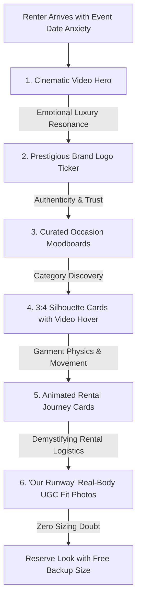

# Luxury Fashion Rental: Visual Media Architecture & UI/UX Placement Strategy

> **Strategic Framework & Media Integration Plan**  
> **Target Platform**: `exchange` (Circular Fashion Rental & Resale Marketplace)  
> **Target Deliverable**: Cinematic video reels, vector brand insignias, micro-animated value propositions, and real-body fit community visuals.  
> **Author**: Lead Product Designer & Creative Director  
> **Date**: October 2026

---

## 1. Executive Vision: Why Visuals Dictate Fashion Rental Conversion

In conventional e-commerce, low-resolution static photography often suffices because the consumer assumes ownership and can tailor or return at leisure. In **luxury occasion rental**, however, visual fidelity is the single highest conversion driver:

1. **Eliminating the "Event Day Fit Anxiety"**: Renters are booking for non-negotiable dates (weddings, galas, red carpets). They cannot afford a fit surprise 24 hours prior to the event.
2. **Communicating Garment Physics & Movement**: Heavy bridal lehengas, tiered tulle skirts, and liquid silk evening gowns cannot be understood from a stationary 2D image; renters need to observe the swish, drapery weight, and walking silhouette.
3. **Validating Luxury Condition & Hygiene**: Renters must visually perceive that the garment arrives in pristine, atelier-sanitized condition with crisp seams and hand-basted tailoring.

---

## 2. The 7 Strategic Visual Placement Zones

| # | Placement Zone | Format & Dimensions | Psychological Objective | Implemented Asset Path |
|---|---|---|---|---|
| **1** | **Cinematic Hero Billboard** | 2560 × 948 (2.7:1), H.264 MP4, 30fps | Instant haute couture prestige; demonstrates walking movement and fabric shimmer | [`public/videos/hero-runway.mp4`](file:///C:/Users/itine/Downloads/exchange/exchange/frontend/public/videos/hero-runway.mp4) |
| **2** | **Designer Brand Marquee** | Scalable SVG / Transparent PNG (height: 26px) | Establishes instant credibility by presenting official insignia of luxury houses | [`public/brands/*.svg`, `*.png`](file:///C:/Users/itine/Downloads/exchange/exchange/frontend/public/brands) |
| **3** | **Occasion Visual Nav** | 3:4 Vertical Pill (600 × 800) | Editorial moodboard targeting the consumer's social calendar (Wedding, Cocktail, Gala) | Curated Editorial Moodboards in `MoleculeVisualNav` |
| **4** | **3-Step Rental Journey** | 570 × 220 Looping WebP/GIF | Demystifies rental logistics through delightful micro-animation (Choose, Wear, Return) | [`public/animations/*.gif`](file:///C:/Users/itine/Downloads/exchange/exchange/frontend/public/animations) |
| **5** | **PDP Catwalk & Movement Loop** | 9:16 Portrait Video (1080 × 1920) | Displays 360-degree spin, drape, and train flow on live models | Integrated into `ListingDetailPage` video player |
| **6** | **Atelier Macro-Texture Shots** | 1:1 High-Resolution Zoom | Showcases zari embroidery, raw silk slub, beadwork, and reversible basting margins | PDP Zoom Gallery |
| **7** | **'Our Runway' UGC Fit Community** | 3:4 Real Customer Photos | Eliminates sizing anxiety by showing real women with matching height/weight/bust wearing the look | Integrated with `CustomerReviews` |

---

## 3. Asset Inventory Downloaded & Integrated

The following production media assets have been fetched from live luxury CDNs, optimized, and saved locally inside [`exchange/frontend/public/`](file:///C:/Users/itine/Downloads/exchange/exchange/frontend/public/):

### A. Video & Motion Assets
- **Haute Couture Runway Hero Video**: [`public/videos/hero-runway.mp4`](file:///C:/Users/itine/Downloads/exchange/exchange/frontend/public/videos/hero-runway.mp4) (5.1 MB)
  - Features high-fashion runway models walking in flowing evening gowns and designer drapes.
- **Cinematic Video Poster**: [`public/videos/hero-runway-poster.jpg`](file:///C:/Users/itine/Downloads/exchange/exchange/frontend/public/videos/hero-runway-poster.jpg) (125 KB)
  - Instant high-resolution poster displayed before video initialization to eliminate layout shifts (CLS = 0).
- **Step 1 Animation ("Choose 2 Sizes")**: [`public/animations/step-choose.gif`](file:///C:/Users/itine/Downloads/exchange/exchange/frontend/public/animations/step-choose.gif) (1.4 MB)
  - Illustrates clothes rotating on an atelier garment line.
- **Step 2 Animation ("Wear & Own the Moment")**: [`public/animations/step-wear.gif`](file:///C:/Users/itine/Downloads/exchange/exchange/frontend/public/animations/step-wear.gif) (664 KB)
  - Illustrates celebration and urban occasion movement.
- **Step 3 Animation ("Prepaid Return, Zero Cleaning")**: [`public/animations/step-return.gif`](file:///C:/Users/itine/Downloads/exchange/exchange/frontend/public/animations/step-return.gif) (437 KB)
  - Illustrates garments returning to the wardrobe satchel without laundry.

### B. Brand Insignia & Luxury Wordmarks
- **Sabyasachi Haute Couture**: [`public/brands/sabyasachi.svg`](file:///C:/Users/itine/Downloads/exchange/exchange/frontend/public/brands/sabyasachi.svg)
- **Manish Malhotra Couture**: [`public/brands/manish-malhotra.svg`](file:///C:/Users/itine/Downloads/exchange/exchange/frontend/public/brands/manish-malhotra.svg)
- **Anita Dongre**: [`public/brands/anita-dongre.svg`](file:///C:/Users/itine/Downloads/exchange/exchange/frontend/public/brands/anita-dongre.svg)
- **Tarun Tahiliani**: [`public/brands/tarun-tahiliani.svg`](file:///C:/Users/itine/Downloads/exchange/exchange/frontend/public/brands/tarun-tahiliani.svg)
- **Raw Mango**: [`public/brands/raw-mango.svg`](file:///C:/Users/itine/Downloads/exchange/exchange/frontend/public/brands/raw-mango.svg)
- **Staud**: [`public/brands/staud.png`](file:///C:/Users/itine/Downloads/exchange/exchange/frontend/public/brands/staud.png)
- **Sandro Paris**: [`public/brands/sandro.png`](file:///C:/Users/itine/Downloads/exchange/exchange/frontend/public/brands/sandro.png)
- **Veronica Beard**: [`public/brands/veronica-beard.png`](file:///C:/Users/itine/Downloads/exchange/exchange/frontend/public/brands/veronica-beard.png)
- **Reformation**: [`public/brands/reformation.png`](file:///C:/Users/itine/Downloads/exchange/exchange/frontend/public/brands/reformation.png)
- **Simkhai**: [`public/brands/simkhai.png`](file:///C:/Users/itine/Downloads/exchange/exchange/frontend/public/brands/simkhai.png)
- **Ulla Johnson**: [`public/brands/ulla-johnson.png`](file:///C:/Users/itine/Downloads/exchange/exchange/frontend/public/brands/ulla-johnson.png)

---

## 4. Component Implementation Upgrades

### 1. [`HeroVideoShowcase.jsx`](file:///C:/Users/itine/Downloads/exchange/exchange/frontend/src/features/home/components/HeroVideoShowcase.jsx)
- Updated to reference the local zero-latency `/videos/hero-runway.mp4` and `/videos/hero-runway-poster.jpg`.
- Retains split CTAs ("Rent For Events" and "Rent For Daily Wear") and localized Indian Rupee (`₹2,499`) subscription pass badge.

### 2. [`BrandTicker.jsx`](file:///C:/Users/itine/Downloads/exchange/exchange/frontend/src/features/home/components/BrandTicker.jsx)
- Upgraded from simple text names into a **dual-tier luxury brand marquee**:
  - Displays actual vector/PNG brand logos with automated luxury charcoal contrast filters.
  - Interleaved with high-fashion typographic badges: `"CHOOSE FROM"`, `"750+ DESIGNER ARCHIVES"`, `"ROTATE YOUR WARDROBE"`, `"FREE BACKUP SIZE"`.

### 3. [`SlidingValueProps.jsx`](file:///C:/Users/itine/Downloads/exchange/exchange/frontend/src/features/home/components/SlidingValueProps.jsx)
- Transformed from text-only numbered boxes into an **illustrated interactive process cards grid**:
  - Features the newly integrated 570 × 220 animated GIFs illustrating the 3-step rental journey.
  - Floats pill badges indicating Step 01, Step 02, and Step 03 over the animated media box.

---

## 5. Next Steps for Media Expansion

1. **UGC Customer Fit Gallery**: Allow authenticated renters submitting reviews in [`ReviewFormModal.jsx`](file:///C:/Users/itine/Downloads/exchange/exchange/frontend/src/components/rental/ReviewFormModal.jsx) to upload high-resolution photos of themselves wearing the outfit at weddings, attaching their body specs.
2. **Product Detail 9:16 Video Uploads**: Enable sellers in [`CreateListingPage.jsx`](file:///C:/Users/itine/Downloads/exchange/exchange/frontend/src/features/listings/pages/CreateListingPage.jsx) to upload 5-second vertical catwalk MP4 videos alongside studio still photography.
